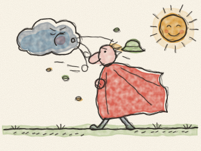
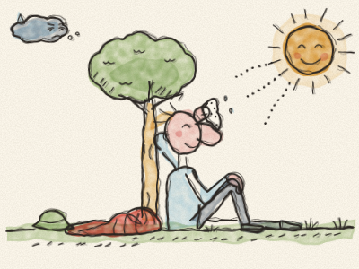

# O Vento Norte e o Sol

Lá no alto do céu, o Vento Norte e o Sol estavam a discutir.

— Eu é que sou o mais forte! — rugiu o Vento Norte. — Consigo dobrar as árvores mais altas e levantar ondas do tamanho de casas!

— Talvez — disse o Sol, a sorrir. — Vamos fazer um pequeno concurso. Estás a ver aquele viajante, lá em baixo na estrada, com a sua capa vermelha comprida? Quem conseguir que ele tire a capa é o mais forte.

— Fácil! — disse o Vento Norte. Encheu o peito de ar, inchou as bochechas e soprou. *Fuuuuuh!*

As folhas voaram das árvores. O chapéu do viajante voou da cabeça dele. Mas o viajante apenas apertou mais a capa à sua volta.

Então o Vento Norte soprou com mais força. *FUUUUUUH!* O viajante tremeu de frio, apertou todos os botões e agarrou a capa com mais força ainda.

O Vento Norte soprou, soprou, até ficar sem fôlego nenhum. — Pff… pff… desisto — arfou ele.

Então chegou a vez do Sol. O Sol não gritou nem empurrou. Saiu simplesmente de trás de uma nuvem e brilhou, devagarinho e quentinho, sobre o viajante.

O viajante deixou de tremer. Desapertou um botão. Depois outro. Limpou a testa. — Caramba, que calor! — disse ele. E tirou a capa, sentou-se debaixo de uma árvore e descansou tranquilamente ao sol.

O Sol sorriu ao Vento Norte. E, pela primeira vez, o Vento Norte não disse mais nada.

> A doçura e o calor conseguem aquilo que os gritos e a força não conseguem.
