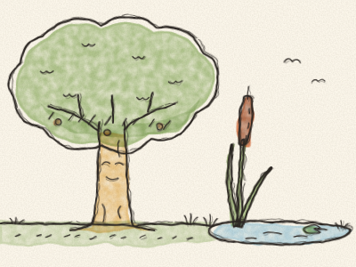
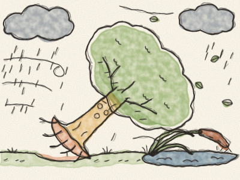

# The Oak and the Reed

At the edge of a pond there stood a great big Oak tree. His trunk was thick, his branches were wide, and his leaves went *shhh, shhh* in the breeze. Right beside him grew a little Reed, thin and green and as light as a feather.

“Poor little Reed,” said the Oak. “You are so weak! When a tiny bird lands on you, you bend. When a little wind blows, you bow your head. Look at me! I stand straight and strong. Nothing in the world can make me bend.”

“Thank you, Oak,” said the Reed kindly. “But don’t worry about me. I bend, but I don’t break.”

That night, a storm came. The wind blew. *Whooo!* The wind blew harder. *WHOOOOO!*

The little Reed bent down, low, low, almost to the water. *Swish, swish.* She let the wind pass over her.

The big Oak stood straight. “I will not bend!” he said. He pushed against the wind with all his branches. The wind pushed back. He pushed harder. The wind pushed harder still… and — *CRAAACK!* — the great Oak tipped over, roots and all, and lay down in the grass.

In the morning, the sun came out. The little Reed lifted her head, shook off the raindrops, and stood up again, green and fine.

“Oh, Oak,” she said softly. “Sometimes it is better to bend a little.”

The Oak said nothing. But by his roots, one of his acorns was already growing into a new little tree.

> Better to bend a little than to break.
