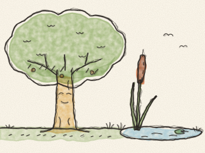
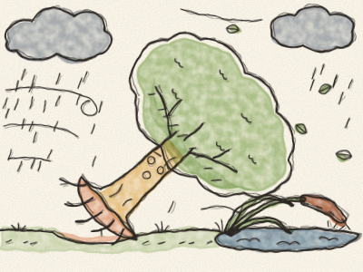

# Le Chêne et le Roseau

Au bord d’un étang se dressait un grand Chêne. Son tronc était épais, ses branches étaient larges, et ses feuilles faisaient *chhh, chhh* dans la brise. Juste à côté de lui poussait un petit Roseau, mince et vert, léger comme une plume.

« Pauvre petit Roseau », dit le Chêne. « Comme tu es faible ! Quand un minuscule oiseau se pose sur toi, tu plies. Quand un petit vent souffle, tu baisses la tête. Regarde-moi ! Je me tiens droit et fort. Rien au monde ne peut me faire plier. »

« Merci, Chêne », répondit gentiment le Roseau. « Mais ne t’inquiète pas pour moi. Je plie, et ne romps pas. »

Cette nuit-là, une tempête arriva. Le vent souffla. *Whouuu !* Le vent souffla plus fort. *WHOUUUUU !*

Le petit Roseau se pencha, bas, tout bas, presque jusqu’à l’eau. *Swich, swich.* Il laissa le vent passer par-dessus lui.

Le grand Chêne resta tout droit. « Je ne plierai pas ! » dit-il. Il poussa contre le vent de toutes ses branches. Le vent poussa aussi. Il poussa plus fort. Le vent poussa plus fort encore… et — *CRAAAC !* — le grand Chêne bascula, avec toutes ses racines, et se coucha dans l’herbe.

Au matin, le soleil revint. Le petit Roseau leva la tête, secoua les gouttes de pluie, et se redressa, vert et joli.

« Oh, Chêne », dit-il doucement. « Parfois, il vaut mieux plier un peu. »

Le Chêne ne dit rien. Mais près de ses racines, l’un de ses glands devenait déjà un nouveau petit arbre.

> Mieux vaut plier un peu que rompre.
