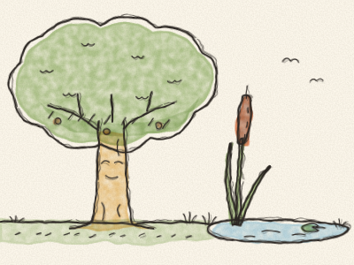
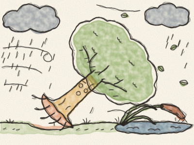

# O Carvalho e o Junco

À beira de um lago havia um Carvalho muito grande. O tronco era grosso, os ramos eram largos, e as folhas faziam *chhh, chhh* com a brisa. Mesmo ao lado dele crescia um Junco pequenino, fino e verde, leve como uma pena.

— Pobre Junco pequenino — disse o Carvalho. — És tão fraco! Quando um passarinho pousa em ti, dobras-te. Quando sopra um ventinho, baixas a cabeça. Olha para mim! Estou direito e forte. Nada no mundo me faz dobrar.

— Obrigado, Carvalho — disse o Junco, com simpatia. — Mas não te preocupes comigo. Eu dobro-me, mas não me parto.

Nessa noite, chegou uma tempestade. O vento soprou. *Uuuu!* O vento soprou mais forte. *UUUUUU!*

O Junco pequenino dobrou-se, baixinho, baixinho, quase até à água. *Suich, suich.* Deixou o vento passar por cima dele.

O grande Carvalho ficou direito. — Eu não me dobro! — disse ele. Empurrou o vento com todos os seus ramos. O vento empurrou também. Ele empurrou com mais força. O vento empurrou com mais força ainda… e — *CRAAAC!* — o grande Carvalho tombou, com raízes e tudo, e ficou deitado na relva.

De manhã, o sol voltou. O Junco pequenino levantou a cabeça, sacudiu as gotas de chuva e endireitou-se, verde e bonito.

— Ai, Carvalho — disse ele baixinho. — Às vezes, é melhor dobrar um bocadinho.

O Carvalho não disse nada. Mas junto às suas raízes, uma das suas bolotas já estava a crescer e a tornar-se uma nova arvorezinha.

> Mais vale dobrar um bocadinho do que partir.
