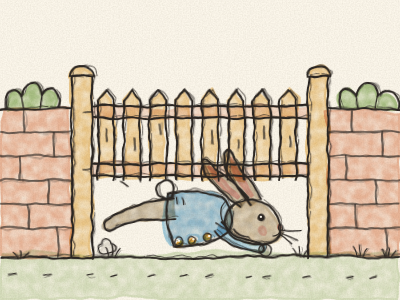
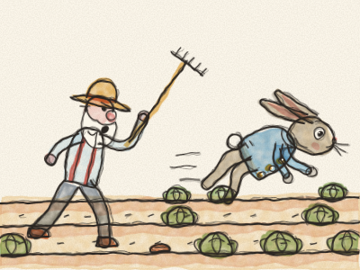
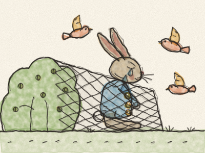
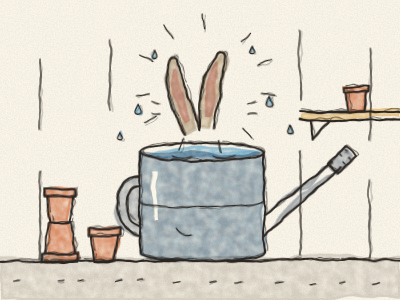
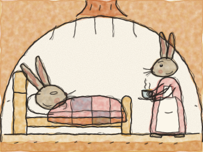

# The Tale of Peter Rabbit

Once upon a time, there were four little rabbits. Their names were Flopsy, Mopsy, Cottontail and Peter. They lived with their Mother in a sandy hole, under the root of a very big fir tree.

One morning, Mother Rabbit said, “Now, my dears, you may go into the fields, or down the lane. But don’t go into Mr McGregor’s garden!”

Then she took her basket and her umbrella, and went off to the baker’s.

Flopsy, Mopsy and Cottontail were good little bunnies. They went down the lane to pick blackberries.

But Peter, who was very naughty, ran straight away to Mr McGregor’s garden. And he squeezed under the gate! *Squish, squash, squeeze.*

First he ate some lettuces. *Crunch, crunch.* Then he ate some beans. *Munch, munch.* Then he ate some radishes. *Crunch, munch, crunch.* And then, feeling rather sick, he went to look for some parsley.

But round the end of a cucumber frame, whom should he meet but… Mr McGregor!

Mr McGregor was on his hands and knees, planting cabbages. He jumped up and ran after Peter, waving a rake and calling out, “Stop, thief!”

Peter was most dreadfully frightened. He rushed all over the garden, for he had forgotten the way back to the gate. He lost one of his shoes among the cabbages, and the other shoe amongst the potatoes.

Then he ran into a gooseberry net, and got caught by the big brass buttons on his jacket. It was a blue jacket, quite new.

Peter gave himself up for lost, and shed big tears. *Sniff, sniff.* But some friendly sparrows flew to him. “Don’t give up, Peter! Try again! Wriggle!”

Mr McGregor came up with a sieve, to pop on top of Peter. But Peter wriggled out just in time, leaving his jacket behind him. *Wriggle, wriggle, pop!*

He rushed into the tool-shed, and jumped into a watering can. It would have been a beautiful thing to hide in, if it had not had so much water in it.

Mr McGregor was quite sure that Peter was somewhere in the tool-shed. He looked under every flowerpot, one by one. Suddenly Peter sneezed. “*Kertyschoo!*” Mr McGregor was after him in no time.

Peter jumped out of a window, upsetting three plants. The window was too small for Mr McGregor, and he was tired of running after Peter. So he went back to his work.

Peter sat down to rest. He was out of breath and trembling with fright, and he had not the least idea which way to go. *(Pause, and ask Constance: which way do you think is the gate?)*

He wandered about, looking all around. At last, at the far end of the garden, he saw the gate! Peter ran as fast as he could. He slipped underneath the gate, and he was safe at last, in the wood outside the garden.

He never stopped running, and he never looked behind him, till he got home to the big fir tree.

He was so tired that he flopped down on the soft sand on the floor of the rabbit hole and shut his eyes. His mother was busy cooking. She wondered what he had done with his clothes. It was the second little jacket and pair of shoes that Peter had lost in a fortnight!

I am sorry to say that Peter was not very well during the evening. His mother put him to bed, and gave him a cup of camomile tea. “One spoonful at bedtime,” she said.

But Flopsy, Mopsy and Cottontail had bread and milk and blackberries for supper. *Yum!*

> Mummy’s advice is there to keep you safe, so listen to it.
