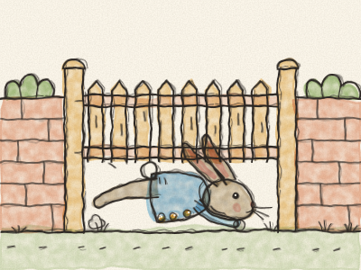
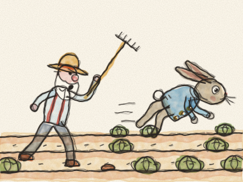
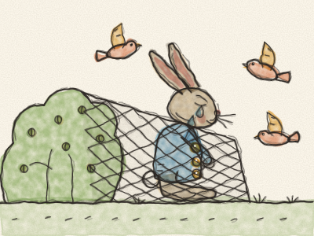
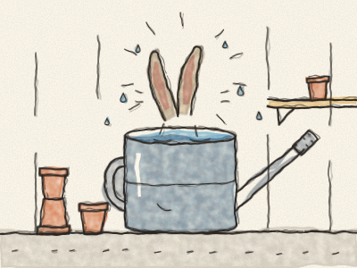
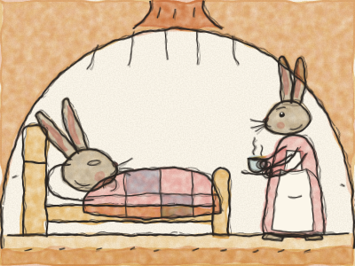

# Pierre Lapin

Il était une fois quatre petits lapins. Ils s’appelaient Flopsaut, Trotsaut, Queue-de-Coton et Pierre. Ils vivaient avec leur maman dans un terrier de sable, sous la racine d’un très grand sapin.

Un matin, Maman Lapin dit : « Maintenant, mes chéris, vous pouvez aller dans les champs, ou au bout du chemin. Mais n’allez pas dans le jardin de M. McGregor ! »

Puis elle prit son panier et son parapluie, et partit chez le boulanger.

Flopsaut, Trotsaut et Queue-de-Coton étaient de gentils petits lapins. Ils descendirent le chemin pour cueillir des mûres.

Mais Pierre, qui était très désobéissant, courut tout droit au jardin de M. McGregor. Et il se faufila sous la barrière ! *Squich, squach, il se tortille.*

D’abord, il mangea des laitues. *Crounch, crounch.* Puis il mangea des haricots. *Miam, miam.* Puis il mangea des radis. *Crounch, miam, crounch.* Et puis, un peu barbouillé, il partit chercher du persil.

Mais au coin d’un châssis de concombres, qui rencontra-t-il ? M. McGregor !

M. McGregor était à quatre pattes, en train de planter des choux. Il se releva d’un bond et courut après Pierre, en agitant un râteau et en criant : « Au voleur ! »

Pierre eut terriblement peur. Il courut dans tout le jardin, car il avait oublié le chemin de la barrière. Il perdit une de ses chaussures dans les choux, et l’autre dans les pommes de terre.

Puis il fonça dans un filet à groseilles, et resta accroché par les gros boutons dorés de sa veste. C’était une veste bleue, toute neuve.

Pierre se crut perdu, et versa de grosses larmes. *Snif, snif.* Mais des moineaux bien gentils volèrent jusqu’à lui. « Ne te décourage pas, Pierre ! Essaie encore ! Tortille-toi ! »

M. McGregor arriva avec un tamis, pour le poser sur Pierre. Mais Pierre se tortilla et s’échappa juste à temps, en laissant sa veste derrière lui. *Tortille, tortille, pop !*

Il se précipita dans la cabane à outils, et sauta dans un arrosoir. C’aurait été une très bonne cachette, s’il n’y avait pas eu autant d’eau dedans.

M. McGregor était sûr que Pierre était quelque part dans la cabane. Il regarda sous chaque pot de fleurs, un par un. Tout à coup, Pierre éternua. « *Atchoum !* » En un clin d’œil, M. McGregor lui courait après.

Pierre sauta par une fenêtre, en renversant trois plantes. La fenêtre était trop petite pour M. McGregor, et il en avait assez de courir après Pierre. Alors il retourna à son travail.

Pierre s’assit pour se reposer. Il était tout essoufflé et tremblait de peur, et il n’avait pas la moindre idée du chemin à prendre. *(Faites une pause, et demandez à Constance : à ton avis, où est la barrière ?)*

Il se promena en regardant partout. Enfin, tout au bout du jardin, il vit la barrière ! Pierre courut aussi vite qu’il put. Il se glissa dessous, et il fut enfin sauvé, dans le bois, hors du jardin.

Il ne s’arrêta pas de courir, et ne regarda jamais derrière lui, jusqu’à ce qu’il arrive chez lui, sous le grand sapin.

Il était si fatigué qu’il s’effondra sur le sable doux du terrier et ferma les yeux. Sa maman était occupée à cuisiner. Elle se demanda ce qu’il avait fait de ses habits. C’était la deuxième petite veste et la deuxième paire de chaussures que Pierre perdait en quinze jours !

Je suis triste de vous dire que Pierre ne se sentit pas très bien ce soir-là. Sa maman le mit au lit, et lui donna une tasse de tisane de camomille. « Une cuillerée au coucher, » dit-elle.

Mais Flopsaut, Trotsaut et Queue-de-Coton eurent du pain, du lait et des mûres pour le dîner. *Miam !*

> Les conseils de Maman sont là pour te protéger : écoute-les.
