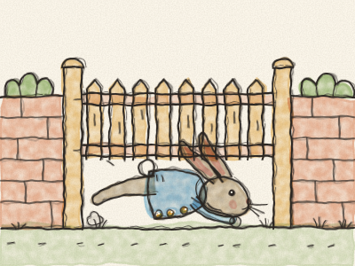
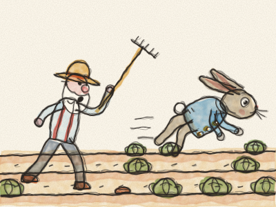
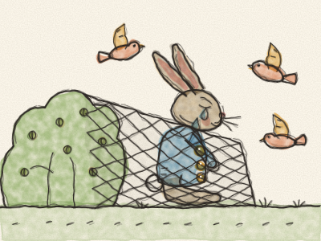
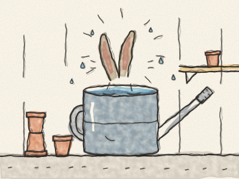
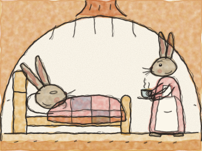

# A História do Pedro Coelho

Era uma vez quatro coelhinhos. Chamavam-se Flopsy, Mopsy, Rabinho-de-Algodão e Pedro. Viviam com a mãe numa toca de areia, debaixo da raiz de um pinheiro muito grande.

Uma manhã, a Mãe Coelha disse: — Agora, meus queridos, podem ir para os campos ou descer o caminho. Mas não entrem na horta do senhor McGregor!

Depois pegou no cesto e no guarda-chuva, e foi à padaria.

A Flopsy, a Mopsy e a Rabinho-de-Algodão eram coelhinhas bem-comportadas. Desceram o caminho para apanhar amoras.

Mas o Pedro, que era muito traquinas, correu direitinho para a horta do senhor McGregor. E passou espremido por baixo do portão! *Espreme, espreme, aperta.*

Primeiro, comeu umas alfaces. *Crunch, crunch.* Depois comeu uns feijões. *Nham, nham.* Depois comeu uns rabanetes. *Crunch, nham, crunch.* E depois, já um bocadinho enjoado, foi procurar salsa.

Mas, ao virar a esquina de um canteiro de pepinos, quem é que ele encontrou? … O senhor McGregor!

O senhor McGregor estava de gatas, a plantar couves. Levantou-se de um salto e correu atrás do Pedro, a abanar um ancinho e a gritar: — Agarra, ladrão!

O Pedro ficou cheio de medo. Correu pela horta toda, porque se tinha esquecido do caminho para o portão. Perdeu um sapato no meio das couves e o outro no meio das batatas.

Depois foi contra uma rede de groselhas e ficou preso pelos grandes botões dourados do casaco. Era um casaco azul, novinho em folha.

O Pedro achou que estava perdido e chorou lágrimas grossas. *Snif, snif.* Mas uns pardais simpáticos voaram até ele. — Não desistas, Pedro! Tenta outra vez! Mexe-te!

O senhor McGregor chegou com uma peneira, para a pôr em cima do Pedro. Mas o Pedro contorceu-se e escapou mesmo a tempo, deixando o casaco para trás. *Mexe, mexe, pop!*

Correu para o barracão das ferramentas e saltou para dentro de um regador. Teria sido um esconderijo perfeito, se não tivesse tanta água lá dentro.

O senhor McGregor tinha a certeza de que o Pedro estava algures no barracão. Espreitou debaixo de cada vaso, um a um. De repente, o Pedro espirrou. — *Atchim!* Num instante, o senhor McGregor estava atrás dele.

O Pedro saltou por uma janela, derrubando três plantas. A janela era pequena demais para o senhor McGregor, e ele estava cansado de correr atrás do Pedro. Por isso, voltou ao trabalho.

O Pedro sentou-se a descansar. Estava sem fôlego e a tremer de medo, e não fazia a menor ideia para onde ir. *(Faça uma pausa e pergunte à Constance: onde achas que fica o portão?)*

Andou por ali, a olhar para todo o lado. Por fim, lá ao fundo da horta, viu o portão! O Pedro correu o mais depressa que pôde. Passou por baixo do portão e ficou finalmente a salvo, no bosque, fora da horta.

Nunca parou de correr, nem olhou para trás, até chegar a casa, debaixo do grande pinheiro.

Estava tão cansado que se deixou cair na areia macia do chão da toca e fechou os olhos. A mãe estava ocupada a cozinhar. Perguntou-se o que é que ele teria feito à roupa. Era o segundo casaquinho e o segundo par de sapatos que o Pedro perdia em quinze dias!

Tenho pena de dizer que o Pedro não se sentiu nada bem nessa noite. A mãe deitou-o e deu-lhe uma chávena de chá de camomila. — Uma colherada antes de dormir — disse ela.

Mas a Flopsy, a Mopsy e a Rabinho-de-Algodão comeram pão, leite e amoras ao jantar. *Nham!*

> Os conselhos da mãe existem para te proteger: ouve-os.
