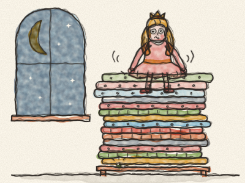
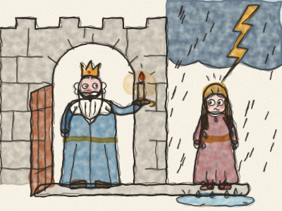
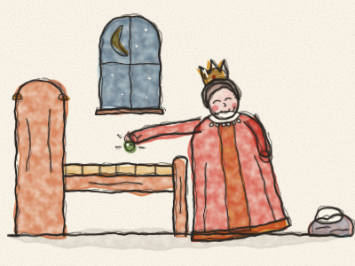
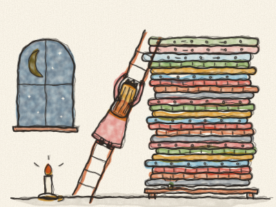

# The Princess and the Pea

Once upon a time there was a Prince who wanted to marry a princess. But not just any princess. She had to be a *real* princess.

So the Prince rode his horse all around the world, *clip-clop, clip-clop*, to find one. He met a great many princesses. Some were very grand, some were very clever, and some were very, very bossy. But each time, something was not quite right. “Is she a real princess?” he wondered. “How can I ever be sure?”

At last he came home to his castle, all by himself. “I will never find a real princess,” he sighed, and he looked out of the window, feeling very sad.

That very evening, there was a terrible storm. The thunder went *BOOM!* The lightning went *FLASH!* And the rain came down like buckets: *splish, splash, splosh!*

Suddenly, someone knocked at the castle door. *Knock, knock, knock!*

The old King went to open it himself. And there, on the doorstep, stood a girl. Oh, what a state she was in! Water ran out of her hair and down her nose. Water ran into her shoes and out at the heels. *Squelch, squelch!*

“Good evening,” she said, dripping. “I am a princess. A real princess. May I please come in out of the rain?”

“A real princess?” whispered the Queen. “We shall see about that!”

The Queen said nothing to anybody. She went quietly up to the guest bedroom. She took all the bedding off the bed, and on the bare wooden boards she put… one tiny green pea. *(Hold up your finger and thumb, very close together.)* That small!

Then on top of the pea she put a mattress. And another mattress. And another one, and another one… until there were twenty mattresses! On top of the mattresses she put twenty soft feather quilts. *(Count some of them together: one, two, three…)*

The bed was now so tall that it nearly touched the ceiling. “There,” said the Queen, with a little smile. “Now we shall see.”

“Here is your bed, my dear,” said the Queen. The princess looked up, and up, and up. Then she climbed a long, long ladder, all the way to the top, and snuggled down under the quilts. “Good night!”

But it was not a good night at all. The princess wriggled to the left. She wriggled to the right. She turned over onto her tummy, then onto her back. “Ouch!” she said. “Something is poking me!”

She tried counting sheep. She tried humming a song. *Mmm-mmm-mmm.* But all night long, something hard and lumpy dug into her back, and she did not sleep a wink.

In the morning she came down to breakfast, yawning a giant yawn. *Haaa-aaa-aaah!*

“Did you sleep well, my dear?” asked the Queen.

“Thank you, you are very kind,” said the princess politely. “But I hardly slept at all! There was something hard in my bed, and now I am black and blue all over.”

The Queen clapped her hands. “Only a real princess could feel one tiny pea through twenty mattresses and twenty feather quilts!”

The Prince was so happy that he did a little dance. At last he had found a real princess! Soon they were married, and everybody ate cake.

And the pea? It was put in a glass box in the castle museum, where you can still see it today… unless somebody has eaten it!

> You cannot tell who someone really is just by looking at them on a rainy night.
