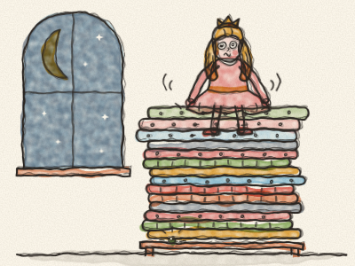
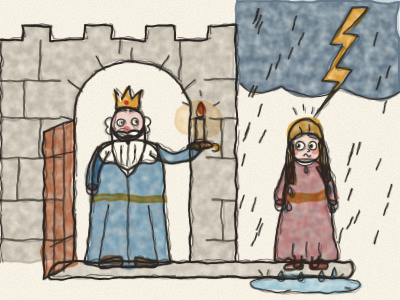
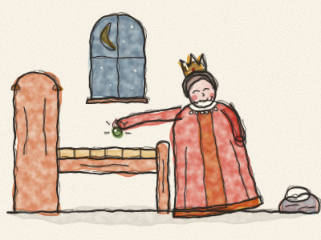
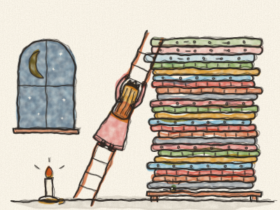

# La Princesse au petit pois

Il était une fois un Prince qui voulait épouser une princesse. Mais pas n’importe quelle princesse. Il fallait que ce soit une *vraie* princesse.

Alors le Prince fit le tour du monde sur son cheval, *cataclop, cataclop*, pour en trouver une. Il rencontra beaucoup de princesses. Certaines étaient très élégantes, d’autres très savantes, et d’autres très, très autoritaires. Mais chaque fois, il y avait quelque chose qui n’allait pas tout à fait. « Est-ce une vraie princesse ? » se demandait-il. « Comment en être sûr ? »

Enfin il rentra dans son château, tout seul. « Je ne trouverai jamais de vraie princesse », soupira-t-il, et il regarda par la fenêtre, tout triste.

Ce soir-là, il y eut un terrible orage. Le tonnerre faisait *BOUM !* Les éclairs faisaient *FLASH !* Et la pluie tombait à seaux : *plic, ploc, splash !*

Soudain, quelqu’un frappa à la porte du château. *Toc, toc, toc !*

Le vieux Roi alla ouvrir lui-même. Et là, sur le seuil, se tenait une jeune fille. Oh, dans quel état elle était ! L’eau coulait de ses cheveux et le long de son nez. L’eau entrait dans ses souliers et ressortait par les talons. *Floc, floc !*

« Bonsoir », dit-elle, toute dégoulinante. « Je suis une princesse. Une vraie princesse. Puis-je entrer me mettre à l’abri de la pluie, s’il vous plaît ? »

« Une vraie princesse ? » chuchota la Reine. « C’est ce que nous allons voir ! »

La Reine ne dit rien à personne. Elle monta sans bruit dans la chambre d’amis. Elle enleva toute la literie du lit, et sur les planches de bois, elle posa… un tout petit pois vert. *(Montrez avec le pouce et l’index, tout près l’un de l’autre.)* Petit comme ça !

Puis, par-dessus le pois, elle mit un matelas. Et encore un matelas. Et encore un, et encore un… jusqu’à ce qu’il y ait vingt matelas ! Par-dessus les matelas, elle mit vingt édredons de plumes tout doux. *(Comptez-en quelques-uns ensemble : un, deux, trois…)*

Le lit était maintenant si haut qu’il touchait presque le plafond. « Voilà », dit la Reine avec un petit sourire. « Maintenant, nous allons voir. »

« Voici votre lit, ma chère », dit la Reine. La princesse leva les yeux, et encore, et encore. Puis elle grimpa à une longue, longue échelle, jusqu’en haut, et se blottit sous les édredons. « Bonne nuit ! »

Mais ce ne fut pas une bonne nuit du tout. La princesse se tortilla vers la gauche. Elle se tortilla vers la droite. Elle se mit sur le ventre, puis sur le dos. « Aïe ! » dit-elle. « Quelque chose me pique ! »

Elle essaya de compter les moutons. Elle essaya de fredonner une chanson. *Mmm-mmm-mmm.* Mais toute la nuit, quelque chose de dur et de bosselé lui rentrait dans le dos, et elle ne ferma pas l’œil.

Le matin, elle descendit pour le petit déjeuner en bâillant un bâillement de géant. *Aaaa-aaa-aaah !*

« Avez-vous bien dormi, ma chère ? » demanda la Reine.

« Merci, vous êtes très aimable », répondit poliment la princesse. « Mais je n’ai presque pas dormi ! Il y avait quelque chose de dur dans mon lit, et maintenant j’ai des bleus partout. »

La Reine frappa dans ses mains. « Seule une vraie princesse peut sentir un tout petit pois à travers vingt matelas et vingt édredons de plumes ! »

Le Prince fut si content qu’il fit une petite danse. Enfin, il avait trouvé une vraie princesse ! Bientôt ils se marièrent, et tout le monde mangea du gâteau.

Et le petit pois ? On le mit dans une boîte en verre, au musée du château, où l’on peut encore le voir aujourd’hui… à moins que quelqu’un ne l’ait mangé !

> On ne sait pas qui est vraiment quelqu’un rien qu’en le regardant, un soir de pluie.
