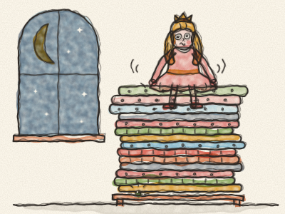
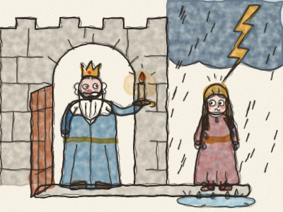
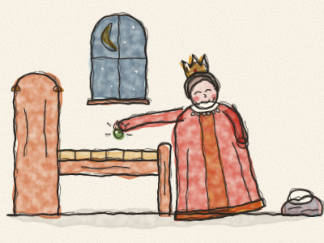
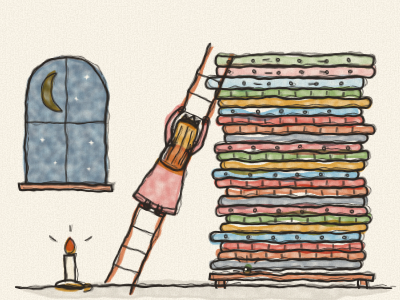

# A Princesa e a Ervilha

Era uma vez um Príncipe que queria casar com uma princesa. Mas não com uma princesa qualquer. Tinha de ser uma princesa *verdadeira*.

Então o Príncipe deu a volta ao mundo no seu cavalo, *catrapum, catrapum*, para encontrar uma. Conheceu muitas, muitas princesas. Umas eram muito elegantes, outras muito sabidas, e outras muito, muito mandonas. Mas de cada vez havia qualquer coisa que não estava bem. — Será uma princesa verdadeira? — perguntava ele. — Como é que posso ter a certeza?

Por fim, voltou para o seu castelo, sozinho. — Nunca vou encontrar uma princesa verdadeira — suspirou, e ficou a olhar pela janela, muito triste.

Nessa mesma noite, houve uma tempestade terrível. O trovão fazia *BUM!* O relâmpago fazia *FLASH!* E a chuva caía a potes: *plic, ploc, splash!*

De repente, alguém bateu à porta do castelo. *Truz, truz, truz!*

Foi o velho Rei em pessoa abrir a porta. E ali, à entrada, estava uma rapariga. Ai, em que estado ela vinha! A água escorria-lhe pelo cabelo e pelo nariz abaixo. A água entrava-lhe nos sapatos e saía pelos calcanhares. *Chap, chap!*

— Boa noite — disse ela, toda a pingar. — Eu sou uma princesa. Uma princesa verdadeira. Posso entrar para me abrigar da chuva, por favor?

— Uma princesa verdadeira? — sussurrou a Rainha. — Isso é o que vamos ver!

A Rainha não disse nada a ninguém. Subiu de mansinho ao quarto dos hóspedes. Tirou toda a roupa da cama e, em cima das tábuas de madeira, pôs… uma ervilha verde pequenina. *(Mostre com o polegar e o indicador, muito juntinhos.)* Assim pequenina!

Depois, por cima da ervilha, pôs um colchão. E mais um colchão. E mais outro, e mais outro… até haver vinte colchões! Por cima dos colchões, pôs vinte edredões de penas, muito macios. *(Contem alguns juntos: um, dois, três…)*

A cama estava agora tão alta que quase tocava no teto. — Pronto — disse a Rainha, com um sorrisinho. — Agora vamos ver.

— Aqui está a sua cama, minha querida — disse a Rainha. A princesa olhou para cima, e para cima, e mais para cima. Depois subiu uma escada comprida, comprida, até lá ao cimo, e aconchegou-se debaixo dos edredões. — Boa noite!

Mas não foi nada uma boa noite. A princesa virou-se para a esquerda. Virou-se para a direita. Pôs-se de barriga para baixo, depois de barriga para cima. — Ai! — disse ela. — Está qualquer coisa a picar-me!

Experimentou contar carneirinhos. Experimentou cantarolar uma canção. *Hum-hum-hum.* Mas a noite inteira houve qualquer coisa dura e cheia de altos a espetar-se-lhe nas costas, e ela não pregou olho.

De manhã, desceu para o pequeno-almoço a dar um bocejo enorme. *Aaaa-aaa-aaah!*

— Dormiu bem, minha querida? — perguntou a Rainha.

— Obrigada, é muito simpática — respondeu a princesa, com boas maneiras. — Mas quase não dormi! Havia qualquer coisa dura na minha cama, e agora estou cheia de nódoas negras.

A Rainha bateu palmas. — Só uma princesa verdadeira podia sentir uma ervilha pequenina através de vinte colchões e vinte edredões de penas!

O Príncipe ficou tão contente que fez uma dancinha. Finalmente tinha encontrado uma princesa verdadeira! Pouco depois casaram-se, e toda a gente comeu bolo.

E a ervilha? Foi posta numa caixinha de vidro, no museu do castelo, onde ainda hoje a podem ver… a não ser que alguém a tenha comido!

> Não se sabe quem alguém é de verdade só de olhar para ele numa noite de chuva.
