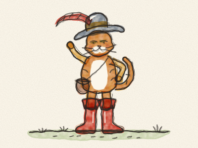
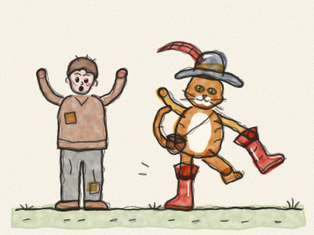
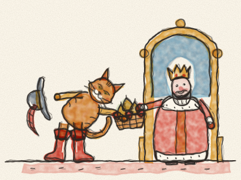
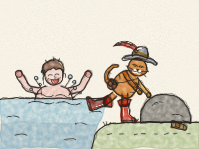
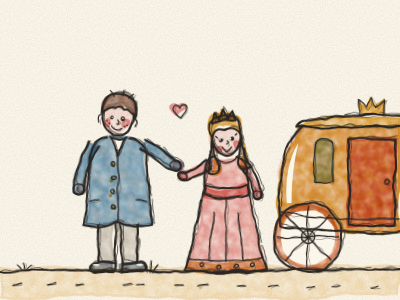
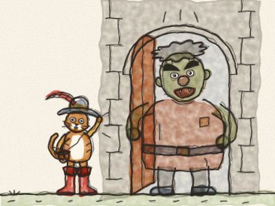
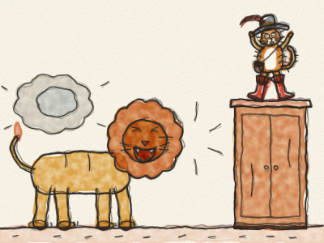
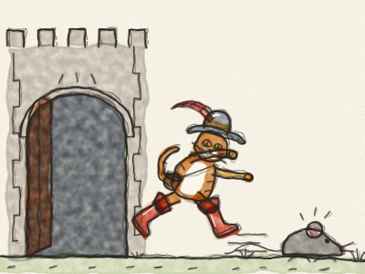

# Puss in Boots

Once upon a time, an old miller died and left his three sons everything he had. The eldest son got the mill. The middle son got the donkey. And the youngest son… got the cat.

“A cat!” sighed the youngest son, sitting down on a stone. “What can I do with a cat? My brothers can grind flour and carry sacks. But me? I shall eat my supper, and then I shall have nothing at all.”

The cat was sitting next to him, washing his whiskers. He stopped, looked up and said, very politely, “Don’t be sad, master. Give me a bag and a pair of boots, so that I can walk through the brambles, and you will see that I am worth much more than a mill and a donkey.”

The young man was so surprised to hear a cat talk that he said yes at once. He spent his very last coins on a little bag, a hat with a feather and a pair of tall red boots. The cat pulled them on, *stomp, stomp*, and walked up and down. “Perfect!” he purred. From that day on, everybody called him Puss in Boots.

Puss went off into the woods. He filled his bag with the sweetest wild strawberries and the plumpest golden pears. Then he marched straight to the King’s palace. *Stomp, stomp, stomp.*

“Who goes there?” asked the guards.

“I am Puss in Boots,” said the cat, “and I have a present for His Majesty.”

Puss took off his feathered hat and made a very low bow. “Your Majesty,” he said, “my master, the Marquis of Carabas, sends you these strawberries and pears from his garden.”

There was no Marquis of Carabas, of course. Puss had just made up the name. But it sounded very grand.

“How kind!” said the King, tasting a strawberry. “Mmm! Please thank the Marquis of Carabas.”

The next day, Puss brought more presents. And the day after, and the day after that. Every time he said, “From my master, the Marquis of Carabas.” Soon the King was very curious to meet this generous Marquis.

One morning, Puss heard that the King was going for a drive along the river with his daughter, the Princess.

Puss ran home. “Master, quick! Come with me to the river, take off your clothes and jump into the water. Then leave everything to me.”

The young man didn’t understand, but he did as he was told. *Splash!* While he was swimming, Puss took his old patched clothes and hid them under a big rock.

Soon, along came the King’s golden carriage. *Clip-clop, clip-clop.* Puss jumped out onto the road, waving his hat.

“Help! Help!” he shouted. “The Marquis of Carabas is in the river, and robbers have stolen his clothes!”

The King stopped the carriage at once. “Quick!” he told his servants. “Fetch the finest clothes in the palace for the Marquis of Carabas!”

So the young man came out of the river and put on a blue velvet coat, a silk shirt and shiny shoes. He looked so handsome that the Princess smiled at him, and he smiled back, and his cheeks went pink.

“Do come for a ride with us, Marquis,” said the King. And the young man climbed into the golden carriage, next to the Princess.

Puss in Boots smiled to himself and ran on ahead, as fast as his boots could carry him. *Stomp-stomp-stomp-stomp!*

Soon he came to a field where farmers were cutting hay. *Swish, swish.*

“Good farmers,” said Puss, “the King is coming this way. When he asks whose fields these are, please say, ‘They belong to the Marquis of Carabas.’ It will be a lovely surprise.”

The farmers laughed. A cat in boots! But they liked him, so they said yes.

When the carriage came by, the King leaned out of the window. “Whose fine fields are these?”

“They belong to the Marquis of Carabas!” called all the farmers together.

“My, my,” said the King. The young man said nothing at all. He was just as surprised as the King.

In fact, all these fields, and the woods, and the hills, belonged to a big grumpy Ogre who lived in a castle at the top of the hill. And that is where Puss in Boots went next.

*Knock, knock, knock!*

The great door opened. *Creeeak.* There stood the Ogre, as tall as a tree, with bushy eyebrows and a very bad temper. “WHAT DO YOU WANT?” he boomed.

Puss bowed politely. “Good day, sir. I have heard that you are the cleverest Ogre in the world. People say you can turn yourself into any animal you like. But I am sure that isn’t true.”

“NOT TRUE?” roared the Ogre. “Watch this!”

And — *POOF!* — the Ogre turned into an enormous lion. *ROOOAAAR!*

Puss got such a fright that he jumped right up to the top of the tallest cupboard, boots and all. His fur stood on end.

*POOF!* The lion turned back into the Ogre, who laughed and laughed. “Ho ho ho! I scared you, little cat!”

Puss climbed down, his knees still wobbling. “That was very impressive,” he said. “Anybody big can turn into something big. But I bet you can’t turn into something tiny. A little mouse, for example. No, that would be much too hard.”

“TOO HARD?” bellowed the Ogre. “Nothing is too hard for me!”

*POOF!* And there on the floor was a teeny-tiny grey mouse.

*Pounce!* Puss leapt. The little mouse squeaked and ran, and Puss chased him round the table, under the chairs, down the stairs and out of the big front door. *Squeak, squeak, squeak!* The mouse ran down the hill and into the woods, and he never, ever came back to bother anyone again.

Puss dusted off his boots. “There,” he said. “Now this castle needs a new master.”

Then he heard the wheels of the golden carriage on the road. *Clip-clop, clip-clop.* Quick as a flash, Puss ran to the door to meet it.

“Welcome, Your Majesty,” he said with his very best bow, “to the castle of the Marquis of Carabas!”

The King’s eyes opened wide. “What a beautiful castle! Marquis, you have the finest fields, the finest woods and the finest castle in the whole kingdom.”

They had a wonderful feast in the great hall, with cakes and music. The young man and the Princess talked and laughed all evening, and before long they were married. They were always kind to the farmers, and everybody was happy.

And Puss in Boots? He became a great lord. He wore his boots every day, slept on a velvet cushion, and chased mice only when he wanted to play.

> Being clever and working hard are worth more than anything you are simply given.
