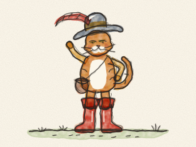
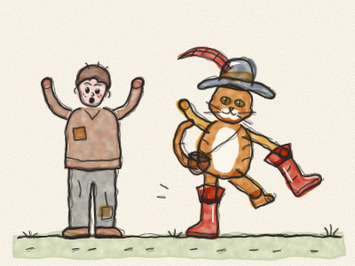
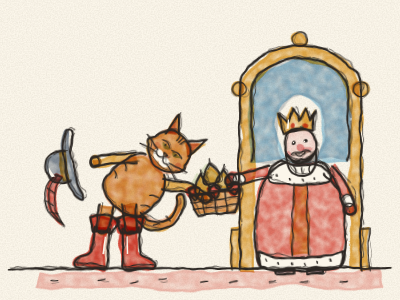
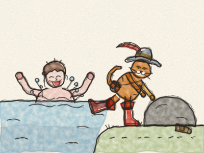
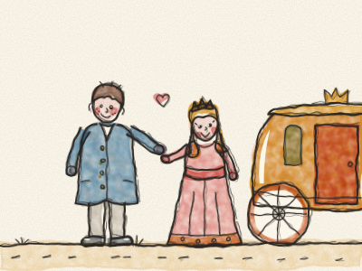
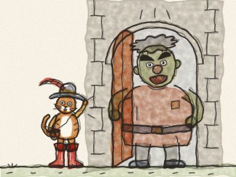
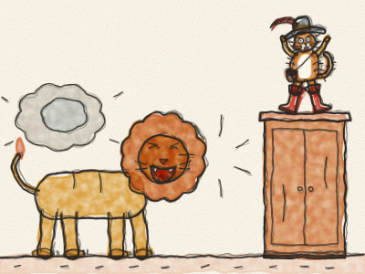
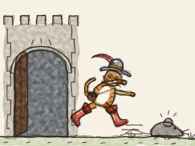

# Le Chat botté

Il était une fois un vieux meunier qui mourut et laissa tout ce qu’il avait à ses trois fils. L’aîné eut le moulin. Le deuxième eut l’âne. Et le plus jeune… eut le chat.

« Un chat ! » soupira le plus jeune en s’asseyant sur une pierre. « Qu’est-ce que je peux faire d’un chat ? Mes frères pourront moudre la farine et porter des sacs. Mais moi ? Je mangerai mon souper, et puis je n’aurai plus rien du tout. »

Le chat était assis à côté de lui et se lavait les moustaches. Il s’arrêta, leva la tête et dit, très poliment : « Ne soyez pas triste, mon maître. Donnez-moi un sac et une paire de bottes pour marcher dans les ronces, et vous verrez que je vaux bien plus qu’un moulin et un âne. »

Le jeune homme fut si surpris d’entendre parler un chat qu’il dit oui tout de suite. Il dépensa ses toutes dernières pièces pour un petit sac, un chapeau à plume et une paire de hautes bottes rouges. Le chat les enfila, *boum, boum*, et marcha de long en large. « Parfait ! » ronronna-t-il. À partir de ce jour, tout le monde l’appela le Chat botté.

Le Chat s’en alla dans les bois. Il remplit son sac des fraises des bois les plus sucrées et des poires dorées les plus juteuses. Puis il marcha tout droit jusqu’au palais du Roi. *Boum, boum, boum.*

« Qui va là ? » demandèrent les gardes.

« Je suis le Chat botté », dit le chat, « et j’apporte un cadeau pour Sa Majesté. »

Le Chat ôta son chapeau à plume et fit une très grande révérence. « Majesté », dit-il, « mon maître, le marquis de Carabas, vous envoie ces fraises et ces poires de son jardin. »

Bien sûr, il n’y avait pas de marquis de Carabas. Le Chat venait d’inventer ce nom. Mais il sonnait très bien.

« Comme c’est gentil ! » dit le Roi en goûtant une fraise. « Mmm ! Remerciez bien le marquis de Carabas. »

Le lendemain, le Chat apporta d’autres cadeaux. Et le surlendemain, et le jour d’après. Chaque fois, il disait : « De la part de mon maître, le marquis de Carabas. » Bientôt, le Roi eut très envie de rencontrer ce marquis si généreux.

Un matin, le Chat apprit que le Roi allait se promener en carrosse le long de la rivière, avec sa fille, la Princesse.

Le Chat courut à la maison. « Mon maître, vite ! Venez avec moi à la rivière, enlevez vos habits et sautez dans l’eau. Ensuite, laissez-moi faire. »

Le jeune homme ne comprenait pas, mais il fit ce qu’on lui disait. *Plouf !* Pendant qu’il nageait, le Chat prit ses vieux habits rapiécés et les cacha sous un gros rocher.

Bientôt arriva le carrosse doré du Roi. *Cataclop, cataclop.* Le Chat bondit sur la route en agitant son chapeau.

« Au secours ! Au secours ! » cria-t-il. « Le marquis de Carabas est dans la rivière, et des voleurs ont pris ses habits ! »

Le Roi fit arrêter le carrosse aussitôt. « Vite ! » dit-il à ses serviteurs. « Allez chercher les plus beaux habits du palais pour le marquis de Carabas ! »

Alors le jeune homme sortit de la rivière et mit un habit de velours bleu, une chemise de soie et des souliers brillants. Il était si beau que la Princesse lui sourit, il lui sourit aussi, et ses joues devinrent toutes roses.

« Venez donc vous promener avec nous, marquis », dit le Roi. Et le jeune homme monta dans le carrosse doré, à côté de la Princesse.

Le Chat botté sourit dans ses moustaches et partit en avant, aussi vite que ses bottes le pouvaient. *Boum-boum-boum-boum !*

Bientôt, il arriva dans un pré où des paysans fauchaient le foin. *Fchhh, fchhh.*

« Braves gens », dit le Chat, « le Roi va passer par ici. Quand il vous demandera à qui sont ces prés, dites, s’il vous plaît : “Ils sont à monsieur le marquis de Carabas.” Ce sera une jolie surprise. »

Les paysans éclatèrent de rire. Un chat en bottes ! Mais ils le trouvaient sympathique, alors ils dirent oui.

Quand le carrosse passa, le Roi se pencha à la fenêtre. « À qui sont ces beaux prés ? »

« Ils sont à monsieur le marquis de Carabas ! » répondirent tous les paysans ensemble.

« Ça alors ! » dit le Roi. Le jeune homme ne dit rien du tout. Il était aussi étonné que le Roi.

En vérité, tous ces prés, et les bois, et les collines, appartenaient à un gros Ogre grognon qui vivait dans un château en haut de la colline. Et c’est là que le Chat botté se rendit ensuite.

*Toc, toc, toc !*

La grande porte s’ouvrit. *Criiic.* Devant lui se tenait l’Ogre, grand comme un arbre, avec des sourcils broussailleux et un très mauvais caractère. « QU’EST-CE QUE TU VEUX ? » tonna-t-il.

Le Chat salua poliment. « Bonjour, monsieur. On m’a dit que vous êtes l’Ogre le plus habile du monde. On raconte que vous pouvez vous changer en n’importe quel animal. Mais je suis sûr que ce n’est pas vrai. »

« PAS VRAI ? » rugit l’Ogre. « Regarde bien ! »

Et — *POUF !* — l’Ogre se changea en un lion énorme. *ROOOAAAR !*

Le Chat eut si peur qu’il sauta tout en haut de la plus grande armoire, avec ses bottes et tout. Ses poils se dressèrent sur son dos.

*POUF !* Le lion redevint l’Ogre, qui riait, riait. « Ho ho ho ! Je t’ai fait peur, petit chat ! »

Le Chat redescendit, les genoux encore tremblants. « C’était très impressionnant », dit-il. « Quand on est grand, c’est facile de se changer en quelque chose de grand. Mais je parie que vous ne pouvez pas vous changer en quelque chose de minuscule. Une petite souris, par exemple. Non, ce serait bien trop difficile. »

« TROP DIFFICILE ? » hurla l’Ogre. « Rien n’est trop difficile pour moi ! »

*POUF !* Et là, sur le sol, il y avait une toute petite souris grise.

*Hop !* Le Chat bondit. La petite souris poussa un cri et s’enfuit, et le Chat la poursuivit autour de la table, sous les chaises, dans l’escalier et jusque dehors, par la grande porte. *Couic, couic, couic !* La souris dévala la colline jusque dans les bois, et elle ne revint plus jamais embêter personne.

Le Chat épousseta ses bottes. « Voilà », dit-il. « Maintenant, ce château a besoin d’un nouveau maître. »

Puis il entendit les roues du carrosse doré sur la route. *Cataclop, cataclop.* Vif comme l’éclair, le Chat courut à la porte pour l’accueillir.

« Bienvenue, Majesté », dit-il avec sa plus belle révérence, « au château de monsieur le marquis de Carabas ! »

Le Roi ouvrit de grands yeux. « Quel beau château ! Marquis, vous avez les plus beaux prés, les plus beaux bois et le plus beau château de tout le royaume. »

Ils firent un merveilleux festin dans la grande salle, avec des gâteaux et de la musique. Le jeune homme et la Princesse parlèrent et rirent toute la soirée, et bientôt ils se marièrent. Ils furent toujours bons avec les paysans, et tout le monde fut heureux.

Et le Chat botté ? Il devint un grand seigneur. Il porta ses bottes tous les jours, dormit sur un coussin de velours, et ne courut plus après les souris que pour s’amuser.

> L’industrie et le savoir-faire valent mieux que des biens acquis.
