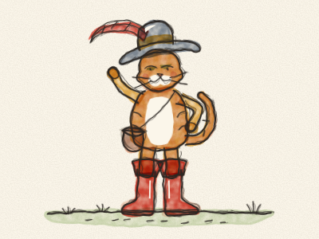
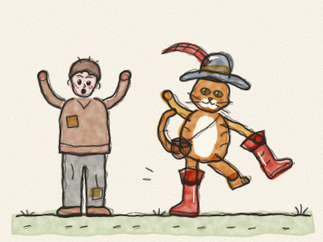
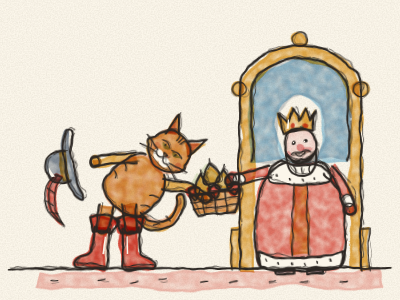
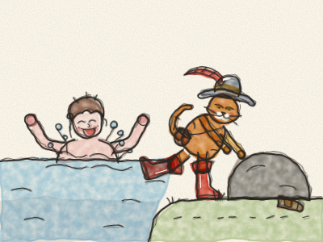
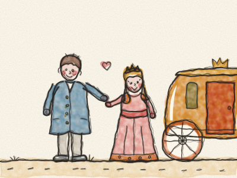
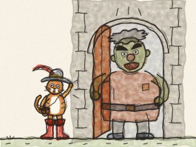
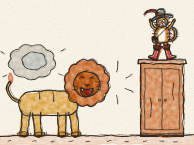
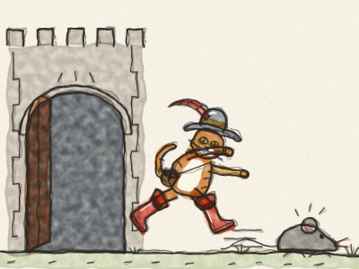

# O Gato das Botas

Era uma vez um velho moleiro que morreu e deixou tudo o que tinha aos seus três filhos. O mais velho ficou com o moinho. O do meio ficou com o burro. E o mais novo… ficou com o gato.

— Um gato! — suspirou o mais novo, sentando-se numa pedra. — O que é que eu faço com um gato? Os meus irmãos podem moer farinha e carregar sacos. Mas eu? Como o meu jantar e depois fico sem nada.

O gato estava sentado ao lado dele, a lavar os bigodes. Parou, olhou para cima e disse, muito bem-educado: — Não fique triste, meu amo. Dê-me um saco e um par de botas, para eu poder andar pelas silvas, e vai ver que valho muito mais do que um moinho e um burro.

O rapaz ficou tão espantado por ouvir um gato falar que disse logo que sim. Gastou as últimas moedas num saquinho, num chapéu com uma pena e num par de botas altas vermelhas. O gato calçou-as, *pum, pum*, e passeou de um lado para o outro. — Perfeito! — ronronou. A partir desse dia, toda a gente lhe chamou o Gato das Botas.

O Gato foi para o bosque. Encheu o saco com os morangos silvestres mais doces e as peras douradas mais sumarentas. Depois marchou direitinho até ao palácio do Rei. *Pum, pum, pum.*

— Quem vem lá? — perguntaram os guardas.

— Sou o Gato das Botas — disse o gato — e trago um presente para Sua Majestade.

O Gato tirou o chapéu de pena e fez uma vénia muito grande. — Majestade — disse ele —, o meu amo, o Marquês de Carabás, manda-lhe estes morangos e estas peras do seu jardim.

Claro que não havia Marquês de Carabás nenhum. O Gato tinha acabado de inventar o nome. Mas soava muito importante.

— Que simpático! — disse o Rei, a provar um morango. — Hum! Agradeça ao Marquês de Carabás.

No dia seguinte, o Gato trouxe mais presentes. E no outro dia, e no outro a seguir. De cada vez dizia: — Da parte do meu amo, o Marquês de Carabás. — Em pouco tempo, o Rei ficou muito curioso por conhecer aquele Marquês tão generoso.

Certa manhã, o Gato soube que o Rei ia dar um passeio de carruagem ao longo do rio, com a filha, a Princesa.

O Gato correu para casa. — Meu amo, depressa! Venha comigo até ao rio, tire a roupa e salte para a água. Depois deixe tudo comigo.

O rapaz não percebeu nada, mas fez o que o Gato lhe disse. *Chape!* Enquanto ele nadava, o Gato pegou na roupa velha e remendada e escondeu-a debaixo de uma rocha grande.

Pouco depois, apareceu a carruagem dourada do Rei. *Cataplão, cataplão.* O Gato saltou para a estrada, a acenar com o chapéu.

— Socorro! Socorro! — gritou ele. — O Marquês de Carabás está no rio, e uns ladrões roubaram-lhe a roupa!

O Rei mandou parar a carruagem imediatamente. — Depressa! — disse aos criados. — Tragam do palácio as roupas mais bonitas para o Marquês de Carabás!

Então o rapaz saiu do rio e vestiu um casaco de veludo azul, uma camisa de seda e uns sapatos brilhantes. Estava tão bonito que a Princesa lhe sorriu, ele sorriu-lhe também, e as bochechas dele ficaram cor-de-rosa.

— Venha passear connosco, Marquês — disse o Rei. E o rapaz subiu para a carruagem dourada, ao lado da Princesa.

O Gato das Botas sorriu para os seus bigodes e correu à frente, tão depressa quanto as botas o deixavam. *Pum-pum-pum-pum!*

Pouco depois, chegou a um campo onde uns camponeses cortavam feno. *Zás, zás.*

— Bons camponeses — disse o Gato —, o Rei vai passar por aqui. Quando ele perguntar de quem são estes campos, digam, por favor: «São do senhor Marquês de Carabás.» Vai ser uma bela surpresa.

Os camponeses desataram a rir. Um gato de botas! Mas gostaram dele e disseram que sim.

Quando a carruagem passou, o Rei debruçou-se na janela. — De quem são estes campos tão bonitos?

— São do senhor Marquês de Carabás! — responderam os camponeses todos juntos.

— Ora vejam só! — disse o Rei. O rapaz não disse nada. Estava tão espantado como o Rei.

Na verdade, todos aqueles campos, e os bosques, e as colinas, pertenciam a um Ogre grande e rabugento que vivia num castelo no alto da colina. E foi para lá que o Gato das Botas foi a seguir.

*Toc, toc, toc!*

A grande porta abriu-se. *Nhiiic.* Ali estava o Ogre, alto como uma árvore, com sobrancelhas farfalhudas e muito mau feitio. — O QUE É QUE QUERES? — trovejou ele.

O Gato fez uma vénia, muito bem-educado. — Bom dia, senhor. Ouvi dizer que é o Ogre mais esperto do mundo. Dizem que se consegue transformar em qualquer animal. Mas tenho a certeza de que isso não é verdade.

— NÃO É VERDADE? — rugiu o Ogre. — Olha bem!

E — *PUF!* — o Ogre transformou-se num leão enorme. *ROOOAAAR!*

O Gato apanhou um susto tão grande que saltou para cima do armário mais alto, com botas e tudo. Ficou com o pelo todo eriçado.

*PUF!* O leão voltou a ser o Ogre, que se ria, ria. — Oh oh oh! Assustei-te, gatinho!

O Gato desceu, ainda com os joelhos a tremer. — Foi muito impressionante — disse ele. — Quem é grande consegue transformar-se numa coisa grande. Mas aposto que não se consegue transformar numa coisa pequenina. Num ratinho, por exemplo. Não, isso seria difícil demais.

— DIFÍCIL DEMAIS? — berrou o Ogre. — Para mim nada é difícil demais!

*PUF!* E ali, no chão, estava um ratinho cinzento pequenino, pequenino.

*Zás!* O Gato saltou. O ratinho guinchou e fugiu, e o Gato correu atrás dele à volta da mesa, por baixo das cadeiras, pelas escadas abaixo e pela grande porta fora. *Chi, chi, chi!* O ratinho desceu a colina a correr e meteu-se no bosque, e nunca, nunca mais voltou para incomodar ninguém.

O Gato sacudiu o pó das botas. — Pronto — disse ele. — Agora este castelo precisa de um novo dono.

Então ouviu as rodas da carruagem dourada na estrada. *Cataplão, cataplão.* Rápido como um relâmpago, o Gato correu até à porta para a receber.

— Bem-vindo, Majestade — disse ele, com a sua vénia mais bonita —, ao castelo do senhor Marquês de Carabás!

O Rei arregalou os olhos. — Que castelo tão bonito! Marquês, tem os campos mais bonitos, os bosques mais bonitos e o castelo mais bonito de todo o reino.

Fizeram um banquete maravilhoso no grande salão, com bolos e música. O rapaz e a Princesa conversaram e riram a noite inteira e, pouco tempo depois, casaram-se. Foram sempre bons para os camponeses, e toda a gente foi feliz.

E o Gato das Botas? Tornou-se um grande senhor. Andava de botas todos os dias, dormia numa almofada de veludo e só corria atrás dos ratos quando lhe apetecia brincar.

> Ser esperto e trabalhador vale mais do que tudo o que nos dão.
