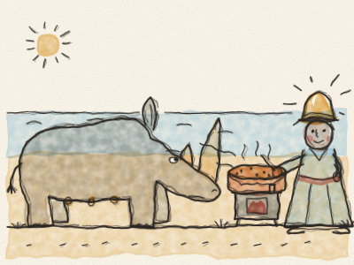
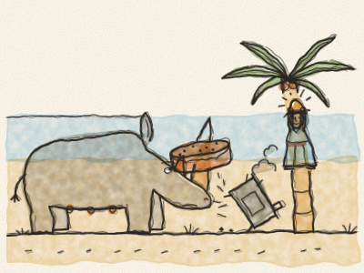
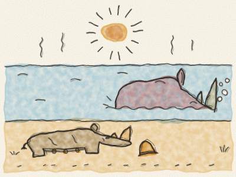
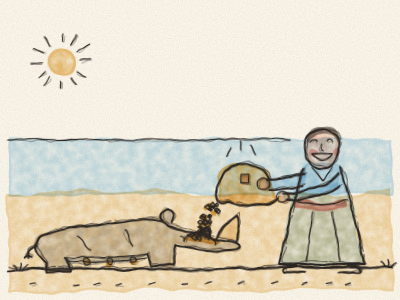
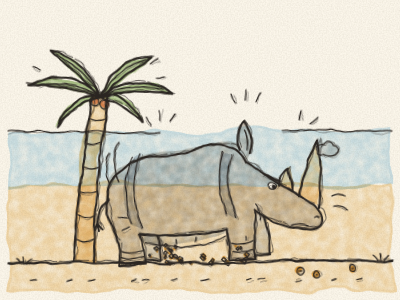

# How the Rhinoceros Got His Skin

Once upon a time, O Best Beloved, on a little island by the Red Sea, there lived a Parsee man. He had a hat that shone in the sun, brighter than the sun itself, a little cooking stove, and nothing else at all.

One day he took flour and water, currants and plums and sugar, and he made himself a cake. It was as big as a cartwheel and as thick as a pillow. It was, he said, a Superior Comestible! *(Say it grandly: a Su-pe-ri-or Co-mes-ti-ble!)* That means something very, very good to eat.

He put it on his stove, *sizzle, sizzle*, and baked it until it was all brown and smelt delicious.

But just as he was going to eat it, along the beach came the Rhinoceros. In those days, his skin fitted him tight, quite tight, with no wrinkles anywhere. It buttoned up underneath with three buttons, like a raincoat. *(Count them: one, two, three!)*

He had a horn on his nose, two little piggy eyes, and no manners at all. He did not say “Good morning.” He did not say “Please.” He just said, “How!” *(Say it in a big, rude voice.)*

The Parsee man climbed to the very top of a palm tree, *scramble, scramble!*

The Rhinoceros spiked the cake on his horn and ate it all up, *munch, munch, GULP!* He knocked over the stove, *clang, clatter!*, and off he went without a single “thank you”.

Then the Parsee man came down and said this rhyme: “Them that takes cakes which the Parsee man bakes makes dreadful mistakes!” *(Wag your finger as you say it.)*

A few weeks later, there was a heatwave by the Red Sea. It was hot, hot, HOT! So hot that everybody took off everything they could. The Parsee man took off his hat. And the Rhinoceros… took off his skin!

He undid the three buttons, *pop, pop, pop!*, peeled off his skin, and left it lying on the beach. Then he waddled into the cool sea, *splish, splosh*, to blow bubbles through his nose.

The Parsee man saw the skin, and he smiled a smile that went all round his face, two times. *(Smile the biggest smile you can.)*

He ran to his camp and brought back crumbs. Old, dry, stale, tickly cake crumbs, and some burnt currants too. He never ate anything but cake, and he never swept up, so he had lots and lots of crumbs!

He took the skin, and he shook it, and he scrubbed it, and he filled it with crumbs, as many as it could possibly hold. *Shake, shake, sprinkle!* Then he climbed back up his palm tree to see what would happen.

Out of the water came the Rhinoceros, dripping. He put his skin back on and buttoned it up, *one, two, three*… and it tickled. Like crumbs in bed!

He tried to scratch, but that made it worse. *Itchy! Scratchy! Itchy-scratchy-itchy!* So he lay down and rolled on the sand, and every time he rolled, the crumbs tickled him more.

Then he rubbed, and rubbed, and rubbed himself against the palm tree. *Rub-a-dub, rub-a-dub!* He rubbed so hard that his skin slipped into great big folds: over his shoulders, underneath where the buttons had been, and down his legs. And his temper got very bad indeed.

And from that day to this, O Best Beloved, every rhinoceros has great folds in his skin and a very grumpy temper, all because of the cake crumbs inside.

And the Parsee man? He baked himself another cake. *(And maybe, the next time, the Rhinoceros said, “Please, may I have a slice?” And the Parsee man said, “Of course!”)*

> Say please and thank you, and never take what isn’t yours: it might come back to tickle you!
