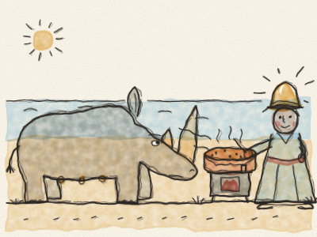
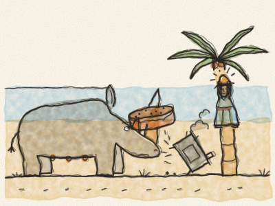
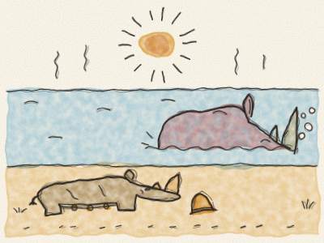
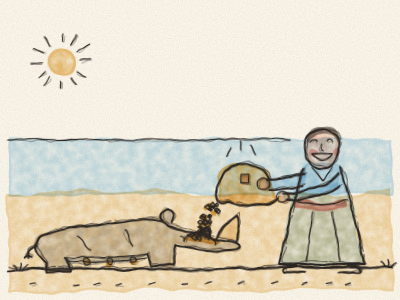
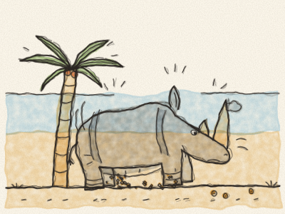

# Comment le Rhinocéros a eu sa peau

Il était une fois, ô ma Bien-Aimée, sur une petite île au bord de la mer Rouge, un homme Parsi. Il avait un chapeau qui brillait au soleil, plus fort que le soleil lui-même, un petit fourneau pour cuisiner, et rien d’autre du tout.

Un jour, il prit de la farine et de l’eau, des raisins secs, des prunes et du sucre, et il se fit un gâteau. Il était grand comme une roue de charrette et épais comme un oreiller. C’était, disait-il, un Comestible Supérieur ! *(Dites-le d’une voix très chic : un Co-mes-ti-ble Su-pé-rieur !)* Cela veut dire quelque chose de très, très bon à manger.

Il le posa sur son fourneau, *grésille, grésille*, et le fit cuire jusqu’à ce qu’il soit tout doré et sente délicieusement bon.

Mais juste au moment où il allait le manger, le Rhinocéros arriva sur la plage. En ce temps-là, sa peau lui allait serré, tout serré, sans un seul pli. Elle se boutonnait en dessous avec trois boutons, comme un imperméable. *(Comptez-les : un, deux, trois !)*

Il avait une corne sur le nez, deux petits yeux de cochon, et pas de manières du tout. Il ne disait pas « Bonjour ». Il ne disait pas « S’il vous plaît ». Il disait seulement : « How ! » *(Dites-le d’une grosse voix malpolie.)*

L’homme Parsi grimpa tout en haut d’un palmier, *hop, hop, hop !*

Le Rhinocéros piqua le gâteau sur sa corne et le mangea tout entier, *miam, miam, GLOUP !* Il renversa le fourneau, *bing, badaboum !*, et s’en alla sans dire un seul « merci ».

Alors l’homme Parsi descendit et dit cette petite comptine : « Qui chipe les gâteaux du Parsi aux fourneaux le regrettera bientôt ! » *(Agitez le doigt en le disant.)*

Quelques semaines plus tard, il y eut une canicule au bord de la mer Rouge. Il faisait chaud, chaud, CHAUD ! Si chaud que tout le monde enleva tout ce qu’il pouvait. L’homme Parsi enleva son chapeau. Et le Rhinocéros… enleva sa peau !

Il défit les trois boutons, *pop, pop, pop !*, retira sa peau et la laissa sur la plage. Puis il entra en se dandinant dans la mer fraîche, *splish, splash*, pour faire des bulles avec son nez.

L’homme Parsi vit la peau, et il fit un sourire qui fit le tour de son visage, deux fois. *(Faites le plus grand sourire possible.)*

Il courut à son campement et rapporta des miettes. De vieilles miettes de gâteau, sèches, rassises, qui grattent, et aussi quelques raisins brûlés. Il ne mangeait jamais que du gâteau, et il ne balayait jamais, alors il avait des tas et des tas de miettes !

Il prit la peau, il la secoua, il la frotta, et il la remplit de miettes, autant qu’elle pouvait en contenir. *Secoue, secoue, saupoudre !* Puis il remonta dans son palmier pour voir ce qui allait se passer.

Le Rhinocéros sortit de l’eau, tout dégoulinant. Il remit sa peau et la reboutonna, *un, deux, trois*… et ça grattait. Comme des miettes dans le lit !

Il essaya de se gratter, mais c’était pire. *Ça gratte ! Ça pique ! Ça gratte-pique-gratte !* Alors il se coucha et se roula dans le sable, et chaque fois qu’il se roulait, les miettes le grattaient encore plus.

Puis il se frotta, se frotta, se frotta contre le palmier. *Frotti, frotta, frotti, frotta !* Il se frotta si fort que sa peau glissa en grands plis : sur ses épaules, en dessous, là où étaient les boutons, et le long de ses pattes. Et il devint très, très grognon.

Et depuis ce jour, ô ma Bien-Aimée, tous les rhinocéros ont de grands plis dans la peau et un caractère très grognon, tout ça à cause des miettes de gâteau à l’intérieur.

Et l’homme Parsi ? Il se fit un autre gâteau. *(Et peut-être que, la fois suivante, le Rhinocéros dit : « S’il vous plaît, est-ce que je peux en avoir une part ? » Et l’homme Parsi répondit : « Bien sûr ! »)*

> Dis « s’il te plaît » et « merci », et ne prends jamais ce qui n’est pas à toi : ça pourrait bien te gratter !
