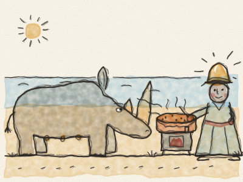
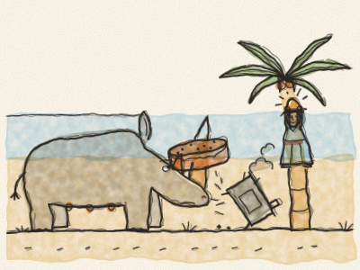
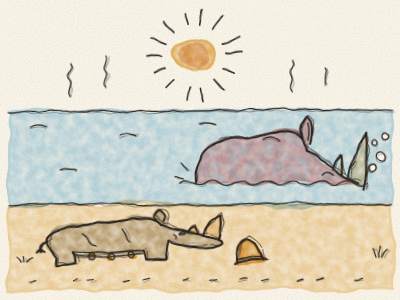
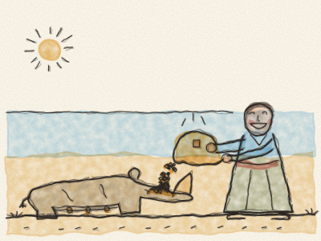
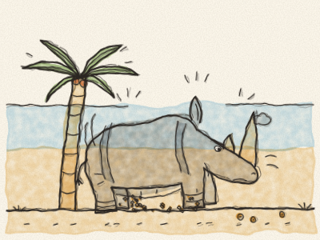

# Como o Rinoceronte Ganhou a Sua Pele

Era uma vez, ó minha Mais-Querida, numa pequena ilha à beira do mar Vermelho, um homem Parse. Tinha um chapéu que brilhava ao sol, mais ainda do que o próprio sol, um pequeno fogão para cozinhar, e mais nada.

Um dia, pegou em farinha e água, passas, ameixas e açúcar, e fez um bolo para si. Era grande como uma roda de carroça e grosso como uma almofada. Era, dizia ele, um Comestível Superior! *(Dizer com uma voz muito importante: um Co-mes-tí-vel Su-pe-ri-or!)* Isso quer dizer uma coisa muito, muito boa para comer.

Pô-lo no fogão, *chiii, chiii*, e cozeu-o até ficar todo douradinho e a cheirar maravilhosamente.

Mas mesmo quando ia comê-lo, apareceu na praia o Rinoceronte. Naquele tempo, a pele dele era justa, muito justinha, sem uma única ruga. Abotoava-se por baixo com três botões, como uma gabardina. *(Contá-los: um, dois, três!)*

Tinha um corno no nariz, dois olhinhos de porco e nenhumas maneiras. Não disse «Bom dia». Não disse «Por favor». Disse só: — How! *(Dizer com uma voz grossa e malcriada.)*

O homem Parse subiu até ao cimo de uma palmeira, *trepa, trepa!*

O Rinoceronte espetou o bolo no corno e comeu-o todo, *nham, nham, GLUP!* Deitou o fogão abaixo, *pumba, catrapum!*, e foi-se embora sem dizer um único «obrigado».

Então o homem Parse desceu e disse esta lengalenga: — Quem rouba o bolo do Parse ao fogão vai levar uma grande lição! *(Abanar o dedo ao dizer isto.)*

Umas semanas mais tarde, houve uma onda de calor à beira do mar Vermelho. Estava calor, calor, CALOR! Tanto calor que toda a gente tirou tudo o que podia. O homem Parse tirou o chapéu. E o Rinoceronte… tirou a pele!

Desabotoou os três botões, *pop, pop, pop!*, despiu a pele e deixou-a na praia. Depois entrou a bambolear no mar fresquinho, *chape, chape*, para fazer bolhas com o nariz.

O homem Parse viu a pele e fez um sorriso que lhe deu a volta à cara, duas vezes. *(Fazer o maior sorriso possível.)*

Correu ao acampamento e trouxe migalhas. Migalhas de bolo velhas, secas, duras, que fazem comichão, e também umas passas queimadas. Ele nunca comia nada a não ser bolo, e nunca varria, por isso tinha montes e montes de migalhas!

Pegou na pele, sacudiu-a, esfregou-a e encheu-a de migalhas, tantas quantas lá cabiam. *Sacode, sacode, polvilha!* Depois voltou a subir à palmeira para ver o que ia acontecer.

O Rinoceronte saiu da água, a pingar. Vestiu outra vez a pele e abotoou-a, *um, dois, três*… e fazia comichão. Como migalhas na cama!

Tentou coçar-se, mas ainda foi pior. *Que comichão! Que picadela! Comichão-picadela-comichão!* Então deitou-se e rebolou na areia, e de cada vez que rebolava, as migalhas faziam-lhe mais comichão.

Depois esfregou-se, esfregou-se, esfregou-se contra a palmeira. *Esfrega-esfrega, esfrega-esfrega!* Esfregou-se com tanta força que a pele escorregou e fez grandes pregas: nos ombros, por baixo, onde antes estavam os botões, e pelas patas abaixo. E ficou muito, muito mal-disposto.

E desde esse dia até hoje, ó minha Mais-Querida, todos os rinocerontes têm grandes pregas na pele e um feitio muito rabugento, tudo por causa das migalhas de bolo lá dentro.

E o homem Parse? Fez outro bolo para si. *(E talvez, da vez seguinte, o Rinoceronte tenha dito: — Por favor, posso comer uma fatia? E o homem Parse respondeu: — Claro que sim!)*

> Diz «por favor» e «obrigado», e nunca tires o que não é teu: ainda te pode fazer comichão!
