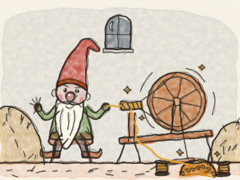
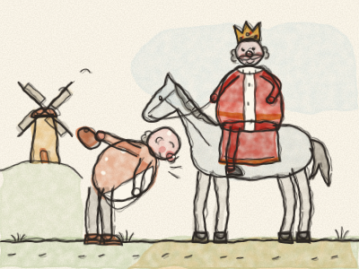
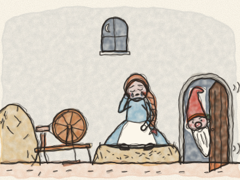
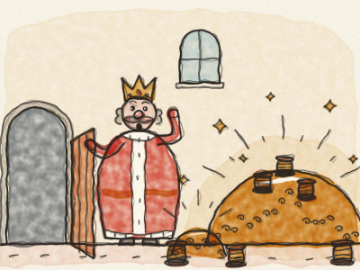
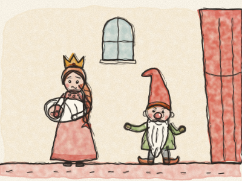
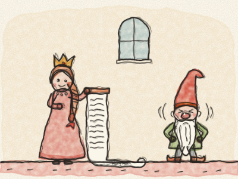
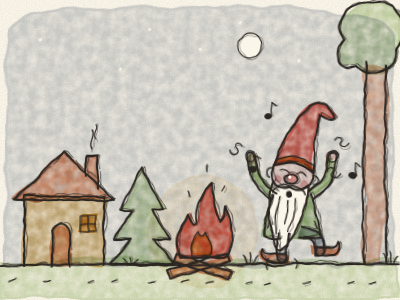
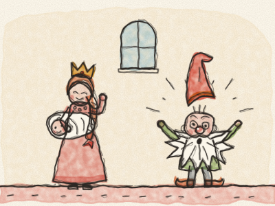

# Rumpelstiltskin

Once upon a time, there was a poor miller who had a beautiful daughter. Her name was Annie. The miller loved her very much, and he was very proud of her. Perhaps a little too proud.

One day, the King rode past the mill on his big white horse. The miller wanted so much to look important that he took off his hat, bowed very low, and said something very silly.

“Your Majesty! My daughter is so clever that she can spin straw into gold!”

Of course, that was not true. Nobody can spin straw into gold. But the King loved gold more than anything in the world.

“Spin straw into gold? How wonderful!” said the King, and his eyes went round and shiny. “Bring her to my castle tomorrow, and we shall see.”

The next day, the King took Annie to a little room at the top of a tower. It was full of straw, from the floor to the ceiling. In the middle there was a spinning wheel.

“Spin all this straw into gold by the morning,” said the King. “I shall come and see.” And he shut the door. *Clunk.*

Poor Annie sat down on the straw. She had no idea how to spin straw into gold. She did not even know how to begin. And she began to cry. *Boo-hoo-hoo.*

Suddenly the door creaked open. *Creeeak.* In came a funny little man, with a long beard down to his knees and a pointy hat on his head.

“Good evening, miller’s daughter,” he said. “Why are you crying so?”

“I must spin all this straw into gold,” sobbed Annie, “and I don’t know how.”

“Hmm,” said the little man. “What will you give me if I do it for you?”

“My necklace,” said Annie.

The little man took the necklace. He sat down at the spinning wheel, and — *whirr, whirr, whirr* — three turns, and the bobbin was full of golden thread! He spun all night long, and by morning, all the straw was gone. The room was full of shining gold.

At sunrise, the King came in. When he saw the gold, his mouth fell open. He was delighted. But, being a greedy king, he wanted even more.

That evening, he took Annie to a bigger room, full of even more straw. “Spin this into gold too, by the morning,” he said. *Clunk.*

Annie cried again, and again the door creaked open. *Creeeak.* There was the little man. “What will you give me this time?”

“The ring from my finger,” said Annie.

*Whirr, whirr, whirr.* By morning, all the straw was gold. The King was even more delighted, and even greedier. He took Annie to the biggest room of all, full of straw right up to the windows.

“Spin all this into gold by the morning,” said the King, “and you shall be my queen.”

When Annie was alone, the little man appeared a third time. “What will you give me now?”

“I have nothing left,” said Annie sadly.

The little man thought for a moment. Then he said, “Then promise me this. When you are queen, you will give me your first little baby. I live all alone, and I would so like someone to love.”

Annie did not know what else to do. And who knew what would happen one day? So she promised.

*Whirr, whirr, whirr.* By morning, the biggest room was full of gold. The King kept his word, and Annie became the Queen.

A year later, the Queen had a beautiful baby. She was so happy that she had forgotten all about the little man.

But one day, he walked into her room. *Creeeak.* “Now give me what you promised,” he said.

The Queen held her baby tight and cried. “Please! I’ll give you all the gold in the kingdom, but not my baby!”

“Something alive is worth more to me than all the gold in the world,” said the little man. But the Queen cried so much that he felt a little sorry for her.

“Very well,” he said. “I’ll give you three days. If, by then, you can guess my name, you may keep your baby.” And off he went.

All night long, the Queen thought of every name she had ever heard. And she sent a messenger far and wide to find more.

The next day, when the little man came, she began. “Is your name Caspar? Melchior? Balthazar?”

“That is not my name,” said the little man, every time, shaking his head. *(Let Constance suggest a name, too!)*

On the second day, she tried all the funny names she could find. “Is your name Spindleshanks? Muttonchops? Bandylegs?”

“That is not my name,” said the little man, with a grin.

On the third day, the messenger came back, all out of breath. “Your Majesty! I couldn’t find a single new name. But I saw something very strange.”

“High up on a mountain, at the edge of the forest, there was a tiny house. In front of it, a fire was burning. And round the fire, a funny little man was hopping about on one leg, singing:

*Today I bake, tomorrow I brew,*
*then the Queen’s baby, I’ll take it too!*
*How glad I am that nobody knows*
*that Rumpelstiltskin is my name-o!*”

How happy the Queen was when she heard that name! She said it over and over, so as not to forget it. *Rumpelstiltskin, Rumpelstiltskin.*

*(Ask Constance: can you remember the little man’s name?)*

Soon the little man came in. “Well, Your Majesty, what is my name?”

The Queen pretended to think. “Is your name… Conrad?”

“No!”

“Is your name… Harry?”

“No, no!”

“Is your name… Henry?”

“No, no, NO!” said the little man, hopping with glee. “You’ll never guess it!”

“Then perhaps… your name is… Rumpelstiltskin?”

The little man went red, then purple. “Who told you? Who told you?” he shouted. And he stamped his foot so hard — *STAMP!* — that it went right through the floor, up to his knee!

He pulled his foot out, grumbling and grumbling. Then he jumped on a big wooden spoon, like a broomstick, and flew out of the window. *Whoosh!* And nobody ever saw him again.

The Queen laughed and laughed, and the baby laughed too. *Ha, ha, ha!* Then she went down to the mill, to show the baby to his grandfather.

The Queen kept her baby and loved him very much. And from that day on, the miller never, ever boasted again.

> A boast can cause big trouble, so always tell the truth.
