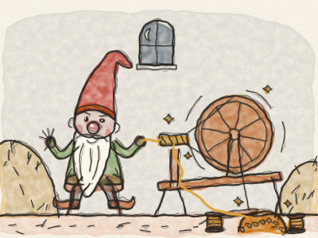
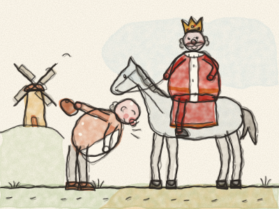
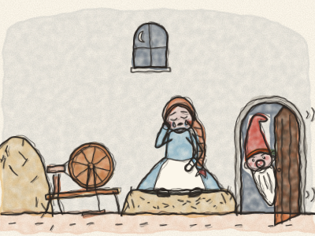
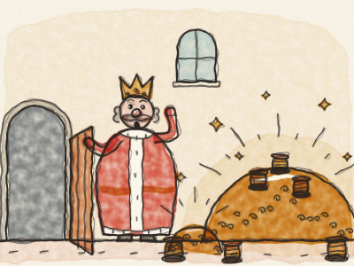
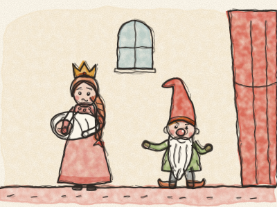
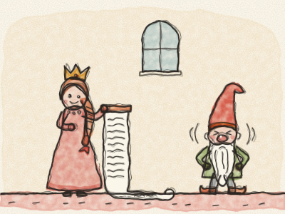
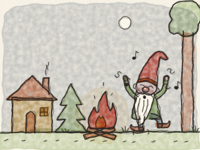
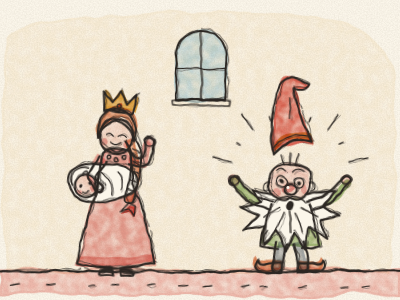

# Tracassin

Il était une fois un pauvre meunier qui avait une très jolie fille. Elle s’appelait Annie. Le meunier l’aimait très fort, et il était très fier d’elle. Peut-être un peu trop fier.

Un jour, le Roi passa devant le moulin sur son grand cheval blanc. Le meunier voulait tellement avoir l’air important qu’il ôta son chapeau, fit une grande révérence, et dit une grosse bêtise.

« Votre Majesté ! Ma fille est si habile qu’elle sait filer la paille en or ! »

Bien sûr, ce n’était pas vrai. Personne ne sait filer la paille en or. Mais le Roi aimait l’or plus que tout au monde.

« Filer la paille en or ? Merveilleux ! » dit le Roi, et ses yeux devinrent tout ronds et tout brillants. « Amène-la à mon château demain, et nous verrons bien. »

Le lendemain, le Roi conduisit Annie dans une petite pièce, tout en haut d’une tour. Elle était pleine de paille, du sol jusqu’au plafond. Au milieu, il y avait un rouet.

« File toute cette paille en or d’ici demain matin, » dit le Roi. « Je viendrai voir. » Et il ferma la porte. *Clonk.*

La pauvre Annie s’assit sur la paille. Elle ne savait pas du tout comment filer la paille en or. Elle ne savait même pas par où commencer. Et elle se mit à pleurer. *Bouhouhou.*

Tout à coup, la porte s’ouvrit en grinçant. *Criiic.* Entra un drôle de petit bonhomme, avec une longue barbe jusqu’aux genoux et un chapeau pointu sur la tête.

« Bonsoir, fille du meunier, » dit-il. « Pourquoi pleures-tu ainsi ? »

« Je dois filer toute cette paille en or, » sanglota Annie, « et je ne sais pas comment faire. »

« Hum, » fit le petit bonhomme. « Que me donneras-tu si je le fais pour toi ? »

« Mon collier, » dit Annie.

Le petit bonhomme prit le collier. Il s’assit devant le rouet, et — *frrr, frrr, frrr* — trois tours, et la bobine était pleine de fil d’or ! Il fila toute la nuit, et au matin, toute la paille avait disparu. La pièce était pleine d’or brillant.

Au lever du soleil, le Roi entra. Quand il vit l’or, il resta bouche bée. Il était ravi. Mais comme c’était un roi gourmand, il en voulait encore plus.

Le soir, il conduisit Annie dans une pièce plus grande, avec encore plus de paille. « File aussi celle-ci en or, d’ici demain matin, » dit-il. *Clonk.*

Annie pleura encore, et encore la porte s’ouvrit en grinçant. *Criiic.* C’était le petit bonhomme. « Que me donneras-tu cette fois ? »

« La bague que j’ai au doigt, » dit Annie.

*Frrr, frrr, frrr.* Au matin, toute la paille était devenue de l’or. Le Roi était encore plus ravi, et encore plus gourmand. Il conduisit Annie dans la plus grande pièce de toutes, pleine de paille jusqu’aux fenêtres.

« File tout cela en or d’ici demain matin, » dit le Roi, « et tu seras ma reine. »

Quand Annie fut seule, le petit bonhomme apparut une troisième fois. « Que me donneras-tu maintenant ? »

« Je n’ai plus rien, » dit Annie tristement.

Le petit bonhomme réfléchit un instant. Puis il dit : « Alors promets-moi ceci. Quand tu seras reine, tu me donneras ton premier petit bébé. Je vis tout seul, et j’aimerais tant avoir quelqu’un à aimer. »

Annie ne savait pas quoi faire d’autre. Et qui savait ce qui arriverait un jour ? Alors elle promit.

*Frrr, frrr, frrr.* Au matin, la plus grande pièce était pleine d’or. Le Roi tint parole, et Annie devint reine.

Un an plus tard, la Reine eut un magnifique bébé. Elle était si heureuse qu’elle avait complètement oublié le petit bonhomme.

Mais un jour, il entra dans sa chambre. *Criiic.* « Maintenant, donne-moi ce que tu m’as promis, » dit-il.

La Reine serra son bébé très fort et pleura. « Je vous en prie ! Je vous donnerai tout l’or du royaume, mais pas mon bébé ! »

« Quelque chose de vivant vaut plus pour moi que tout l’or du monde, » dit le petit bonhomme. Mais la Reine pleurait tant qu’il eut un peu pitié d’elle.

« Bon, » dit-il. « Je te donne trois jours. Si d’ici là tu devines mon nom, tu pourras garder ton bébé. » Et il s’en alla.

Toute la nuit, la Reine pensa à tous les prénoms qu’elle avait jamais entendus. Et elle envoya un messager partout, très loin, pour en trouver d’autres.

Le lendemain, quand le petit bonhomme vint, elle commença. « T’appelles-tu Gaspard ? Melchior ? Balthazar ? »

« Ce n’est pas mon nom, » répondait le petit bonhomme à chaque fois, en secouant la tête. *(Laissez Constance proposer un nom, elle aussi !)*

Le deuxième jour, elle essaya tous les noms rigolos qu’elle put trouver. « T’appelles-tu Pattes-de-Héron ? Côtelette ? Jambes-Tordues ? »

« Ce n’est pas mon nom, » dit le petit bonhomme, avec un grand sourire.

Le troisième jour, le messager revint, tout essoufflé. « Votre Majesté ! Je n’ai pas trouvé un seul nouveau nom. Mais j’ai vu quelque chose de très bizarre. »

« Tout en haut d’une montagne, au bord de la forêt, il y avait une toute petite maison. Devant, un feu brûlait. Et autour du feu, un drôle de petit bonhomme sautillait sur une jambe, en chantant :

*Aujourd’hui le pain, demain la soupe aux choux,*
*après-demain le bébé de la reine sera chez nous !*
*Quelle chance que personne ne sache, oh là là,*
*que je m’appelle Tracassin, tralala !* »

Comme la Reine fut heureuse d’entendre ce nom ! Elle le répéta encore et encore, pour ne pas l’oublier. *Tracassin, Tracassin.*

*(Demandez à Constance : te souviens-tu du nom du petit bonhomme ?)*

Bientôt, le petit bonhomme entra. « Eh bien, Votre Majesté, quel est mon nom ? »

La Reine fit semblant de réfléchir. « T’appelles-tu… Conrad ? »

« Non ! »

« T’appelles-tu… Harry ? »

« Non, non ! »

« T’appelles-tu… Henri ? »

« Non, non, NON ! » dit le petit bonhomme, en sautillant de joie. « Tu ne trouveras jamais ! »

« Alors peut-être… que tu t’appelles… Tracassin ? »

Le petit bonhomme devint tout rouge, puis tout violet. « Qui te l’a dit ? Qui te l’a dit ? » cria-t-il. Et il tapa du pied si fort — *BOUM !* — que son pied passa à travers le plancher, jusqu’au genou !

Il retira son pied, en grognant et en grognant. Puis il sauta sur une grande cuillère en bois, comme sur un balai, et s’envola par la fenêtre. *Fiouuu !* Et plus personne ne le revit jamais.

La Reine rit et rit encore, et le bébé rit aussi. *Ha, ha, ha !* Puis elle descendit au moulin, pour montrer le bébé à son grand-père.

La Reine garda son bébé et l’aima très fort. Et depuis ce jour-là, le meunier ne se vanta plus jamais, jamais.

> Une vantardise peut causer de gros ennuis : dis toujours la vérité.
