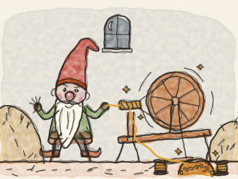
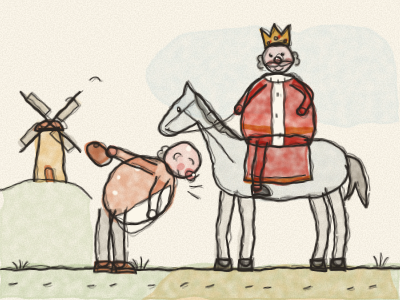
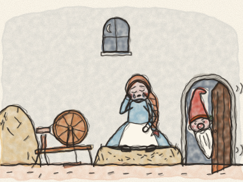
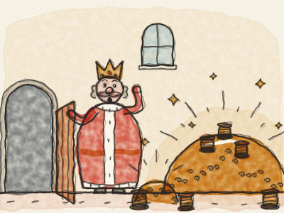
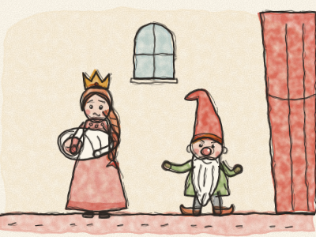
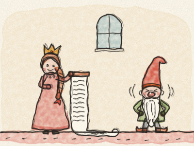
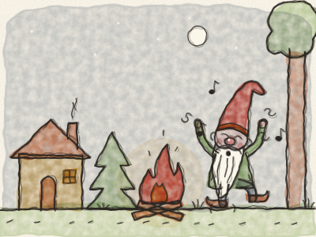
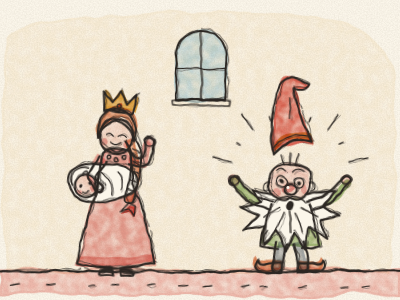

# Rumpelstiltskin

Era uma vez um moleiro pobre que tinha uma filha muito bonita. Chamava-se Ana. O moleiro gostava muito dela e tinha muito orgulho nela. Talvez orgulho a mais.

Um dia, o Rei passou pelo moinho no seu grande cavalo branco. O moleiro queria tanto parecer importante que tirou o chapéu, fez uma grande vénia e disse uma grande tolice.

— Majestade! A minha filha é tão habilidosa que consegue fiar palha e transformá-la em ouro!

Claro que não era verdade. Ninguém consegue transformar palha em ouro. Mas o Rei gostava de ouro mais do que de tudo no mundo.

— Transformar palha em ouro? Que maravilha! — disse o Rei, e os olhos dele ficaram redondos e a brilhar. — Traz-ma amanhã ao castelo, e logo veremos.

No dia seguinte, o Rei levou a Ana para um quartinho lá no alto de uma torre. Estava cheio de palha, do chão até ao teto. No meio, havia uma roca.

— Fia esta palha toda em ouro até amanhã de manhã — disse o Rei. — Eu venho ver. — E fechou a porta. *Clonc.*

A pobre Ana sentou-se na palha. Não fazia ideia de como transformar palha em ouro. Nem sequer sabia por onde começar. E desatou a chorar. *Buá, buá, buá.*

De repente, a porta abriu-se a ranger. *Nheeec.* Entrou um homenzinho engraçado, com uma barba comprida até aos joelhos e um chapéu bicudo na cabeça.

— Boa noite, filha do moleiro — disse ele. — Porque é que choras tanto?

— Tenho de transformar esta palha toda em ouro — soluçou a Ana — e não sei como.

— Hum — disse o homenzinho. — O que me dás se eu o fizer por ti?

— O meu colar — disse a Ana.

O homenzinho pegou no colar. Sentou-se à roca e — *zum, zum, zum* — três voltas, e o carrinho estava cheio de fio de ouro! Fiou a noite inteira, e de manhã já não havia palha nenhuma. O quarto estava cheio de ouro a brilhar.

Ao nascer do sol, o Rei entrou. Quando viu o ouro, ficou de boca aberta. Estava encantado. Mas, como era um rei guloso, queria ainda mais.

Nessa noite, levou a Ana para um quarto maior, com ainda mais palha. — Fia também esta em ouro, até amanhã de manhã — disse ele. *Clonc.*

A Ana chorou outra vez, e outra vez a porta se abriu a ranger. *Nheeec.* Lá estava o homenzinho. — O que me dás desta vez?

— O anel que tenho no dedo — disse a Ana.

*Zum, zum, zum.* De manhã, a palha toda era ouro. O Rei ficou ainda mais encantado, e ainda mais guloso. Levou a Ana para o maior quarto de todos, cheio de palha até às janelas.

— Fia isto tudo em ouro até amanhã de manhã — disse o Rei — e serás a minha rainha.

Quando a Ana ficou sozinha, o homenzinho apareceu pela terceira vez. — O que me dás agora?

— Já não tenho nada — disse a Ana, muito triste.

O homenzinho pensou um bocadinho. Depois disse: — Então promete-me uma coisa. Quando fores rainha, dás-me o teu primeiro bebé. Vivo sozinho, e gostava tanto de ter alguém de quem gostar.

A Ana não sabia o que mais fazer. E quem sabia o que ia acontecer um dia? Por isso, prometeu.

*Zum, zum, zum.* De manhã, o maior quarto estava cheio de ouro. O Rei cumpriu a palavra, e a Ana tornou-se rainha.

Um ano depois, a Rainha teve um bebé lindo. Estava tão feliz que se tinha esquecido completamente do homenzinho.

Mas um dia, ele entrou no quarto dela. *Nheeec.* — Agora dá-me o que me prometeste — disse ele.

A Rainha apertou o bebé com força e chorou. — Por favor! Dou-te todo o ouro do reino, mas o meu bebé não!

— Uma coisa viva vale mais para mim do que todo o ouro do mundo — disse o homenzinho. Mas a Rainha chorava tanto que ele teve um bocadinho de pena dela.

— Está bem — disse ele. — Dou-te três dias. Se até lá adivinhares o meu nome, podes ficar com o teu bebé. — E foi-se embora.

Durante a noite toda, a Rainha pensou em todos os nomes que alguma vez tinha ouvido. E mandou um mensageiro por toda a parte, para encontrar mais.

No dia seguinte, quando o homenzinho chegou, ela começou: — Chamas-te Gaspar? Belchior? Baltasar?

— Não é esse o meu nome — dizia o homenzinho, de cada vez, a abanar a cabeça. *(Deixe a Constance sugerir um nome também!)*

No segundo dia, ela experimentou todos os nomes engraçados que conseguiu encontrar. — Chamas-te Pernas-de-Pau? Costeleta? Perna-Torta?

— Não é esse o meu nome — disse o homenzinho, com um sorriso maroto.

No terceiro dia, o mensageiro voltou, todo esbaforido. — Majestade! Não encontrei nem um nome novo. Mas vi uma coisa muito estranha.

— Lá no alto de uma montanha, à beira da floresta, havia uma casinha pequenina. À frente, ardia uma fogueira. E à volta da fogueira, um homenzinho engraçado saltava ao pé-coxinho, a cantar:

*Hoje coze-se o pão, amanhã a sopa de feijão,*
*depois o bebé da rainha vem parar à minha mão!*
*Que bom que ninguém sabe, ninguém, ninguém,*
*que Rumpelstiltskin é o meu nome, e de mais ninguém!*

Como a Rainha ficou feliz quando ouviu aquele nome! Repetiu-o vezes sem conta, para não se esquecer. *Rumpelstiltskin, Rumpelstiltskin.*

*(Pergunte à Constance: lembras-te do nome do homenzinho?)*

Pouco depois, o homenzinho entrou. — Então, Majestade, qual é o meu nome?

A Rainha fingiu que estava a pensar. — Chamas-te… Conrado?

— Não!

— Chamas-te… Duarte?

— Não, não!

— Chamas-te… Henrique?

— Não, não, NÃO! — disse o homenzinho, aos saltinhos de alegria. — Nunca hás de adivinhar!

— Então talvez… te chames… Rumpelstiltskin?

O homenzinho ficou vermelho, depois roxo. — Quem te disse? Quem te disse? — gritou ele. E bateu com o pé com tanta força — *PUM!* — que o pé atravessou o soalho, até ao joelho!

Tirou o pé, a resmungar e a resmungar. Depois saltou para cima de uma grande colher de pau, como se fosse uma vassoura, e voou pela janela fora. *Fiuuu!* E nunca mais ninguém o viu.

A Rainha riu e riu, e o bebé riu também. *Ah, ah, ah!* Depois foi até ao moinho, mostrar o bebé ao avô.

A Rainha ficou com o seu bebé e gostou muito dele. E desde esse dia, o moleiro nunca, nunca mais se gabou.

> Gabar-se pode trazer grandes sarilhos: diz sempre a verdade.
