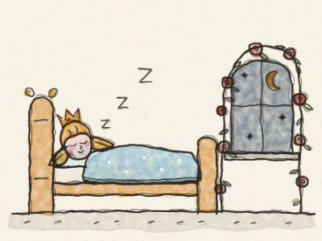
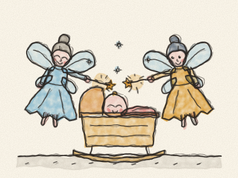
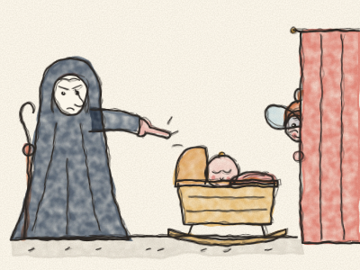
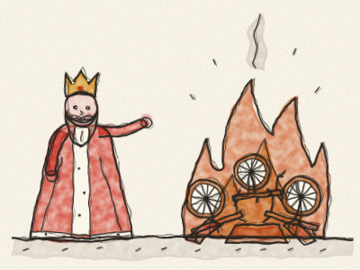
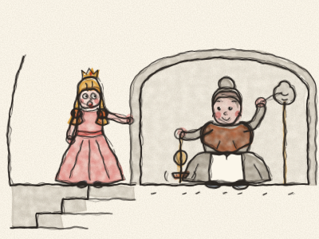
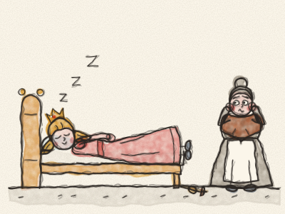
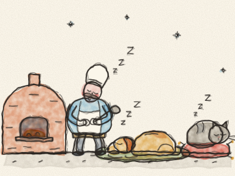
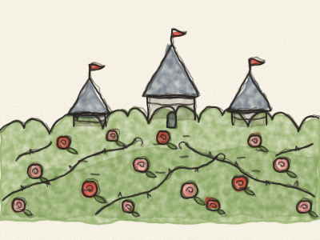
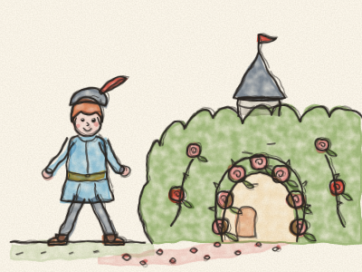
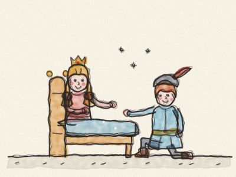

# Sleeping Beauty

Once upon a time, there lived a King and a Queen who wished and wished for a baby. At last, one spring morning, a little girl was born. She had rosy cheeks and a tiny button nose, and the King and the Queen were so happy that they danced round the cradle. *Tra-la-la!*

“We shall have a great feast,” said the King, “and we shall invite the fairies of the kingdom to be her godmothers.”

There were seven good fairies in the land, and the King sent each of them an invitation. He had seven golden plates made for them, with seven golden spoons, seven golden forks and seven golden knives.

On the day of the feast, the seven fairies came flying in through the castle windows. After the dinner, one by one, they leaned over the cradle and gave the baby a gift.

“She will be kind,” said the first fairy.

“She will be clever,” said the second.

“She will dance like a feather,” said the third. “She will sing like a bird,” said the fourth. “She will laugh every day,” said the fifth. “She will be brave,” said the sixth.

But just as the seventh fairy, the youngest, stepped forward… *BANG!* The great doors flew open.

*(Pause, and ask Constance: who do you think it is?)*

In came a very old fairy, in a dark, dusty cloak. Nobody had seen her for fifty years, and everybody had forgotten all about her. There was no golden plate for her, and no invitation.

“So!” she grumbled. “You forgot me, did you? Then here is MY gift.” She pointed her long, bony finger at the cradle. “When the princess is fifteen years old, she will prick her finger on a spindle… and she will fall down asleep!”

Everyone gasped. The Queen began to cry.

But the youngest fairy had been hiding behind a curtain, because she had not given her gift yet. She stepped out. “Don’t cry,” she said gently. “I cannot undo the old fairy’s spell, but I can make it softer.”

“If the princess pricks her finger,” said the youngest fairy, “she will not be hurt. She will only fall into a deep, deep sleep. She will sleep for one hundred years, and then a King’s son will come and wake her.”

The King still wanted to keep his daughter safe. So he made a new law. “Every spindle and every spinning wheel in the kingdom must be burned!” he said.

The King’s men went from house to house. They gathered up all the spinning wheels and piled them up in the castle yard, and they made a great bonfire. *Crackle, crackle, whoosh!* Soon there was not one spindle left in the whole kingdom. Or so everybody thought.

The years went by, and the princess grew up, just as the fairies had said. She was kind, and clever, and brave. She danced like a feather and sang like a bird, and she laughed every day.

On her fifteenth birthday, the King and the Queen had gone out, and the princess was exploring the castle. *Tip, tap, tip, tap.* Up and down the stairs, and in and out of the rooms. At the very top of an old tower, she found a little door she had never seen before.

Inside sat an old woman, spinning wool with a spindle. *Whirr, whirr, whirr.* She lived so high up that she had never heard about the King’s law.

“Good morning,” said the princess. “What are you doing?”

“I am spinning, my dear,” said the old woman.

“How pretty!” said the princess. “May I try?”

She took the spindle in her hand, and — *ouch!* — she pricked her finger. At once, she felt very, very sleepy. She yawned a big yawn, and lay down on the old woman’s bed, and fell fast asleep.

The old woman called for help. The servants came running. They sprinkled water on the princess’s face, and they clapped their hands, and they rang the bells. *Ding, dong!* But nothing could wake her. She slept peacefully, with her cheeks still rosy and a little smile on her lips.

The youngest fairy heard the news, and came flying to the castle. She thought, “When the princess wakes up in a hundred years, she will be all alone. That would be very sad.”

So she touched everyone in the castle with her magic wand. *Ting!* The ladies-in-waiting fell asleep. *Ting!* The guards fell asleep. *Ting!* The cook fell asleep by the oven, and the kitchen boy fell asleep with a spoon in his hand. The horses fell asleep in the stables, the dog fell asleep on the rug, and the cat fell asleep on a cushion. Even the fire in the fireplace fell asleep.

*(Whisper:)* The whole castle was silent. *Shhh…*

The King and the Queen kissed their sleeping daughter goodnight. Then the fairy made a great hedge grow all around the castle. Brambles and briars and wild roses grew, and grew, and grew, thick and tangled and full of thorns, so that nobody could get through. Soon only the tops of the towers could be seen.

And so the years went by. Ten years, fifty years, one hundred years. People in the villages told stories about the castle in the wood, and about the beautiful princess who slept inside. They called her Sleeping Beauty. Some brave young men tried to reach her, but the thorns were too thick, and they had to turn back.

One day, exactly one hundred years later, a young prince came riding by. An old man told him the story of Sleeping Beauty.

“I am not afraid,” said the prince. “I shall go and see her.”

He walked up to the great hedge. And then something wonderful happened. The thorny branches bent aside all by themselves, and covered themselves with pink roses, and opened into a path. *Rustle, rustle.* For the hundred years were over.

The prince walked through the silent castle. He passed the sleeping guards, and the sleeping cook, and the sleeping dog and cat. He climbed the winding stairs to the top of the tower. And there, on the old bed, lay the sleeping princess.

The prince knelt down beside her. At that very moment, the spell was over. The princess opened her eyes, and stretched, and smiled. “Is it you, my prince?” she said. “I have been waiting for you for such a long time.”

And all through the castle, everybody woke up too. The guards yawned. The cook stretched. The dog wagged his tail. *Woof!* The cat said, “*Miaow!*” The fire said, “*Crackle!*” And the kitchen boy went on stirring the soup, as if nothing had happened.

That very evening there was a grand feast, with music and dancing, and the princess danced like a feather. Soon after, the prince and the princess were married, and they lived happily ever after.

> A little kindness can soften even the hardest spell.
