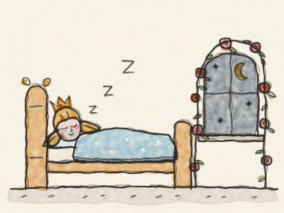
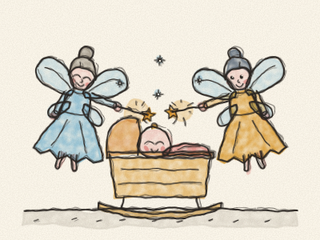
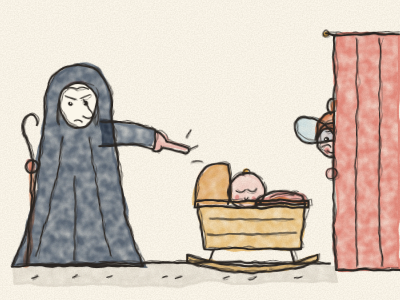
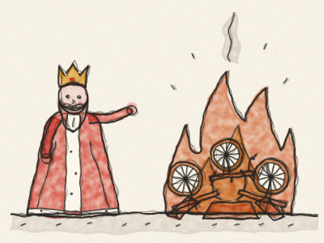
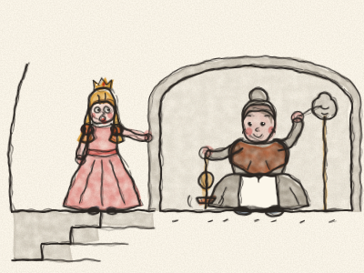
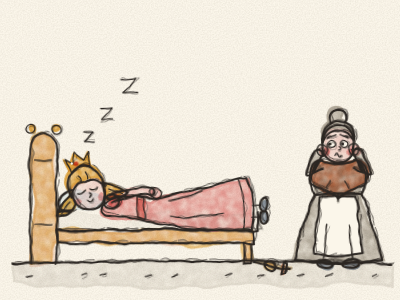
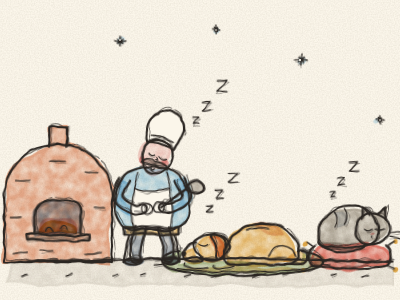
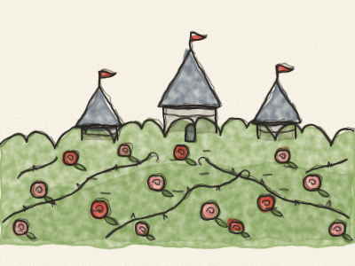
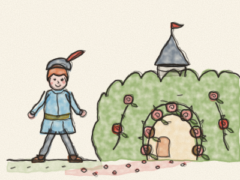
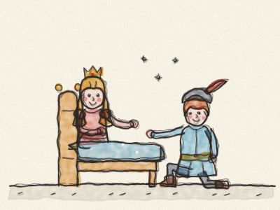

# La Belle au bois dormant

Il était une fois un Roi et une Reine qui souhaitaient de tout leur cœur avoir un bébé. Enfin, un matin de printemps, une petite fille naquit. Elle avait des joues roses et un tout petit nez en bouton, et le Roi et la Reine étaient si heureux qu’ils dansèrent autour du berceau. *Tra-la-la !*

« Nous donnerons une grande fête, dit le Roi, et nous inviterons les fées du royaume à être ses marraines. »

Il y avait sept bonnes fées dans le pays, et le Roi envoya une invitation à chacune d’elles. Il fit faire pour elles sept assiettes d’or, avec sept cuillères d’or, sept fourchettes d’or et sept couteaux d’or.

Le jour de la fête, les sept fées entrèrent en volant par les fenêtres du château. Après le dîner, l’une après l’autre, elles se penchèrent sur le berceau et firent un don au bébé.

« Elle sera gentille », dit la première fée.

« Elle sera intelligente », dit la deuxième.

« Elle dansera comme une plume », dit la troisième. « Elle chantera comme un oiseau », dit la quatrième. « Elle rira tous les jours », dit la cinquième. « Elle sera courageuse », dit la sixième.

Mais juste au moment où la septième fée, la plus jeune, s’avançait… *BANG !* Les grandes portes s’ouvrirent d’un coup.

*(Faites une pause et demandez à Constance : qui est-ce, à ton avis ?)*

Entra une très vieille fée, dans une cape sombre et poussiéreuse. Personne ne l’avait vue depuis cinquante ans, et tout le monde l’avait complètement oubliée. Il n’y avait pas d’assiette d’or pour elle, et pas d’invitation.

« Ah ! grommela-t-elle. Vous m’avez oubliée, hein ? Alors voici MON don. » Elle pointa son long doigt maigre vers le berceau. « Quand la princesse aura quinze ans, elle se piquera le doigt à un fuseau… et elle tombera endormie ! »

Tout le monde poussa un cri. La Reine se mit à pleurer.

Mais la plus jeune fée s’était cachée derrière un rideau, car elle n’avait pas encore fait son don. Elle sortit. « Ne pleurez pas, dit-elle doucement. Je ne peux pas défaire le sort de la vieille fée, mais je peux l’adoucir. »

« Si la princesse se pique le doigt, dit la plus jeune fée, elle n’aura aucun mal. Elle tombera seulement dans un sommeil profond, très profond. Elle dormira cent ans, et puis le fils d’un Roi viendra la réveiller. »

Le Roi voulait quand même protéger sa fille. Alors il fit une nouvelle loi. « Tous les fuseaux et tous les rouets du royaume doivent être brûlés ! » dit-il.

Les hommes du Roi allèrent de maison en maison. Ils ramassèrent tous les rouets, les entassèrent dans la cour du château, et firent un grand feu de joie. *Crac, crac, fouuuh !* Bientôt, il ne resta plus un seul fuseau dans tout le royaume. Du moins, c’est ce que tout le monde croyait.

Les années passèrent, et la princesse grandit, comme les fées l’avaient dit. Elle était gentille, intelligente et courageuse. Elle dansait comme une plume et chantait comme un oiseau, et elle riait tous les jours.

Le jour de ses quinze ans, le Roi et la Reine étaient sortis, et la princesse explorait le château. *Tip, tap, tip, tap.* En haut et en bas des escaliers, dans une pièce et puis dans l’autre. Tout en haut d’une vieille tour, elle trouva une petite porte qu’elle n’avait jamais vue.

Dedans était assise une vieille femme qui filait la laine avec un fuseau. *Frrr, frrr, frrr.* Elle vivait si haut qu’elle n’avait jamais entendu parler de la loi du Roi.

« Bonjour, dit la princesse. Que faites-vous ? »

« Je file, ma chérie », dit la vieille femme.

« Comme c’est joli ! dit la princesse. Je peux essayer ? »

Elle prit le fuseau dans sa main, et — *aïe !* — elle se piqua le doigt. Aussitôt, elle eut très, très sommeil. Elle bâilla un grand bâillement, s’allongea sur le lit de la vieille femme, et s’endormit profondément.

La vieille femme appela au secours. Les serviteurs accoururent. Ils lui jetèrent de l’eau sur le visage, ils tapèrent dans leurs mains, ils sonnèrent les cloches. *Ding, dong !* Mais rien ne pouvait la réveiller. Elle dormait paisiblement, les joues toujours roses et un petit sourire aux lèvres.

La plus jeune fée apprit la nouvelle, et arriva au château en volant. Elle pensa : « Quand la princesse se réveillera dans cent ans, elle sera toute seule. Ce serait bien triste. »

Alors elle toucha tout le monde au château avec sa baguette magique. *Ting !* Les dames de compagnie s’endormirent. *Ting !* Les gardes s’endormirent. *Ting !* Le cuisinier s’endormit près du four, et le petit marmiton s’endormit une cuillère à la main. Les chevaux s’endormirent dans l’écurie, le chien s’endormit sur le tapis, et le chat s’endormit sur un coussin. Même le feu dans la cheminée s’endormit.

*(Chuchotez :)* Tout le château était silencieux. *Chut…*

Le Roi et la Reine embrassèrent leur fille endormie pour lui dire bonne nuit. Puis la fée fit pousser une grande haie tout autour du château. Les ronces, les épines et les roses sauvages poussèrent, poussèrent, poussèrent, épaisses, emmêlées et pleines de piquants, si bien que personne ne pouvait passer. Bientôt, on ne vit plus que le haut des tours.

Et les années passèrent. Dix ans, cinquante ans, cent ans. Dans les villages, on racontait des histoires sur le château dans le bois, et sur la belle princesse qui dormait à l’intérieur. On l’appelait la Belle au bois dormant. Quelques jeunes gens courageux essayèrent de l’atteindre, mais les épines étaient trop épaisses, et ils durent faire demi-tour.

Un jour, cent ans tout juste plus tard, un jeune prince passa à cheval. Un vieil homme lui raconta l’histoire de la Belle au bois dormant.

« Je n’ai pas peur, dit le prince. J’irai la voir. »

Il s’avança vers la grande haie. Et alors, une chose merveilleuse arriva. Les branches épineuses s’écartèrent toutes seules, se couvrirent de roses roses, et s’ouvrirent en un chemin. *Frou, frou.* Car les cent ans étaient passés.

Le prince traversa le château silencieux. Il passa devant les gardes endormis, le cuisinier endormi, le chien et le chat endormis. Il monta l’escalier en colimaçon jusqu’en haut de la tour. Et là, sur le vieux lit, dormait la princesse.

Le prince s’agenouilla près d’elle. À cet instant précis, le sort prit fin. La princesse ouvrit les yeux, s’étira et sourit. « Est-ce vous, mon prince ? dit-elle. Vous vous êtes bien fait attendre. »

Et dans tout le château, tout le monde se réveilla aussi. Les gardes bâillèrent. Le cuisinier s’étira. Le chien remua la queue. *Ouaf !* Le chat fit : « *Miaou !* » Le feu fit : « *Crac !* » Et le petit marmiton continua de tourner la soupe, comme si de rien n’était.

Le soir même, il y eut un grand festin, avec de la musique et des danses, et la princesse dansa comme une plume. Peu après, le prince et la princesse se marièrent, et ils vécurent heureux pour toujours.

> Un peu de bonté peut adoucir même le sort le plus dur.
