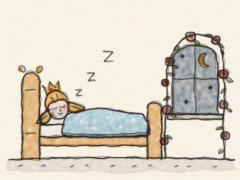
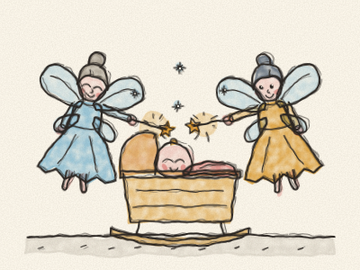
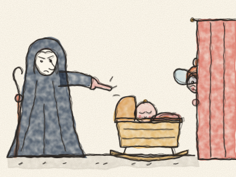
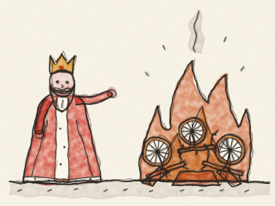
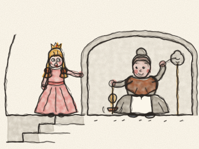
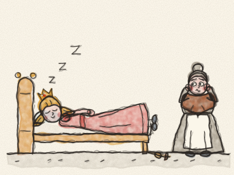
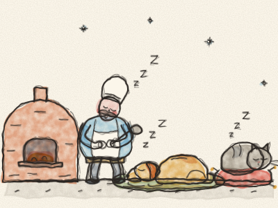
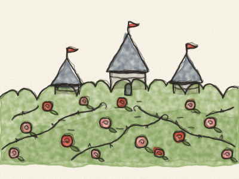
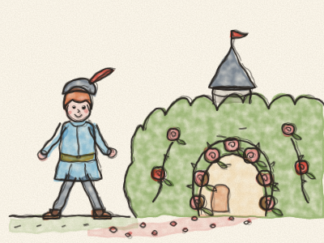
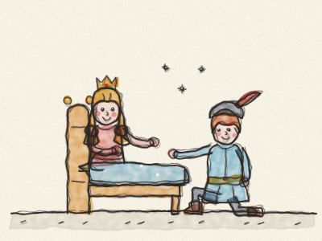

# A Bela Adormecida

Era uma vez um Rei e uma Rainha que desejavam muito, muito ter um bebé. Por fim, numa manhã de primavera, nasceu uma menina. Tinha as bochechas cor-de-rosa e um narizinho pequenino, e o Rei e a Rainha ficaram tão felizes que dançaram à volta do berço. *Tra-la-lá!*

— Vamos dar uma grande festa — disse o Rei — e vamos convidar as fadas do reino para serem as madrinhas dela.

Havia sete fadas boas no reino, e o Rei mandou um convite a cada uma. Mandou fazer para elas sete pratos de ouro, com sete colheres de ouro, sete garfos de ouro e sete facas de ouro.

No dia da festa, as sete fadas entraram a voar pelas janelas do castelo. Depois do jantar, uma de cada vez, debruçaram-se sobre o berço e deram um dom à bebé.

— Vai ser bondosa — disse a primeira fada.

— Vai ser inteligente — disse a segunda.

— Vai dançar leve como uma pena — disse a terceira. — Vai cantar como um passarinho — disse a quarta. — Vai rir todos os dias — disse a quinta. — Vai ser corajosa — disse a sexta.

Mas mesmo quando a sétima fada, a mais nova, ia avançar… *PUM!* As grandes portas abriram-se de repente.

*(Faça uma pausa e pergunte à Constance: quem achas que é?)*

Entrou uma fada muito velha, com uma capa escura e cheia de pó. Ninguém a via há cinquenta anos, e todos se tinham esquecido dela. Não havia prato de ouro para ela, nem convite.

— Ah! — resmungou ela. — Esqueceram-se de mim, não foi? Então aqui está o MEU dom. — Apontou o dedo comprido e ossudo para o berço. — Quando a princesa tiver quinze anos, vai picar o dedo num fuso… e vai cair a dormir!

Todos soltaram um grito. A Rainha começou a chorar.

Mas a fada mais nova tinha-se escondido atrás de uma cortina, porque ainda não tinha dado o seu dom. Saiu e disse com doçura: — Não chorem. Não consigo desfazer o feitiço da fada velha, mas consigo torná-lo mais suave.

— Se a princesa picar o dedo — disse a fada mais nova — não se vai magoar. Vai só cair num sono profundo, muito profundo. Vai dormir cem anos, e depois o filho de um Rei virá acordá-la.

Mesmo assim, o Rei queria proteger a filha. Então fez uma nova lei. — Todos os fusos e todas as rodas de fiar do reino têm de ser queimados! — disse ele.

Os homens do Rei foram de casa em casa. Juntaram todas as rodas de fiar, empilharam-nas no pátio do castelo e fizeram uma grande fogueira. *Crepita, crepita, vuuush!* Em pouco tempo, não restava um único fuso no reino inteiro. Pelo menos, era o que todos pensavam.

Os anos passaram, e a princesa cresceu, tal como as fadas tinham dito. Era bondosa, inteligente e corajosa. Dançava leve como uma pena e cantava como um passarinho, e ria todos os dias.

No dia em que fez quinze anos, o Rei e a Rainha tinham saído, e a princesa andava a explorar o castelo. *Tip, tap, tip, tap.* Escadas acima e escadas abaixo, a entrar e a sair dos quartos. Lá no cimo de uma torre antiga, encontrou uma portinha que nunca tinha visto.

Lá dentro estava sentada uma velhinha a fiar lã com um fuso. *Zum, zum, zum.* Vivia tão lá no alto que nunca tinha ouvido falar da lei do Rei.

— Bom dia — disse a princesa. — O que está a fazer?

— Estou a fiar, minha querida — disse a velhinha.

— Que bonito! — disse a princesa. — Posso experimentar?

Pegou no fuso e — *ai!* — picou o dedo. Logo a seguir, ficou com muito, muito sono. Deu um grande bocejo, deitou-se na cama da velhinha e adormeceu profundamente.

A velhinha gritou por ajuda. Os criados vieram a correr. Salpicaram-lhe a cara com água, bateram palmas, tocaram os sinos. *Dlim, dlão!* Mas nada a conseguia acordar. Dormia tranquila, com as bochechas ainda rosadas e um sorrisinho nos lábios.

A fada mais nova soube da notícia e veio a voar até ao castelo. Pensou: «Quando a princesa acordar daqui a cem anos, vai estar sozinha. Isso seria muito triste.»

Então tocou em todos no castelo com a sua varinha mágica. *Tim!* As damas de companhia adormeceram. *Tim!* Os guardas adormeceram. *Tim!* O cozinheiro adormeceu ao pé do forno, e o ajudante de cozinha adormeceu com uma colher na mão. Os cavalos adormeceram na cavalariça, o cão adormeceu no tapete e o gato adormeceu numa almofada. Até o lume da lareira adormeceu.

*(Sussurre:)* O castelo inteiro ficou em silêncio. *Chiu…*

O Rei e a Rainha deram um beijinho de boa-noite à filha adormecida. Depois a fada fez crescer uma grande sebe à volta do castelo. As silvas, os espinheiros e as rosas bravas cresceram, cresceram, cresceram, cerradas, emaranhadas e cheias de espinhos, para que ninguém conseguisse passar. Em pouco tempo, só se viam os topos das torres.

E os anos foram passando. Dez anos, cinquenta anos, cem anos. Nas aldeias, contavam-se histórias sobre o castelo no bosque e sobre a linda princesa que lá dormia. Chamavam-lhe a Bela Adormecida. Alguns rapazes corajosos tentaram chegar até ela, mas os espinhos eram cerrados demais, e tiveram de voltar para trás.

Um dia, cem anos certinhos depois, passou por ali a cavalo um jovem príncipe. Um velhote contou-lhe a história da Bela Adormecida.

— Eu não tenho medo — disse o príncipe. — Vou vê-la.

Aproximou-se da grande sebe. E então aconteceu uma coisa maravilhosa. Os ramos com espinhos afastaram-se sozinhos, cobriram-se de rosas cor-de-rosa e abriram-se num caminho. *Frufru, frufru.* Porque os cem anos tinham acabado.

O príncipe atravessou o castelo silencioso. Passou pelos guardas a dormir, pelo cozinheiro a dormir, pelo cão e pelo gato a dormir. Subiu a escada em caracol até ao cimo da torre. E ali, na cama antiga, estava a princesa adormecida.

O príncipe ajoelhou-se ao lado dela. Nesse mesmo instante, o feitiço acabou. A princesa abriu os olhos, espreguiçou-se e sorriu. — É o meu príncipe? — disse ela. — Estive tanto tempo à sua espera.

E em todo o castelo, todos acordaram também. Os guardas bocejaram. O cozinheiro espreguiçou-se. O cão abanou a cauda. *Ão!* O gato disse: — *Miau!* — O lume disse: — *Crepita!* — E o ajudante de cozinha continuou a mexer a sopa, como se nada fosse.

Nessa mesma noite houve um grande banquete, com música e bailes, e a princesa dançou leve como uma pena. Pouco depois, o príncipe e a princesa casaram, e viveram felizes para sempre.

> Um pouco de bondade pode suavizar até o feitiço mais duro.
