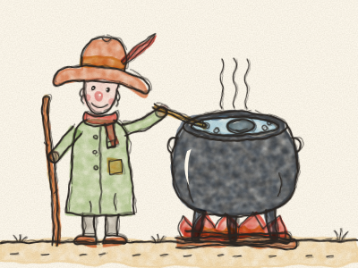
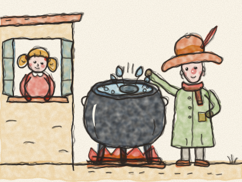
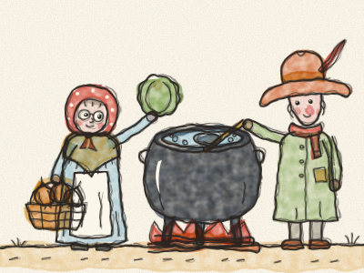
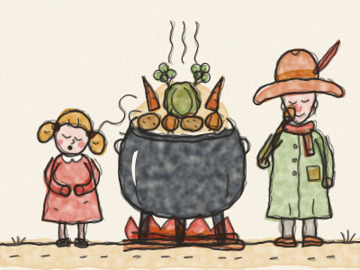
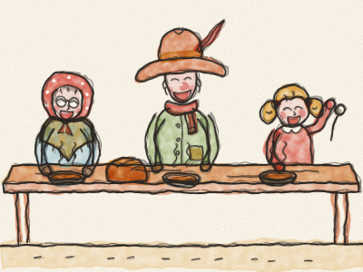

# Stone Soup

Once upon a time, a traveller came walking down a long, long road. He had a floppy hat, a walking stick, a big black pot on his back, and an empty, empty tummy. *Grrrumble!*

At last he came to a little village. “Hello!” he called. “Could anyone spare a little something to eat?”

He knocked at the first door. *Knock, knock!* He knocked at the second door. *Knock, knock!* He knocked at every door in the village.

But the villagers shook their heads. “The harvest was poor this year,” they said. “We have nothing to spare.” And they closed their doors and their shutters. *Clack! Clack! Clack!*

The traveller smiled. “Never mind,” he said. “I shall make my famous stone soup.”

He filled his pot with water from the well and lit a fire in the middle of the village square. Then he took from his pocket a round, smooth, grey stone, and dropped it into the pot. *Plop!*

A little girl peeked out of her window. “What are you making?” she asked.

“Stone soup,” said the traveller, stirring slowly. “The most delicious soup in the world.” He tasted it. “Mmm! Very good. But it would be even better with a carrot or two.”

“I have carrots!” said the little girl, and she ran off to fetch them, as fast as her legs could go. *Tip-tap, tip-tap, tip-tap!*

*Plop, plop!* In went the carrots. The traveller stirred and tasted. “Mmm! Lovely. But an onion would make it perfect.”

By now, the doors of the village were opening, one by one. *Creak… creak… creak…* An old woman came with her basket. “I have some onions,” she said. “And a cabbage too!”

*Plop! Plop!* In went the onions and the cabbage. “Mmm!” said the traveller. “Now, if only we had a few potatoes…”

“Potatoes? I have potatoes!” called the farmer, peeping over his garden gate. He came back with his arms full. *Plop, plop, plop!*

The traveller stirred and stirred. *(Stir the big pot with Constance.)* “Stone soup,” he hummed, “stone soup, the best soup in the world…”

And then everybody wanted to help. The baker brought bread. The miller brought a handful of barley. Someone brought salt, someone brought herbs, and the little girl’s grandmother brought a big bunch of parsley.

The pot bubbled and steamed. *Blub, blub, blub.* A wonderful smell drifted all around the village square. Everyone came out to sniff it. *Sniff, sniff!* *(Sniff together with Constance.)*

“Is it ready yet?” asked the little girl.

“Nearly,” said the traveller. “Be patient. A good soup takes its time.”

At last the traveller tasted the soup one more time. He closed his eyes. “Mmm! Now,” he said, “the stone soup is ready.”

The villagers carried out tables and benches, bowls and spoons. They all sat down together, and they ate, and they laughed, and they had second helpings. Nobody had eaten such a good soup in a long time. The tummies of the whole village were round and warm, and the traveller’s tummy did not grumble any more.

“And to think,” said the little girl, “that it was made from a stone!”

The traveller winked at her. Then he fished the stone out of the pot, wiped it clean, and put it back in his pocket, ready for the next village.

> When everybody brings a little something, there is enough for everyone.
