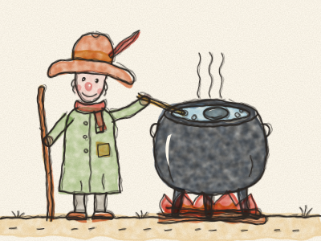
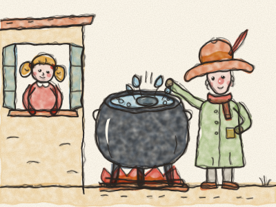
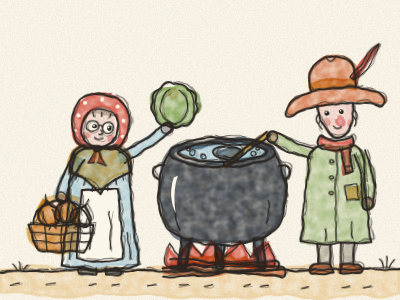
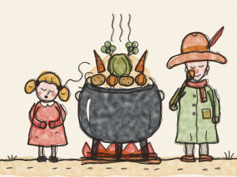
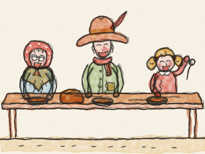

# La Soupe au caillou

Il était une fois un voyageur qui marchait sur une longue, longue route. Il avait un chapeau tout mou, un bâton de marche, une grande marmite noire sur le dos, et le ventre vide, tout vide. *Grrrouuu !*

Enfin, il arriva dans un petit village. « Bonjour ! » lança-t-il. « Quelqu’un aurait-il un petit quelque chose à manger ? »

Il frappa à la première porte. *Toc, toc !* Il frappa à la deuxième porte. *Toc, toc !* Il frappa à toutes les portes du village.

Mais les villageois secouèrent la tête. « La récolte a été mauvaise cette année », dirent-ils. « Nous n’avons rien à donner. » Et ils fermèrent leurs portes et leurs volets. *Clac ! Clac ! Clac !*

Le voyageur sourit. « Tant pis », dit-il. « Je vais préparer ma fameuse soupe au caillou. »

Il remplit sa marmite d’eau au puits et alluma un feu au milieu de la place du village. Puis il sortit de sa poche un caillou rond, lisse et gris, et le laissa tomber dans la marmite. *Plouf !*

Une petite fille passa le nez à sa fenêtre. « Qu’est-ce que vous faites ? » demanda-t-elle.

« De la soupe au caillou », répondit le voyageur en remuant doucement. « La soupe la plus délicieuse du monde. » Il goûta. « Mmm ! Très bonne. Mais elle serait encore meilleure avec une carotte ou deux. »

« J’ai des carottes ! » dit la petite fille, et elle courut les chercher aussi vite que ses jambes le pouvaient. *Tip-tap, tip-tap, tip-tap !*

*Plouf, plouf !* Les carottes tombèrent dans la marmite. Le voyageur remua et goûta. « Mmm ! Délicieux. Mais un oignon la rendrait parfaite. »

À présent, les portes du village s’ouvraient, une à une. *Crrr… crrr… crrr…* Une vieille dame arriva avec son panier. « J’ai des oignons », dit-elle. « Et un chou aussi ! »

*Plouf ! Plouf !* Les oignons et le chou tombèrent dans la marmite. « Mmm ! » dit le voyageur. « Ah, si seulement nous avions quelques pommes de terre… »

« Des pommes de terre ? J’en ai ! » cria le fermier, par-dessus la barrière de son potager. Il revint les bras chargés. *Plouf, plouf, plouf !*

Le voyageur remua, et remua encore. *(Tournez la grande cuillère avec Constance.)* « Soupe au caillou », chantonnait-il, « soupe au caillou, la meilleure soupe du monde… »

Et alors, tout le monde voulut aider. Le boulanger apporta du pain. Le meunier apporta une poignée d’orge. Quelqu’un apporta du sel, quelqu’un apporta des herbes, et la grand-mère de la petite fille apporta un gros bouquet de persil.

La marmite bouillonnait et fumait. *Blob, blob, blob.* Une odeur merveilleuse flottait sur toute la place du village. Tout le monde sortit pour la sentir. *Snif, snif !* *(Reniflez avec Constance.)*

« C’est bientôt prêt ? » demanda la petite fille.

« Presque », dit le voyageur. « Patience. Une bonne soupe prend son temps. »

Enfin, le voyageur goûta la soupe une dernière fois. Il ferma les yeux. « Mmm ! Voilà », dit-il, « la soupe au caillou est prête. »

Les villageois sortirent des tables et des bancs, des bols et des cuillères. Ils s’assirent tous ensemble, et ils mangèrent, et ils rirent, et ils se resservirent. Personne n’avait mangé une soupe aussi bonne depuis bien longtemps. Les ventres de tout le village étaient ronds et bien chauds, et celui du voyageur ne gargouillait plus du tout.

« Et dire », s’écria la petite fille, « qu’elle était faite avec un caillou ! »

Le voyageur lui fit un clin d’œil. Puis il repêcha le caillou dans la marmite, l’essuya bien, et le remit dans sa poche, prêt pour le prochain village.

> Quand chacun apporte un petit quelque chose, il y en a assez pour tout le monde.
