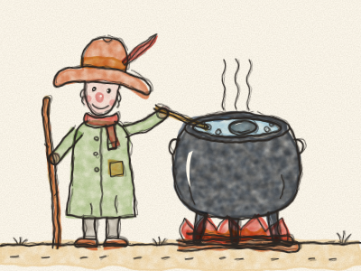
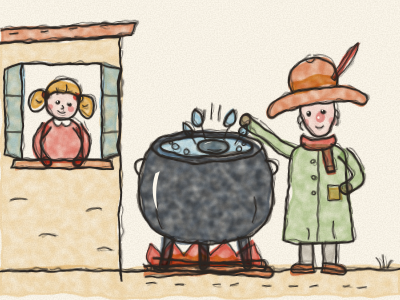
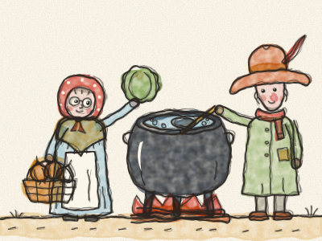
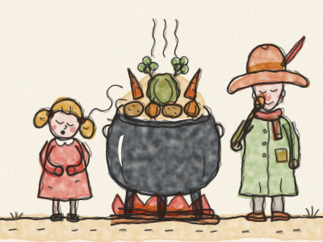
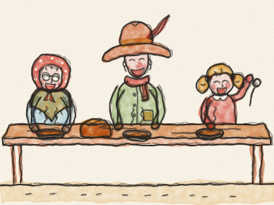

# A Sopa de Pedra

Era uma vez um viajante que caminhava por uma estrada muito, muito comprida. Tinha um chapéu molengão, um cajado, uma grande panela preta às costas e a barriga vazia, muito vazia. *Grrrum!*

Por fim, chegou a uma pequena aldeia. — Olá! — chamou ele. — Alguém me pode dar qualquer coisinha para comer?

Bateu à primeira porta. *Toc, toc!* Bateu à segunda porta. *Toc, toc!* Bateu a todas as portas da aldeia.

Mas os aldeões abanaram a cabeça. — A colheita foi má este ano — disseram. — Não temos nada para dar. — E fecharam as portas e as janelas. *Clac! Clac! Clac!*

O viajante sorriu. — Não faz mal — disse ele. — Vou fazer a minha famosa sopa de pedra.

Encheu a panela com água do poço e acendeu uma fogueira no meio do largo da aldeia. Depois tirou do bolso uma pedra redonda, lisa e cinzenta, e deixou-a cair na panela. *Plof!*

Uma menina espreitou à janela. — O que está a fazer? — perguntou.

— Sopa de pedra — respondeu o viajante, a mexer devagarinho. — A sopa mais deliciosa do mundo. — Provou-a. — Hum! Muito boa. Mas ainda ficava melhor com uma cenoura ou duas.

— Eu tenho cenouras! — disse a menina, e foi buscá-las a correr, o mais depressa que as pernas lhe permitiam. *Tip-tap, tip-tap, tip-tap!*

*Plof, plof!* Lá para dentro foram as cenouras. O viajante mexeu e provou. — Hum! Que bom. Mas uma cebola deixava-a perfeita.

Entretanto, as portas da aldeia iam-se abrindo, uma a uma. *Nhec… nhec… nhec…* Uma senhora idosa chegou com o seu cesto. — Eu tenho cebolas — disse ela. — E também uma couve!

*Plof! Plof!* Lá para dentro foram as cebolas e a couve. — Hum! — disse o viajante. — Ah, se ao menos tivéssemos umas batatas…

— Batatas? Eu tenho batatas! — gritou o lavrador, por cima do portão da horta. Voltou com os braços cheios. *Plof, plof, plof!*

O viajante mexeu, e mexeu mais. *(Mexam a grande panela com a Constance.)* — Sopa de pedra — cantarolava ele —, sopa de pedra, a melhor sopa do mundo…

E então toda a gente quis ajudar. O padeiro trouxe pão. O moleiro trouxe uma mão-cheia de cevada. Alguém trouxe sal, alguém trouxe ervas, e a avó da menina trouxe um grande ramo de salsa.

A panela borbulhava e fumegava. *Blub, blub, blub.* Um cheirinho maravilhoso espalhou-se por todo o largo da aldeia. Toda a gente saiu à rua para o cheirar. *Snif, snif!* *(Cheirem com a Constance.)*

— Já está pronta? — perguntou a menina.

— Quase — disse o viajante. — Paciência. Uma boa sopa leva o seu tempo.

Por fim, o viajante provou a sopa uma última vez. Fechou os olhos. — Hum! Agora sim — disse ele —, a sopa de pedra está pronta.

Os aldeões trouxeram mesas e bancos, tigelas e colheres. Sentaram-se todos juntos, e comeram, e riram, e repetiram. Ninguém comia uma sopa tão boa há muito tempo. As barrigas da aldeia inteira ficaram redondas e quentinhas, e a barriga do viajante deixou de roncar.

— E pensar — disse a menina — que foi feita com uma pedra!

O viajante piscou-lhe o olho. Depois tirou a pedra da panela, limpou-a bem e voltou a guardá-la no bolso, pronta para a próxima aldeia.

> Quando cada um traz uma coisinha, há que chegue para todos.
