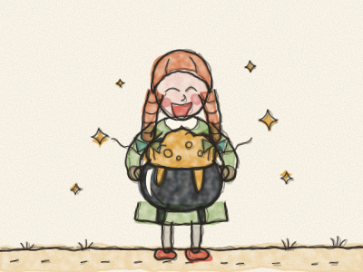
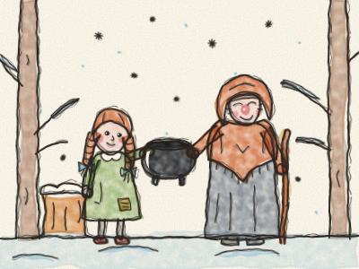
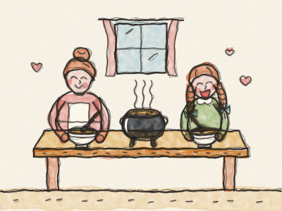
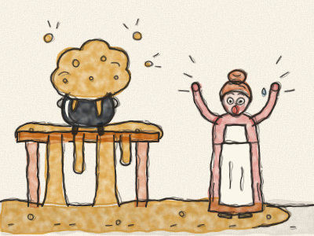
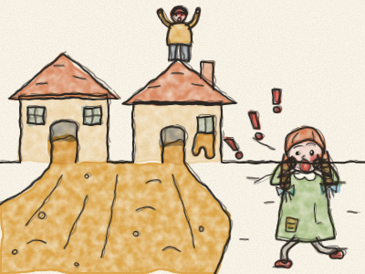

# Sweet Porridge

Once upon a time, a little girl lived with her mother in a tiny house at the edge of a town. They were very poor. One morning, they looked in the cupboard, and there was nothing to eat. Not a crust. Not a crumb. *Grrrumble*, went the little girl’s tummy.

“I’ll go to the wood,” said the little girl. “Perhaps I can find some berries.” She took her basket, and off she went. *Tip-tap, tip-tap.*

In the wood, she looked under every bush and behind every tree. But it was winter, and there were no berries at all. So she sat down on an old tree stump, and she felt very sad.

Just then, an old woman came along the path, leaning on her stick. “Why so sad, little one?” she asked.

“My mother and I have nothing to eat,” said the little girl.

The old woman smiled. From under her shawl, she took a little black pot. “This is a magic pot,” she said. “Put it on the table and say: *Cook, little pot, cook!* And it will cook you sweet, warm porridge. When you have enough, say: *Stop, little pot!* And it will stop. Can you remember that?”

“Cook, little pot, cook. Stop, little pot,” said the little girl. “Thank you!” And she ran home as fast as she could.

At home, she put the pot on the table. “Cook, little pot, cook!” she said. *Blub, blub, blub!* The pot filled up with sweet, golden porridge, warm and smelling of honey. *(Sniff! Mmm!)*

“Stop, little pot!” said the little girl. And the pot stopped.

Her mother could hardly believe her eyes. They filled their bowls and ate, and ate, until their tummies were round and full. From that day on, they were never hungry again. Every morning and every evening, the little pot cooked, and every time, the little girl said: “Stop, little pot!”

One day, the little girl went out to visit her granny. Her mother felt hungry. She put the pot on the table and said: “Cook, little pot, cook!” *Blub, blub, blub!* And the pot cooked.

She filled her bowl and ate. “That’s enough now,” she said. “Erm… Halt, little pot? No… Enough, little pot? No…” She had forgotten the words!

*Blub, blub, blub!* The porridge rose over the top of the pot. It spilled over the table. It ran across the kitchen floor. It filled the kitchen. It filled the whole house! *Splodge, splodge!*

“Oh dear, oh dear!” cried the mother. “Stop! Please stop! Enough!” But the pot did not listen. It only knew the right words.

The porridge poured out of the door and into the street. It ran into the next house, and the next, and the next, as if it wanted to feed the whole world. People climbed onto their roofs. “What is happening?” they cried.

Just then, the little girl came home. She saw the river of porridge, and she knew at once. She cupped her hands round her mouth and called, as loud as she could: “STOP, LITTLE POT!”

And the pot stopped. *Blub.*

But what a mess! Anyone who wanted to cross the town that day had to eat their way through. *Slurp, slurp, slurp!* And everyone agreed it was the most delicious mess they had ever seen.

> Good things are best when we know when to say “Stop!”
