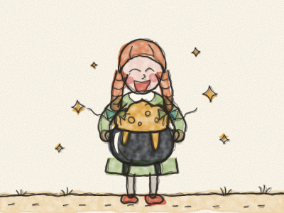
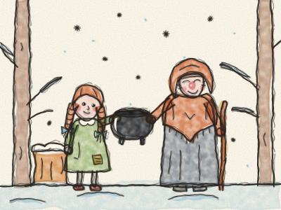
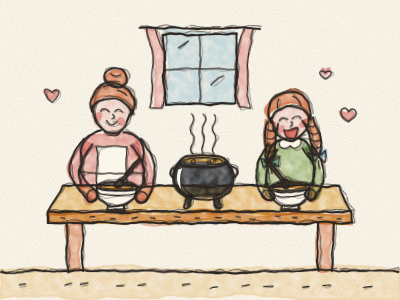
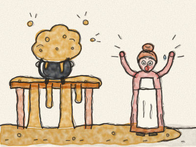
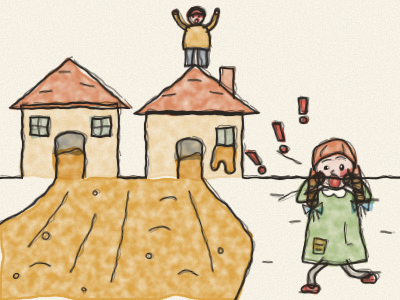

# La Bouillie sucrée

Il était une fois une petite fille qui vivait avec sa maman dans une toute petite maison, au bord d’une ville. Elles étaient très pauvres. Un matin, elles regardèrent dans le placard, et il n’y avait rien à manger. Pas une croûte. Pas une miette. *Grrrrou*, fit le ventre de la petite fille.

« Je vais aller dans le bois, dit la petite fille. Je trouverai peut-être des baies. » Elle prit son panier et partit. *Trip-trap, trip-trap.*

Dans le bois, elle regarda sous chaque buisson et derrière chaque arbre. Mais c’était l’hiver, et il n’y avait pas une seule baie. Alors elle s’assit sur une vieille souche, et elle se sentit très triste.

Juste à ce moment-là, une vieille femme arriva sur le chemin, appuyée sur son bâton. « Pourquoi es-tu si triste, ma petite ? » demanda-t-elle.

« Maman et moi, nous n’avons rien à manger », dit la petite fille.

La vieille femme sourit. De dessous son châle, elle sortit une petite marmite noire. « C’est une marmite magique, dit-elle. Pose-la sur la table et dis : *Petite marmite, cuis !* Et elle te fera une bonne bouillie chaude et sucrée. Quand tu en auras assez, dis : *Petite marmite, arrête !* Et elle s’arrêtera. Tu t’en souviendras ? »

« Petite marmite, cuis. Petite marmite, arrête, répéta la petite fille. Merci ! » Et elle rentra chez elle en courant, aussi vite qu’elle put.

À la maison, elle posa la marmite sur la table. « Petite marmite, cuis ! » dit-elle. *Blob, blob, blob !* La marmite se remplit d’une bouillie dorée et sucrée, toute chaude, qui sentait bon le miel. *(Renifle ! Mmm !)*

« Petite marmite, arrête ! » dit la petite fille. Et la marmite s’arrêta.

Sa maman n’en croyait pas ses yeux. Elles remplirent leurs bols et mangèrent, et mangèrent, jusqu’à avoir le ventre bien rond et bien plein. À partir de ce jour-là, elles n’eurent plus jamais faim. Chaque matin et chaque soir, la petite marmite cuisait, et chaque fois, la petite fille disait : « Petite marmite, arrête ! »

Un jour, la petite fille partit voir sa mamie. Sa maman eut faim. Elle posa la marmite sur la table et dit : « Petite marmite, cuis ! » *Blob, blob, blob !* Et la marmite cuisit.

Elle remplit son bol et mangea. « Ça suffit, maintenant, dit-elle. Euh… Petite marmite, halte ? Non… Petite marmite, assez ? Non… » Elle avait oublié les mots !

*Blob, blob, blob !* La bouillie monta par-dessus le bord de la marmite. Elle coula sur la table. Elle s’étala sur le sol de la cuisine. Elle remplit la cuisine. Elle remplit toute la maison ! *Splotch, splotch !*

« Oh là là, oh là là ! s’écria la maman. Stop ! S’il te plaît, arrête ! Assez ! » Mais la marmite n’écoutait pas. Elle ne connaissait que les bons mots.

La bouillie sortit par la porte et coula dans la rue. Elle entra dans la maison d’à côté, et dans la suivante, et dans la suivante, comme si elle voulait nourrir le monde entier. Les gens grimpèrent sur leurs toits. « Que se passe-t-il ? » criaient-ils.

Juste à ce moment-là, la petite fille rentra. Elle vit la rivière de bouillie, et elle comprit tout de suite. Elle mit ses mains autour de sa bouche et cria, aussi fort qu’elle put : « PETITE MARMITE, ARRÊTE ! »

Et la marmite s’arrêta. *Blob.*

Mais quel désordre ! Ce jour-là, tous ceux qui voulaient traverser la ville durent manger leur chemin. *Slurp, slurp, slurp !* Et tout le monde dit que c’était le désordre le plus délicieux qu’on ait jamais vu.

> Les bonnes choses sont meilleures quand on sait dire : « Arrête ! »
