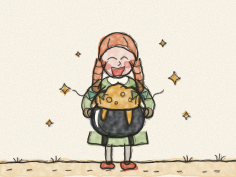
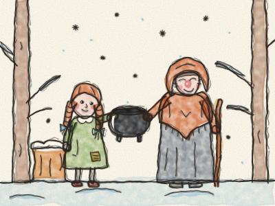
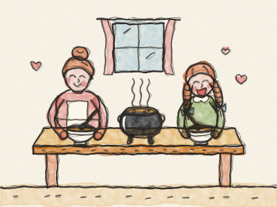
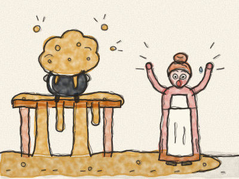
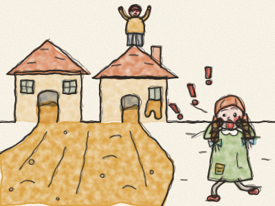

# A Panelinha das Papas Doces

Era uma vez uma menina que vivia com a mãe numa casinha muito pequenina, à beira de uma cidade. Eram muito pobres. Uma manhã, foram ver ao armário, e não havia nada para comer. Nem uma côdea. Nem uma migalha. *Grrrrum*, fez a barriga da menina.

— Vou ao bosque — disse a menina. — Talvez encontre umas bagas. — Pegou no cesto e lá foi ela. *Tip-tap, tip-tap.*

No bosque, procurou debaixo de cada arbusto e atrás de cada árvore. Mas era inverno, e não havia baga nenhuma. Então sentou-se num velho tronco cortado e ficou muito triste.

Nesse momento, apareceu no caminho uma velhinha, apoiada na sua bengala. — Porque estás tão triste, pequenina? — perguntou ela.

— A minha mãe e eu não temos nada para comer — disse a menina.

A velhinha sorriu. De debaixo do xaile, tirou uma panelinha preta. — Esta é uma panela mágica — disse ela. — Põe-na em cima da mesa e diz: *Coze, panelinha, coze!* E ela coze-te umas papas doces e quentinhas. Quando tiveres que chegue, diz: *Para, panelinha!* E ela para. Consegues lembrar-te?

— Coze, panelinha, coze. Para, panelinha — repetiu a menina. — Obrigada! — E correu para casa o mais depressa que pôde.

Em casa, pôs a panela em cima da mesa. — Coze, panelinha, coze! — disse ela. *Blub, blub, blub!* A panela encheu-se de papas douradas e doces, quentinhas e a cheirar a mel. *(Snif! Hum!)*

— Para, panelinha! — disse a menina. E a panela parou.

A mãe nem queria acreditar no que via. Encheram as tigelas e comeram, e comeram, até ficarem com a barriga redondinha e cheia. A partir desse dia, nunca mais passaram fome. Todas as manhãs e todas as noites, a panelinha cozia, e todas as vezes a menina dizia: — Para, panelinha!

Um dia, a menina foi visitar a avó. A mãe ficou com fome. Pôs a panela em cima da mesa e disse: — Coze, panelinha, coze! *Blub, blub, blub!* E a panela cozeu.

Encheu a tigela e comeu. — Agora já chega — disse ela. — Hum… Alto, panelinha? Não… Basta, panelinha? Não… — Tinha-se esquecido das palavras!

*Blub, blub, blub!* As papas subiram por cima da borda da panela. Escorreram pela mesa. Espalharam-se pelo chão da cozinha. Encheram a cozinha. Encheram a casa toda! *Splash, splash!*

— Ai, meu Deus, ai, meu Deus! — gritou a mãe. — Para! Por favor, para! Basta! — Mas a panela não ouvia. Só conhecia as palavras certas.

As papas saíram pela porta e escorreram para a rua. Entraram na casa ao lado, e na seguinte, e na seguinte, como se quisessem dar de comer ao mundo inteiro. As pessoas subiram para os telhados. — O que é que se passa? — gritavam.

Nesse momento, a menina chegou a casa. Viu o rio de papas e percebeu logo. Pôs as mãos à volta da boca e gritou, o mais alto que pôde: — PARA, PANELINHA!

E a panela parou. *Blub.*

Mas que grande trapalhada! Nesse dia, quem quisesse atravessar a cidade tinha de abrir caminho a comer. *Slurp, slurp, slurp!* E toda a gente concordou que era a trapalhada mais deliciosa que alguma vez tinham visto.

> As coisas boas sabem melhor quando sabemos dizer: «Para!»
