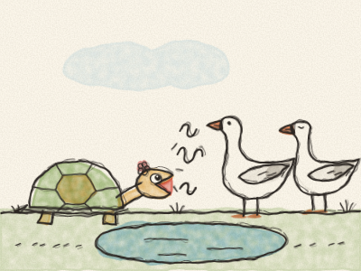
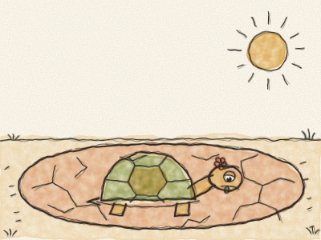
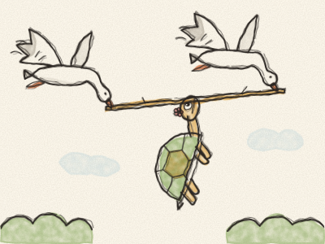
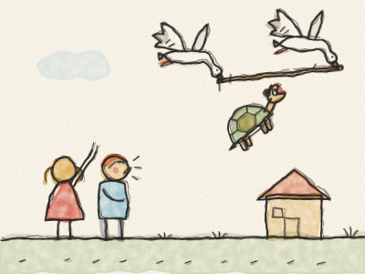
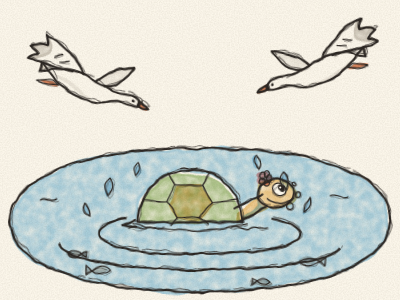

# The Talkative Tortoise

Once upon a time, in a little pond, there lived a Tortoise who loved to talk. She talked in the morning. She talked at lunchtime. She talked at night, until the frogs said, “Shh! We’re trying to sleep!” *Blah, blah, blah, blah, blah.*

Her best friends were two white Geese. Every day they came to the pond, and every day the Tortoise told them everything. “Good morning! Did you see the clouds? Did you hear the frogs? Do you like my shell? I polished it!”

The Geese only smiled. “Honk,” said one. “Honk,” said the other. They could hardly get a word in.

Then one summer, the sun shone and shone, and no rain came at all. Day after day the pond got smaller… and smaller… and smaller, until there was nothing left but dry, cracked mud.

“Oh dear,” said the Tortoise. And for once, she didn’t say anything else.

“Don’t be sad,” said the Geese. “Over the hills there is a big blue lake, full of cool water. We are flying there tomorrow. Come with us!”

“But I can’t fly,” said the Tortoise. “I haven’t got wings. I’ve got a shell. And short legs. And—”

“We have a plan,” said the Geese.

The next morning they brought a long, strong stick. “We will each hold one end in our beaks,” they said. “You hold on to the middle with your mouth. Bite hard, and we will carry you all the way to the lake. But listen carefully: whatever happens, do not open your mouth. Not one word!”

“Not one word,” said the Tortoise. “I promise. I won’t say anything at all. Not a squeak. Not a—”

“Shh!” said the Geese.

The Tortoise bit the stick. *Crunch.* The Geese flapped their wings. *Flap, flap, flap!* And up, up, up they went, over the trees, with the Tortoise swinging in the middle like a little round lantern.

Oh, it was wonderful! The Tortoise could see the fields, the cows and the rooftops. She wanted to say “How beautiful!” She wanted to say “Look at that cow!” But she kept her mouth shut. *Mmm-mmm.*

Then they flew over a village. The children looked up and pointed. “Look! A flying tortoise! Ha ha ha! How silly she looks!”

The Tortoise felt very cross. Silly? SHE wasn’t silly! She had to tell them. She just had to. She opened her mouth and said, “I am NOT sil—”

And — *whoops!* — she let go of the stick. *Down, down, down* she tumbled. *(Oh no!)*

But luck was with her. Right below was the big blue lake. *SPLOOSH!* The Tortoise landed in the soft, cool water, bobbed up again, and blinked. All around her the water was cool and blue, and full of tiny silver fish. *Bubble, bubble.* It was the most beautiful lake she had ever seen.

The Geese came gliding down beside her. “Are you all right?”

The Tortoise opened her mouth to say a hundred things. Then she closed it again. She just smiled and nodded. *Nod, nod.* For once, she didn’t need any words at all.

> Sometimes the cleverest thing to say is nothing at all.
