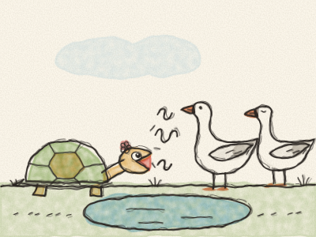
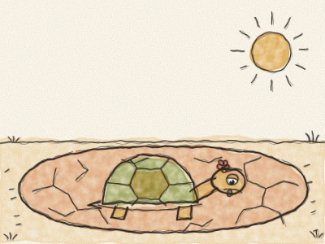
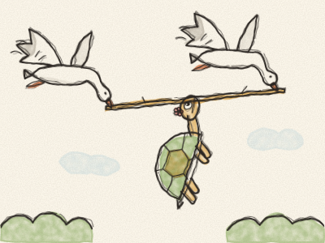
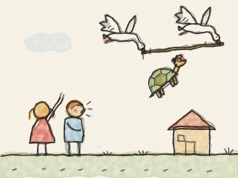
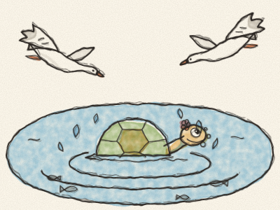

# La Tortue bavarde

Il était une fois, dans une petite mare, une Tortue qui adorait parler. Elle parlait le matin. Elle parlait à midi. Elle parlait le soir, si bien que les grenouilles disaient : « Chut ! On essaie de dormir ! » *Bla, bla, bla, bla, bla.*

Ses meilleures amies étaient deux Oies blanches. Chaque jour, elles venaient à la mare, et chaque jour, la Tortue leur racontait tout. « Bonjour ! Vous avez vu les nuages ? Vous avez entendu les grenouilles ? Elle vous plaît, ma carapace ? Je l’ai fait briller ! »

Les Oies souriaient, c’est tout. « Couac », disait l’une. « Couac », disait l’autre. Elles n’arrivaient presque pas à placer un mot.

Puis un été, le soleil brilla, brilla, et il ne tomba pas une goutte de pluie. Jour après jour, la mare devint plus petite… et plus petite… et plus petite, jusqu’à ce qu’il ne reste plus que de la boue sèche et craquelée.

« Oh là là », dit la Tortue. Et pour une fois, elle ne dit rien d’autre.

« Ne sois pas triste », dirent les Oies. « De l’autre côté des collines, il y a un grand lac bleu, plein d’eau fraîche. Nous nous envolons demain. Viens avec nous ! »

« Mais je ne sais pas voler », dit la Tortue. « Je n’ai pas d’ailes. J’ai une carapace. Et des petites pattes. Et… »

« Nous avons un plan », dirent les Oies.

Le lendemain matin, elles apportèrent un long bâton bien solide. « Chacune de nous tiendra un bout dans son bec », dirent-elles. « Toi, tu tiens le milieu avec ta bouche. Mords bien fort, et nous t’emporterons jusqu’au lac. Mais écoute bien : quoi qu’il arrive, n’ouvre pas la bouche. Pas un mot ! »

« Pas un mot », dit la Tortue. « Promis. Je ne dirai rien du tout. Pas un couinement. Pas un… »

« Chut ! » dirent les Oies.

La Tortue mordit le bâton. *Crac.* Les Oies battirent des ailes. *Flap, flap, flap !* Et elles montèrent, montèrent, montèrent, au-dessus des arbres, avec la Tortue qui se balançait au milieu comme une petite lanterne ronde.

Oh, que c’était merveilleux ! La Tortue voyait les champs, les vaches et les toits. Elle avait envie de dire : « Comme c’est beau ! » Elle avait envie de dire : « Regardez cette vache ! » Mais elle garda la bouche fermée. *Mmm-mmm.*

Puis elles survolèrent un village. Les enfants levèrent la tête et pointèrent le doigt. « Regardez ! Une tortue volante ! Ha ha ha ! Qu’elle a l’air bête ! »

La Tortue se fâcha tout rouge. Bête ? ELLE n’était pas bête ! Il fallait le leur dire. Il le fallait absolument. Elle ouvrit la bouche et dit : « Je ne suis PAS bê… »

Et — *oups !* — elle lâcha le bâton. Elle tomba, *tomba, tomba*. *(Oh non !)*

Mais elle avait de la chance. Juste en dessous, il y avait le grand lac bleu. *PLOUF !* La Tortue tomba dans l’eau douce et fraîche, remonta à la surface et cligna des yeux. Tout autour d’elle, l’eau était fraîche et bleue, pleine de petits poissons argentés. *Blop, blop.* C’était le plus beau lac qu’elle ait jamais vu.

Les Oies descendirent en planant à côté d’elle. « Ça va ? »

La Tortue ouvrit la bouche pour dire cent choses. Puis elle la referma. Elle sourit simplement et hocha la tête. *Oui, oui.* Pour une fois, elle n’avait besoin d’aucun mot.

> Parfois, la chose la plus sage à dire, c’est de ne rien dire du tout.
