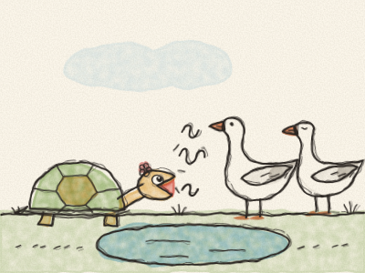
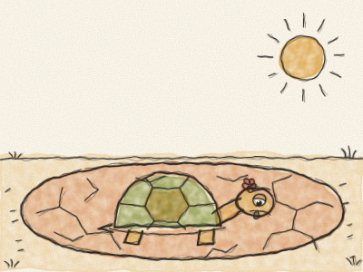
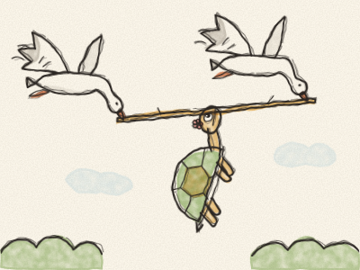
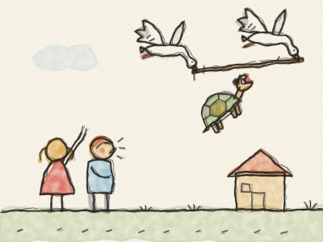
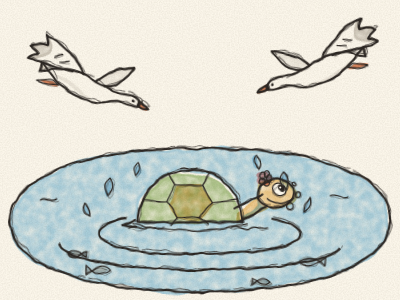

# A Tartaruga Tagarela

Era uma vez, num pequeno charco, uma Tartaruga que adorava falar. Falava de manhã. Falava ao almoço. Falava à noite, até as rãs dizerem: — Chiu! Estamos a tentar dormir! *Blá, blá, blá, blá, blá.*

Os seus melhores amigos eram dois Gansos brancos. Todos os dias vinham ao charco, e todos os dias a Tartaruga lhes contava tudo. — Bom dia! Viram as nuvens? Ouviram as rãs? Gostam da minha carapaça? Pu-la a brilhar!

Os Gansos só sorriam. — Quá — dizia um. — Quá — dizia o outro. Mal conseguiam dizer uma palavra.

Até que, num verão, o sol brilhou, brilhou, e não caiu nem uma gota de chuva. Dia após dia, o charco ficou mais pequeno… e mais pequeno… e mais pequeno, até só restar lama seca e gretada.

— Ai, ai — disse a Tartaruga. E, pela primeira vez, não disse mais nada.

— Não fiques triste — disseram os Gansos. — Do outro lado dos montes há um grande lago azul, cheio de água fresquinha. Vamos voar para lá amanhã. Vem connosco!

— Mas eu não sei voar — disse a Tartaruga. — Não tenho asas. Tenho uma carapaça. E perninhas curtas. E…

— Temos um plano — disseram os Gansos.

Na manhã seguinte, trouxeram um pau comprido e forte. — Cada um de nós segura numa ponta com o bico — disseram eles. — Tu seguras o meio com a boca. Morde com força, e levamos-te até ao lago. Mas ouve bem: aconteça o que acontecer, não abras a boca. Nem uma palavra!

— Nem uma palavra — disse a Tartaruga. — Prometo. Não digo nada de nada. Nem um pio. Nem um…

— Chiu! — disseram os Gansos.

A Tartaruga mordeu o pau. *Crac.* Os Gansos bateram as asas. *Flap, flap, flap!* E subiram, subiram, subiram, por cima das árvores, com a Tartaruga a baloiçar no meio como uma pequena lanterna redonda.

Ai, que maravilha! A Tartaruga via os campos, as vacas e os telhados. Apetecia-lhe dizer: «Que bonito!» Apetecia-lhe dizer: «Olhem aquela vaca!» Mas manteve a boca fechada. *Mmm-mmm.*

Depois, voaram por cima de uma aldeia. As crianças olharam para cima e apontaram. — Olhem! Uma tartaruga a voar! Ah, ah, ah! Que cara mais tonta!

A Tartaruga ficou muito zangada. Tonta? ELA não era tonta! Tinha de lhes dizer. Tinha mesmo de lhes dizer. Abriu a boca e disse: — Eu NÃO sou ton…

E — *ups!* — largou o pau. *Lá foi ela, por ali abaixo, abaixo, abaixo.* *(Oh, não!)*

Mas teve sorte. Mesmo por baixo estava o grande lago azul. *CHAPE!* A Tartaruga caiu na água macia e fresca, voltou à superfície e pestanejou. À volta dela, a água era fresca e azul, cheia de peixinhos prateados. *Blup, blup.* Era o lago mais bonito que alguma vez tinha visto.

Os Gansos desceram a planar ao lado dela. — Estás bem?

A Tartaruga abriu a boca para dizer cem coisas. Depois fechou-a outra vez. Limitou-se a sorrir e a acenar com a cabeça. *Sim, sim.* Pela primeira vez, não precisou de palavra nenhuma.

> Às vezes, a coisa mais esperta a dizer é não dizer nada.
