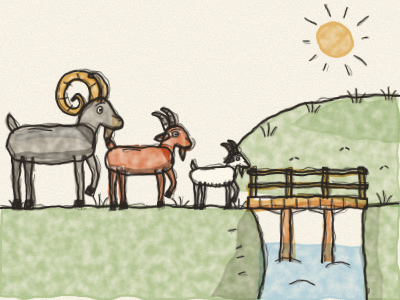
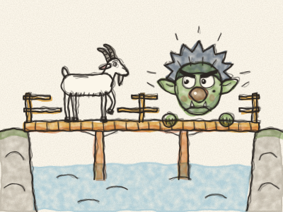
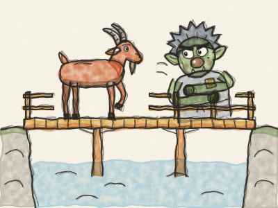
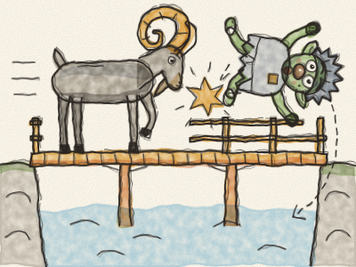
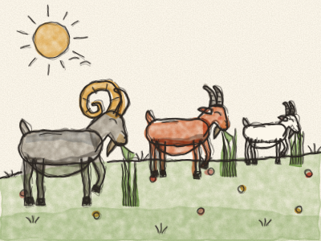

# The Three Billy Goats Gruff

Once upon a time, there were three billy goats, and they were all called Gruff. There was a Little Billy Goat Gruff, a Middle-sized Billy Goat Gruff, and a Great Big Billy Goat Gruff.

They lived in a valley where the grass was short and dry. But across the river, there was a hill covered in long, sweet, juicy green grass. “Mmm,” said the three goats. “Let’s go over there and eat and eat until we’re nice and fat!”

To get there, they had to cross a little wooden bridge. And under the bridge lived a grumpy old Troll, with eyes as big as saucers and a nose as long as a broom handle.

First came the Little Billy Goat Gruff. *Trip, trap! Trip, trap!* went his little hooves on the bridge.

“WHO’S THAT TRIP-TRAPPING OVER MY BRIDGE?” roared the Troll.

“Oh, it’s only me, the Little Billy Goat Gruff,” said the goat, in a tiny little voice. *(Do a tiny voice.)* “I’m going up the hill to eat some grass.”

“Well, I’m coming to gobble you up!” said the Troll.

“Oh no, please don’t! I’m much too little,” said the Little Billy Goat Gruff. “Wait for my brother. He’s much bigger than me.”

“Hmm,” said the Troll. “Bigger, you say? Very well. Off you go!”

A little later came the Middle-sized Billy Goat Gruff. *Trip, trap! Trip, trap!* went his hooves on the bridge.

“WHO’S THAT TRIP-TRAPPING OVER MY BRIDGE?” roared the Troll.

“It’s me, the Middle-sized Billy Goat Gruff,” said the goat, in a middle-sized voice. “I’m going up the hill to eat some grass.”

“Well, I’m coming to gobble you up!” said the Troll.

“Oh no, don’t do that,” said the goat. “Wait for my big brother. He’s much, MUCH bigger than me.”

The Troll licked his lips. “Bigger still? Very well. Off you go!”

Then came the Great Big Billy Goat Gruff. *TRIP, TRAP! TRIP, TRAP!* went his great big hooves, and the whole bridge creaked and groaned under him.

“WHO’S THAT TRIP-TRAPPING OVER MY BRIDGE?” roared the Troll.

“IT’S ME! THE GREAT BIG BILLY GOAT GRUFF!” said the goat, in a great big voice. *(Do your biggest, deepest voice.)*

“Well, I’m coming to gobble you up!” said the Troll, and he climbed onto the bridge.

But the Great Big Billy Goat Gruff lowered his two big curly horns, and he ran, and — *BUMP!* — he tossed that Troll high up into the air. Up, up he went, and down, down he came — *SPLASH!* — into the river.

The river carried the grumpy Troll far, far away, *bobbing and spluttering*, and he never came back to that bridge again.

As for the three Billy Goats Gruff, they trotted up the hill and ate and ate the sweet green grass, until they were so fat they could hardly walk home. *Munch, munch, munch.*

And if they haven’t grown thin again, why, they’re still fat now. *Snip, snap, snout, this tale’s told out!*

> A clever little idea can get you past a big grumpy troll — and being greedy can leave you with nothing at all.
