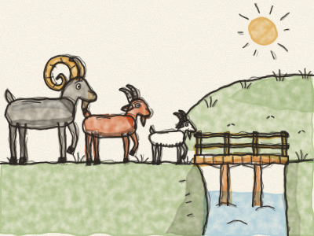
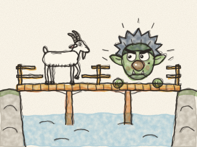
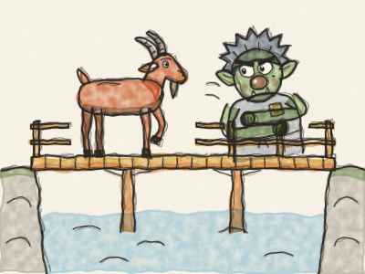
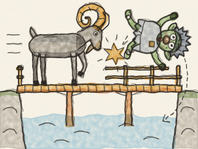
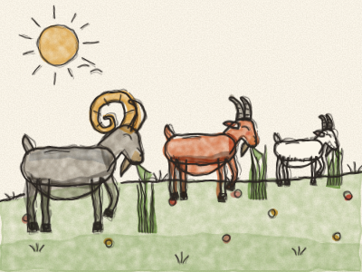

# Les Trois Boucs Bourru

Il était une fois trois boucs, et ils s’appelaient tous Bourru. Il y avait le Petit Bouc Bourru, le Moyen Bouc Bourru et le Gros Bouc Bourru.

Ils vivaient dans une vallée où l’herbe était courte et sèche. Mais de l’autre côté de la rivière, il y avait une colline couverte d’une herbe longue, verte, tendre et délicieuse. « Miam », dirent les trois boucs. « Allons là-bas manger, manger, jusqu’à devenir bien gros ! »

Pour y aller, il fallait traverser un petit pont de bois. Et sous le pont vivait un vieux Troll grognon, avec des yeux grands comme des soucoupes et un nez long comme un manche à balai.

Le premier à passer fut le Petit Bouc Bourru. *Trip, trap ! Trip, trap !* firent ses petits sabots sur le pont.

« QUI FAIT TRIP-TRAP SUR MON PONT ? » rugit le Troll.

« Oh, ce n’est que moi, le Petit Bouc Bourru », dit le bouc d’une toute petite voix. *(Faites une toute petite voix.)* « Je monte sur la colline pour manger de l’herbe. »

« Eh bien, je vais te croquer tout cru ! » dit le Troll.

« Oh non, s’il vous plaît ! Je suis bien trop petit », dit le Petit Bouc Bourru. « Attendez plutôt mon frère. Il est beaucoup plus gros que moi. »

« Hum », dit le Troll. « Plus gros, tu dis ? Très bien. File ! »

Un peu plus tard arriva le Moyen Bouc Bourru. *Trip, trap ! Trip, trap !* firent ses sabots sur le pont.

« QUI FAIT TRIP-TRAP SUR MON PONT ? » rugit le Troll.

« C’est moi, le Moyen Bouc Bourru », dit le bouc d’une voix moyenne. « Je monte sur la colline pour manger de l’herbe. »

« Eh bien, je vais te croquer tout cru ! » dit le Troll.

« Oh non, ne faites pas ça », dit le bouc. « Attendez mon grand frère. Il est beaucoup, BEAUCOUP plus gros que moi. »

Le Troll se lécha les babines. « Encore plus gros ? Très bien. File ! »

Alors arriva le Gros Bouc Bourru. *TRIP, TRAP ! TRIP, TRAP !* firent ses énormes sabots, et tout le pont craqua et gémit sous son poids.

« QUI FAIT TRIP-TRAP SUR MON PONT ? » rugit le Troll.

« C’EST MOI ! LE GROS BOUC BOURRU ! » dit le bouc d’une très grosse voix. *(Faites votre voix la plus grosse et la plus grave.)*

« Eh bien, je vais te croquer tout cru ! » dit le Troll, et il grimpa sur le pont.

Mais le Gros Bouc Bourru baissa ses deux grandes cornes recourbées, il prit son élan, et — *BOUM !* — il envoya le Troll tout en haut dans les airs. Il monta, monta, puis il redescendit, descendit — *PLOUF !* — dans la rivière.

La rivière emporta le Troll grognon très, très loin, *en barbotant et en crachotant*, et il ne revint plus jamais sous ce pont.

Quant aux trois Boucs Bourru, ils montèrent sur la colline au petit trot et mangèrent, mangèrent l’herbe tendre et verte, jusqu’à être si gros qu’ils pouvaient à peine rentrer chez eux. *Crunch, crunch, crunch.*

Et s’ils n’ont pas maigri depuis, eh bien, ils sont encore gros aujourd’hui. *Et cric, et crac, l’histoire est dans le sac !*

> Une petite idée maligne peut venir à bout d’un gros troll grognon — et à trop vouloir, on finit par n’avoir rien du tout.
