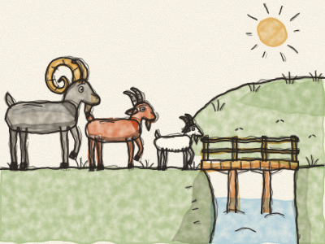
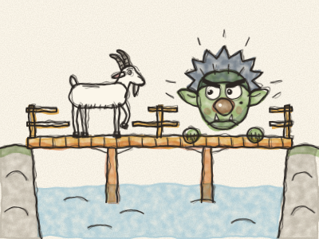
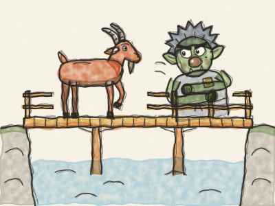
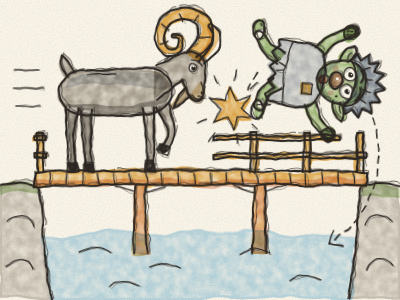
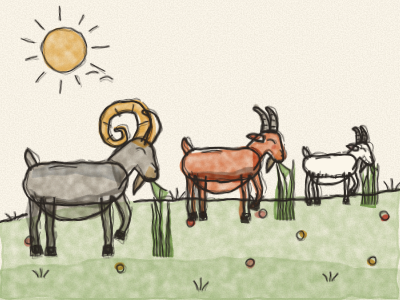

# Os Três Bodes Rezingões

Era uma vez três bodes, e chamavam-se todos Rezingão. Havia o Bode Rezingão Pequeno, o Bode Rezingão Médio e o Bode Rezingão Grande.

Viviam num vale onde a erva era curta e seca. Mas do outro lado do rio havia um monte coberto de erva comprida, verde, tenrinha e deliciosa. — Hum — disseram os três bodes. — Vamos lá comer, comer, até ficarmos bem gordinhos!

Para lá chegar, tinham de atravessar uma pontezinha de madeira. E debaixo da ponte vivia um velho Troll rabugento, com olhos do tamanho de pires e um nariz comprido como um cabo de vassoura.

Primeiro veio o Bode Rezingão Pequeno. *Trip, trap! Trip, trap!* faziam os seus cascos pequeninos na ponte.

— QUEM É QUE FAZ TRIP-TRAP NA MINHA PONTE? — rugiu o Troll.

— Ah, sou só eu, o Bode Rezingão Pequeno — disse o bode, com uma vozinha muito pequenina. *(Faça uma vozinha pequenina.)* — Vou ao monte comer erva.

— Pois eu vou comer-te todo! — disse o Troll.

— Ai não, por favor! Sou pequeno demais — disse o Bode Rezingão Pequeno. — Espere antes pelo meu irmão. Ele é muito maior do que eu.

— Hum — disse o Troll. — Maior, dizes tu? Está bem. Vai-te embora!

Um pouco mais tarde veio o Bode Rezingão Médio. *Trip, trap! Trip, trap!* faziam os seus cascos na ponte.

— QUEM É QUE FAZ TRIP-TRAP NA MINHA PONTE? — rugiu o Troll.

— Sou eu, o Bode Rezingão Médio — disse o bode, com uma voz média. — Vou ao monte comer erva.

— Pois eu vou comer-te todo! — disse o Troll.

— Ai não, não faça isso — disse o bode. — Espere pelo meu irmão mais velho. Ele é muito, MUITO maior do que eu.

O Troll lambeu os beiços. — Ainda maior? Está bem. Vai-te embora!

Então veio o Bode Rezingão Grande. *TRIP, TRAP! TRIP, TRAP!* faziam os seus cascos enormes, e a ponte toda rangia e gemia debaixo dele.

— QUEM É QUE FAZ TRIP-TRAP NA MINHA PONTE? — rugiu o Troll.

— SOU EU! O BODE REZINGÃO GRANDE! — disse o bode, com um vozeirão. *(Faça a sua voz mais grossa e mais grave.)*

— Pois eu vou comer-te todo! — disse o Troll, e subiu para a ponte.

Mas o Bode Rezingão Grande baixou os seus dois grandes chifres enrolados, correu e — *PUMBA!* — atirou o Troll lá para o alto. Subiu, subiu, e depois desceu, desceu — *CHAPE!* — para dentro do rio.

O rio levou o Troll rabugento para muito, muito longe, *a chapinhar e a cuspir água*, e ele nunca mais voltou àquela ponte.

Quanto aos três Bodes Rezingões, subiram o monte a trote e comeram, comeram a erva tenrinha e verde, até ficarem tão gordos que mal conseguiam voltar para casa. *Nham, nham, nham.*

E se não emagreceram desde então, ainda hoje estão gordos. *E vitória, vitória, acabou-se a história!*

> Uma pequena ideia esperta pode vencer um grande troll rabugento — e quem quer sempre mais acaba sem nada.
