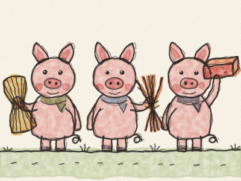
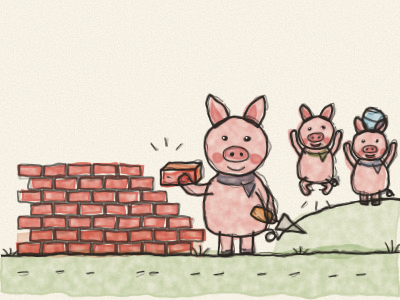
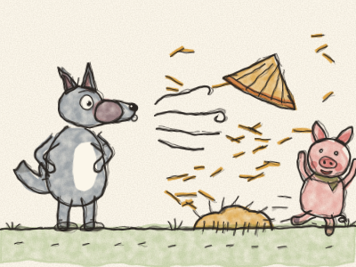
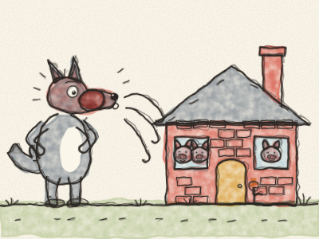
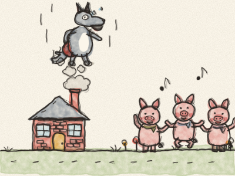

# The Three Little Pigs

Once upon a time, there were three little pigs who lived with their mother. One day, Mother Pig said, “My darlings, you are big now. It is time for each of you to build a house of your own. But be careful of the Big Bad Wolf!”

So the three little pigs set off down the road.

The first little pig met a farmer with a cart full of straw. “Please may I have some straw to build my house?” The farmer said yes, and the first little pig built a house of straw. It took him one morning. “Finished!” he said. “Now I can play all afternoon!”

The second little pig met a man with a bundle of sticks. “Please may I have some sticks to build my house?” The man said yes, and the second little pig built a house of sticks. It took him one whole day. “Finished!” he said. “Now I can play!”

The third little pig met a man with a heavy load of bricks. “Please may I have some bricks to build my house?” The man said yes, and the third little pig began to build. Brick by brick. *Tap, tap, tap.* It took him a whole week, and his arms were very tired. “Come and play!” called his brothers. “Not yet,” said the third little pig. “First, I must finish my house.”

One evening, along came the Big Bad Wolf. He knocked on the door of the straw house. *Knock, knock!*

“Little pig, little pig, let me come in!”

“No, no! Not by the hair on my chinny-chin-chin!”

“Then I’ll huff, and I’ll puff, and I’ll blow your house in!”

And he huffed, *HUFF!*, and he puffed, *PUFF!*, and he blew the house in. Straw flew everywhere! But the first little pig ran out of the back door, as fast as he could, all the way to his brother’s house of sticks.

Soon the Wolf knocked on the door of the stick house. *Knock, knock!*

“Little pigs, little pigs, let me come in!”

“No, no! Not by the hair on our chinny-chin-chins!”

“Then I’ll huff, and I’ll puff, and I’ll blow your house in!”

And he huffed, *HUFF!*, and he puffed, *PUFF!*, and he blew the house in. Sticks flew everywhere! The two little pigs ran, *trot-trot-trot*, all the way to the brick house, and their brother opened the door just in time. *Slam!*

The Wolf knocked on the brick house. *Knock, knock!*

“Little pigs, little pigs, let me come in!”

“No, no! Not by the hair on our chinny-chin-chins!”

“Then I’ll huff, and I’ll puff, and I’ll blow your house in!”

So he huffed, *HUFF!*, and he puffed, *PUFF!* And he huffed and he PUFFED! He went red, then purple, then blue. But the brick house didn’t move. Not one brick.

“Then I’ll come down the chimney!” growled the Wolf, and he climbed up onto the roof. But the clever third little pig had put a big pot of water on the fire. The Wolf slid down the chimney and — *SPLASH! SIZZLE!* — he landed right in the hot water.

“OW! OW! OWWW!” The Wolf shot back up the chimney like a rocket, holding his hot red bottom, and ran away over the hills. He never, ever came back.

The three little pigs danced and sang, and the two brothers said, “Thank you! Next time, we will build our houses the slow way, brick by brick.” And they all lived happily together in the strong little house.

> Doing a job well takes time, but it is worth it.
