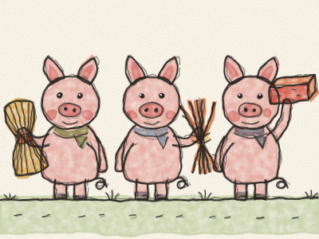
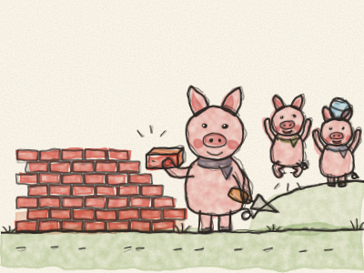
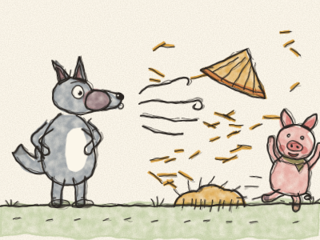
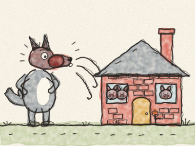
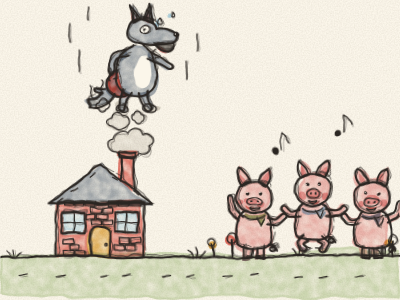

# Les Trois Petits Cochons

Il était une fois trois petits cochons qui vivaient avec leur maman. Un jour, Maman Cochon leur dit : « Mes chéris, vous êtes grands maintenant. Il est temps que chacun de vous construise sa propre maison. Mais méfiez-vous du Grand Méchant Loup ! »

Alors les trois petits cochons partirent sur la route.

Le premier petit cochon rencontra un fermier avec une charrette pleine de paille. « S’il vous plaît, puis-je avoir un peu de paille pour construire ma maison ? » Le fermier dit oui, et le premier petit cochon construisit une maison de paille. Cela lui prit une matinée. « Fini ! dit-il. Maintenant, je peux jouer tout l’après-midi ! »

Le deuxième petit cochon rencontra un homme avec un fagot de bâtons. « S’il vous plaît, puis-je avoir des bâtons pour construire ma maison ? » L’homme dit oui, et le deuxième petit cochon construisit une maison de bâtons. Cela lui prit toute une journée. « Fini ! dit-il. Maintenant, je peux jouer ! »

Le troisième petit cochon rencontra un homme avec un lourd chargement de briques. « S’il vous plaît, puis-je avoir des briques pour construire ma maison ? » L’homme dit oui, et le troisième petit cochon se mit au travail. Brique après brique. *Tac, tac, tac.* Cela lui prit toute une semaine, et ses bras étaient très fatigués. « Viens jouer ! » criaient ses frères. « Pas encore, répondit le troisième petit cochon. D’abord, je dois finir ma maison. »

Un soir, arriva le Grand Méchant Loup. Il frappa à la porte de la maison de paille. *Toc, toc !*

« Petit cochon, petit cochon, laisse-moi entrer ! »

« Non, non ! Pas question, par les poils de mon petit menton ! »

« Alors je vais souffler, et souffler, et ta maison s’envolera ! »

Et il souffla, *FFFOU !*, et il souffla, *FFFOU !*, et la maison s’envola. De la paille partout ! Mais le premier petit cochon sortit par la porte de derrière, aussi vite qu’il put, jusqu’à la maison de bâtons de son frère.

Bientôt, le Loup frappa à la porte de la maison de bâtons. *Toc, toc !*

« Petits cochons, petits cochons, laissez-moi entrer ! »

« Non, non ! Pas question, par les poils de nos petits mentons ! »

« Alors je vais souffler, et souffler, et votre maison s’envolera ! »

Et il souffla, *FFFOU !*, et il souffla, *FFFOU !*, et la maison s’envola. Des bâtons partout ! Les deux petits cochons coururent, *trotte-trotte-trotte*, jusqu’à la maison de briques, et leur frère ouvrit la porte juste à temps. *Clac !*

Le Loup frappa à la maison de briques. *Toc, toc !*

« Petits cochons, petits cochons, laissez-moi entrer ! »

« Non, non ! Pas question, par les poils de nos petits mentons ! »

« Alors je vais souffler, et souffler, et votre maison s’envolera ! »

Alors il souffla, *FFFOU !*, et il souffla, *FFFOU !* Et il souffla et RE-SOUFFLA ! Il devint rouge, puis violet, puis bleu. Mais la maison de briques ne bougea pas. Pas une seule brique.

« Alors je vais descendre par la cheminée ! » grogna le Loup, et il grimpa sur le toit. Mais le troisième petit cochon, très malin, avait mis une grande marmite d’eau sur le feu. Le Loup glissa dans la cheminée et — *PLOUF ! PSCHHH !* — il atterrit tout droit dans l’eau chaude.

« AÏE ! AÏE ! AÏÏÏE ! » Le Loup remonta la cheminée comme une fusée, en se tenant les fesses toutes rouges, et s’enfuit par-delà les collines. Il ne revint plus jamais.

Les trois petits cochons dansèrent et chantèrent, et les deux frères dirent : « Merci ! La prochaine fois, nous construirons nos maisons lentement, brique après brique. » Et ils vécurent heureux tous ensemble dans la solide petite maison.

> Bien faire prend du temps, mais cela en vaut la peine.
