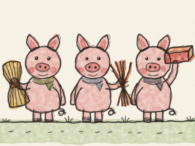
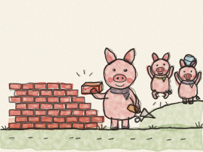
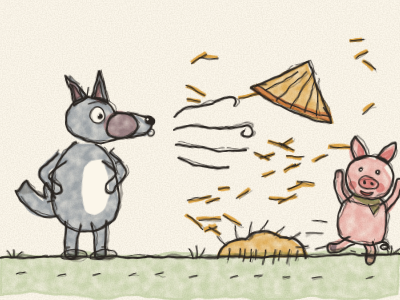
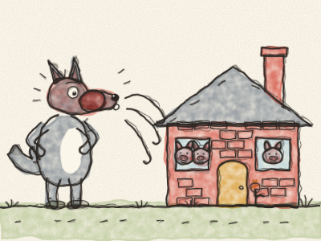
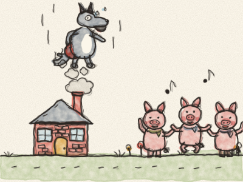

# Os Três Porquinhos

Era uma vez três porquinhos que viviam com a mãe. Um dia, a Mamã Porca disse: — Meus queridos, já estão crescidos. Está na altura de cada um construir a sua própria casa. Mas cuidado com o Lobo Mau!

E lá foram os três porquinhos pela estrada fora.

O primeiro porquinho encontrou um lavrador com uma carroça cheia de palha. — Por favor, pode dar-me um bocadinho de palha para construir a minha casa? — O lavrador disse que sim, e o primeiro porquinho construiu uma casa de palha. Demorou uma manhã. — Pronto! — disse ele. — Agora posso brincar a tarde toda!

O segundo porquinho encontrou um homem com um molho de paus. — Por favor, pode dar-me uns paus para construir a minha casa? — O homem disse que sim, e o segundo porquinho construiu uma casa de paus. Demorou um dia inteiro. — Pronto! — disse ele. — Agora posso brincar!

O terceiro porquinho encontrou um homem com uma carga pesada de tijolos. — Por favor, pode dar-me uns tijolos para construir a minha casa? — O homem disse que sim, e o terceiro porquinho começou a construir. Tijolo a tijolo. *Tac, tac, tac.* Demorou uma semana inteira, e ficou com os braços muito cansados. — Anda brincar! — chamavam os irmãos. — Ainda não — respondeu o terceiro porquinho. — Primeiro, tenho de acabar a minha casa.

Uma noite, apareceu o Lobo Mau. Bateu à porta da casa de palha. *Truz, truz!*

— Porquinho, porquinho, deixa-me entrar!

— Não, não! Nem pensar, pelos pelinhos do meu queixinho!

— Então vou soprar, e soprar, e a tua casa vai voar!

E soprou, *FFFU!*, e soprou, *FFFU!*, e a casa voou. Palha por todo o lado! Mas o primeiro porquinho fugiu pela porta das traseiras, o mais depressa que pôde, até à casa de paus do irmão.

Pouco depois, o Lobo bateu à porta da casa de paus. *Truz, truz!*

— Porquinhos, porquinhos, deixem-me entrar!

— Não, não! Nem pensar, pelos pelinhos dos nossos queixinhos!

— Então vou soprar, e soprar, e a vossa casa vai voar!

E soprou, *FFFU!*, e soprou, *FFFU!*, e a casa voou. Paus por todo o lado! Os dois porquinhos correram, *trote-trote-trote*, até à casa de tijolos, e o irmão abriu-lhes a porta mesmo a tempo. *Pum!*

O Lobo bateu à porta da casa de tijolos. *Truz, truz!*

— Porquinhos, porquinhos, deixem-me entrar!

— Não, não! Nem pensar, pelos pelinhos dos nossos queixinhos!

— Então vou soprar, e soprar, e a vossa casa vai voar!

Então soprou, *FFFU!*, e soprou, *FFFU!* E soprou e SOPROU! Ficou vermelho, depois roxo, depois azul. Mas a casa de tijolos não se mexeu. Nem um tijolo.

— Então vou descer pela chaminé! — rosnou o Lobo, e subiu para o telhado. Mas o terceiro porquinho, muito esperto, tinha posto uma grande panela de água ao lume. O Lobo escorregou pela chaminé abaixo e — *CHAPE! CHIIII!* — caiu mesmo dentro da água quente.

— AI! AI! AIII! — O Lobo subiu pela chaminé como um foguete, a agarrar o rabo todo vermelho, e fugiu para lá dos montes. Nunca, nunca mais voltou.

Os três porquinhos dançaram e cantaram, e os dois irmãos disseram: — Obrigado! Da próxima vez, vamos construir as nossas casas devagarinho, tijolo a tijolo. — E viveram felizes, todos juntos, na pequena casa forte.

> Fazer bem feito leva tempo, mas vale a pena.
