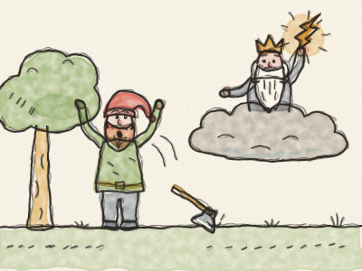
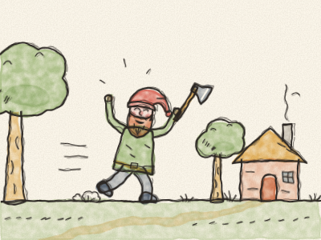
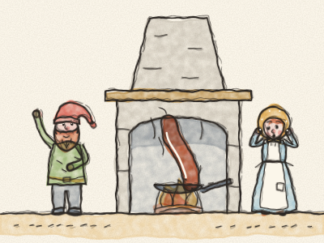
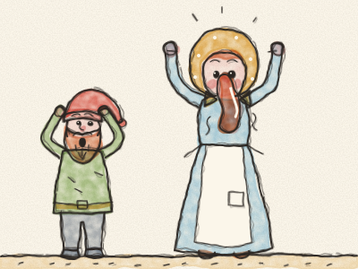
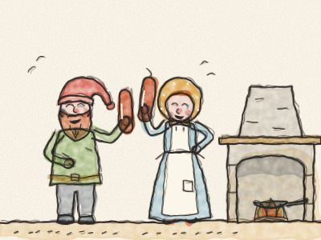

# The Three Wishes

Once upon a time, a poor woodcutter lived in a little cottage at the edge of a great forest. Every morning he took his axe and went off to chop wood. *Chop! Chop! Chop!* And every evening he came home tired, with only a little soup for supper.

One morning, he sat down on a log and sighed. “Oh, I’m so tired of being poor! Nothing nice ever happens to me!”

Just then — *CRACK! BOOM!* — a flash of lightning lit up the sky, and there, on a big grey cloud, stood Jupiter, the king of the sky, with a long white beard and a thunderbolt in his hand.

The woodcutter was so surprised that he dropped his axe. *Clonk!*

“Don’t be frightened,” boomed Jupiter. “I heard you. I am going to give you a present: three wishes. The first three things you wish for will come true. But think carefully before you wish!”

*Whoosh!* The cloud floated away, and the forest was quiet again.

The woodcutter picked up his axe and ran all the way home, waving his arms. “Fanchon! Fanchon!” he called to his wife. “Something wonderful has happened! We have three wishes!”

Fanchon clapped her hands. “Three wishes! We could have a palace! Or a mountain of gold! Or a carriage with six white horses!”

“Let’s not hurry,” said the woodcutter. “Let’s sit by the fire and think about it very carefully.”

So they sat down by the fire. They thought and thought. And while he was thinking, the woodcutter began to feel hungry. He sniffed the air and rubbed his tummy.

“Mmm,” he said, without thinking at all. “I wish I had a nice big sausage for supper!”

*Whoosh! Plop!* Down the chimney came a long, fat, sizzling sausage, and it landed right in the pan.

Fanchon jumped up. “A SAUSAGE? You wished for a SAUSAGE? We could have had a palace, and you wished for a sausage! Oh, you silly, silly man!” She stamped her feet. She waved her arms. She scolded and scolded, on and on and on. *(Do Fanchon’s cross voice!)*

The woodcutter put his hands over his ears. At last he became cross too. “Oh, be quiet!” he shouted. “I wish that sausage were stuck on the end of your nose!”

*Whoosh! Boing!* At once the sausage jumped out of the pan and stuck itself on the end of Fanchon’s nose. It dangled all the way down to her chin. It wiggled when she talked.

“Take it off! Take it off!” cried Fanchon. The woodcutter pulled. *Pull, pull!* Fanchon pulled. *Pull, pull!* But the sausage would not come off.

Now there was only one wish left. “I could wish for a palace,” thought the woodcutter. “But what good is a palace if my dear wife has a sausage on her nose?”

So he took a deep breath and said, “I wish the sausage were off Fanchon’s nose!”

*Whoosh! Pop!* The sausage dropped back into the pan, and Fanchon’s nose was just a nose again.

They looked at each other. And then they began to laugh. They laughed and laughed until tears ran down their cheeks.

“Three wishes,” giggled Fanchon, “and all we have is a sausage!”

“Well,” said the woodcutter, “it is a very good sausage.” And they cooked it, and shared it, and it was the best supper they had ever had.

> Think before you wish, and think before you speak — and a happy home is worth more than a palace.
