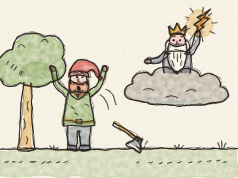
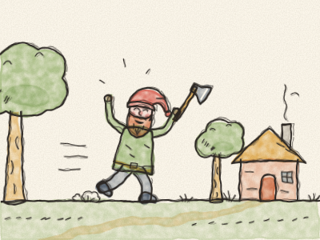
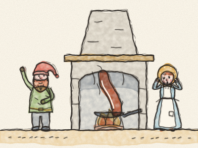
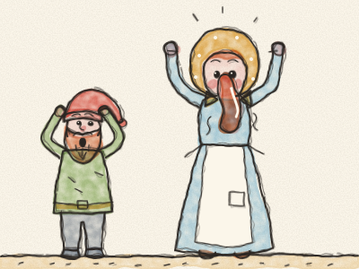
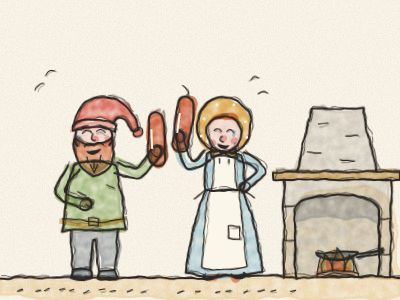

# Les Souhaits ridicules

Il était une fois un pauvre bûcheron qui vivait dans une petite maison au bord d’une grande forêt. Chaque matin, il prenait sa hache et partait couper du bois. *Tchac ! Tchac ! Tchac !* Et chaque soir, il rentrait fatigué, avec juste un peu de soupe pour le dîner.

Un matin, il s’assit sur un tronc et soupira : « Oh, j’en ai assez d’être pauvre ! Il ne m’arrive jamais rien de bien ! »

À ce moment-là — *CRAC ! BOUM !* — un éclair illumina le ciel et là, sur un gros nuage gris, se tenait Jupiter, le roi du ciel, avec une longue barbe blanche et la foudre à la main.

Le bûcheron fut si surpris qu’il lâcha sa hache. *Bong !*

« N’aie pas peur », gronda Jupiter. « Je t’ai entendu. Je vais te faire un cadeau : trois souhaits. Les trois premières choses que tu souhaiteras se réaliseront. Mais réfléchis bien avant de souhaiter ! »

*Fffiou !* Le nuage s’envola, et la forêt redevint silencieuse.

Le bûcheron ramassa sa hache et courut jusque chez lui en agitant les bras. « Fanchon ! Fanchon ! » cria-t-il à sa femme. « Il nous arrive une chose merveilleuse ! Nous avons trois souhaits ! »

Fanchon battit des mains. « Trois souhaits ! On pourrait avoir un palais ! Ou une montagne d’or ! Ou un carrosse avec six chevaux blancs ! »

« Ne nous pressons pas », dit le bûcheron. « Asseyons-nous près du feu, et réfléchissons bien. »

Alors ils s’assirent près du feu. Ils réfléchirent et réfléchirent. Et pendant qu’il réfléchissait, le bûcheron commença à avoir faim. Il renifla et se frotta le ventre.

« Mmm », dit-il, sans réfléchir du tout. « Je voudrais bien une aune de boudin pour le dîner ! »

*Fffiou ! Plof !* Par la cheminée descendit un long, gros boudin tout grésillant, qui tomba pile dans la poêle.

Fanchon bondit. « Du BOUDIN ? Tu as souhaité du BOUDIN ? On pouvait avoir un palais, et tu souhaites du boudin ! Oh, quel nigaud, quel grand nigaud ! » Elle tapa des pieds. Elle agita les bras. Elle gronda et gronda, encore et encore. *(Faites la voix fâchée de Fanchon !)*

Le bûcheron se boucha les oreilles. À la fin, il se fâcha lui aussi. « Oh, tais-toi ! » cria-t-il. « Je voudrais que ce boudin te pende au bout du nez ! »

*Fffiou ! Boïng !* Aussitôt, le boudin sauta de la poêle et alla se coller au bout du nez de Fanchon. Il pendait jusqu’à son menton. Il gigotait quand elle parlait.

« Enlève-le ! Enlève-le ! » cria Fanchon. Le bûcheron tira. *Hop, hop !* Fanchon tira. *Hop, hop !* Mais le boudin ne voulait pas se décoller.

Il ne restait plus qu’un souhait. « Je pourrais souhaiter un palais », pensa le bûcheron. « Mais à quoi sert un palais, si ma chère femme a un boudin au bout du nez ? »

Alors il prit une grande inspiration et dit : « Je voudrais que le boudin quitte le nez de Fanchon ! »

*Fffiou ! Pop !* Le boudin retomba dans la poêle, et le nez de Fanchon redevint un nez tout simple.

Ils se regardèrent. Et puis ils se mirent à rire. Ils rirent et rirent, jusqu’à en pleurer.

« Trois souhaits », gloussa Fanchon, « et tout ce qu’on a, c’est un boudin ! »

« Eh bien », dit le bûcheron, « c’est un très bon boudin. » Et ils le firent cuire, ils le partagèrent, et ce fut le meilleur dîner de leur vie.

> Réfléchis avant de souhaiter, et réfléchis avant de parler — une maison heureuse vaut mieux qu’un palais.
