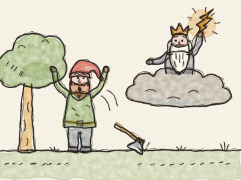
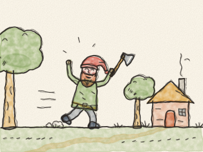
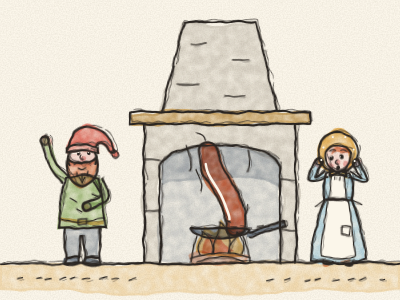
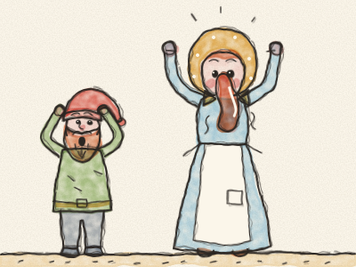
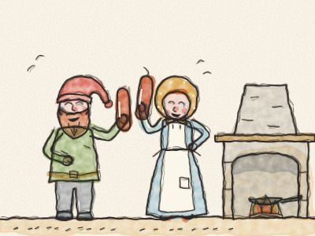

# Os Três Desejos

Era uma vez um lenhador pobre que vivia numa casinha à beira de uma grande floresta. Todas as manhãs pegava no machado e ia cortar lenha. *Tchac! Tchac! Tchac!* E todas as noites voltava para casa cansado, só com um bocadinho de sopa para o jantar.

Uma manhã, sentou-se num tronco e suspirou: — Ai, estou tão farto de ser pobre! Nunca me acontece nada de bom!

Nesse instante — *CRAC! BUM!* — um relâmpago iluminou o céu e ali, numa grande nuvem cinzenta, estava Júpiter, o rei do céu, com uma longa barba branca e um raio na mão.

O lenhador ficou tão espantado que deixou cair o machado. *Bong!*

— Não tenhas medo — trovejou Júpiter. — Eu ouvi-te. Vou dar-te um presente: três desejos. As três primeiras coisas que desejares vão tornar-se realidade. Mas pensa bem antes de desejar!

*Fiuuu!* A nuvem afastou-se, e a floresta ficou outra vez em silêncio.

O lenhador apanhou o machado e correu até casa, a abanar os braços. — Fanchon! Fanchon! — chamou ele pela mulher. — Aconteceu uma coisa maravilhosa! Temos três desejos!

A Fanchon bateu palmas. — Três desejos! Podíamos ter um palácio! Ou uma montanha de ouro! Ou uma carruagem com seis cavalos brancos!

— Não tenhamos pressa — disse o lenhador. — Vamos sentar-nos ao pé da lareira e pensar muito bem.

E assim se sentaram ao pé da lareira. Pensaram e pensaram. E, enquanto pensava, o lenhador começou a ter fome. Cheirou o ar e esfregou a barriga.

— Hum — disse ele, sem pensar nada. — Quem me dera ter uma linguiça bem grande para o jantar!

*Fiuuu! Plof!* Pela chaminé abaixo veio uma linguiça comprida, gorda e a chiar, e caiu mesmo dentro da frigideira.

A Fanchon deu um salto. — Uma LINGUIÇA? Desejaste uma LINGUIÇA? Podíamos ter um palácio, e tu desejas uma linguiça! Ai, que tolo, que grande tolo! — Bateu os pés. Abanou os braços. Ralhou e ralhou, sem parar. *(Faça a voz zangada da Fanchon!)*

O lenhador tapou os ouvidos. Por fim, também ele se zangou. — Ai, cala-te! — gritou. — Quem me dera que essa linguiça ficasse pendurada na ponta do teu nariz!

*Fiuuu! Boing!* Num instante, a linguiça saltou da frigideira e colou-se à ponta do nariz da Fanchon. Pendia até ao queixo. Abanava quando ela falava.

— Tira-ma! Tira-ma! — gritou a Fanchon. O lenhador puxou. *Puxa, puxa!* A Fanchon puxou. *Puxa, puxa!* Mas a linguiça não saía.

Agora só restava um desejo. «Podia desejar um palácio», pensou o lenhador. «Mas de que serve um palácio, se a minha querida mulher tem uma linguiça no nariz?»

Então respirou fundo e disse: — Quem me dera que a linguiça saísse do nariz da Fanchon!

*Fiuuu! Pop!* A linguiça voltou a cair na frigideira, e o nariz da Fanchon voltou a ser só um nariz.

Olharam um para o outro. E depois desataram a rir. Riram e riram até as lágrimas lhes correrem pela cara.

— Três desejos — riu-se a Fanchon — e tudo o que temos é uma linguiça!

— Bem — disse o lenhador —, é uma linguiça muito boa. — E cozinharam-na, partilharam-na, e foi o melhor jantar que alguma vez tiveram.

> Pensa antes de desejar, e pensa antes de falar — uma casa feliz vale mais do que um palácio.
