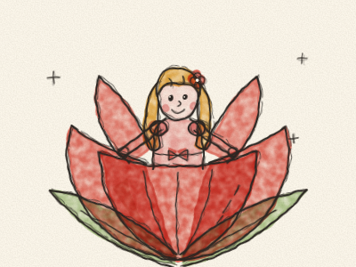
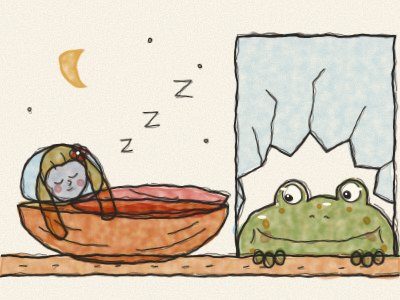
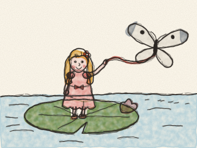
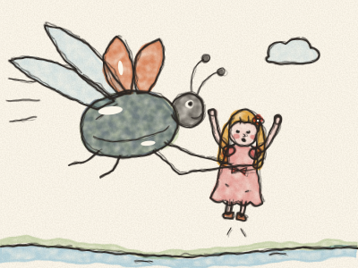
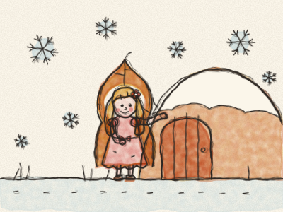
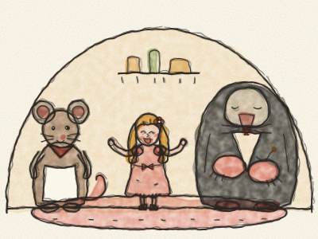
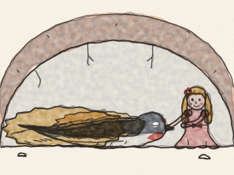
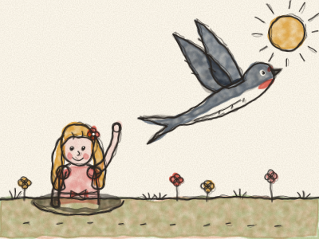
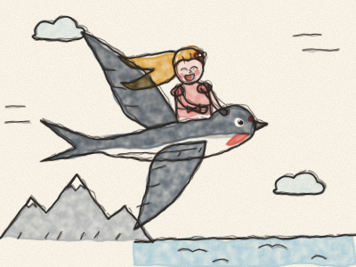
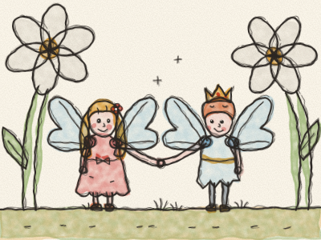

# Thumbelina

Once upon a time, there was a woman who wished and wished for a little child. So she went to see a kind old fairy, who gave her a tiny seed. “Plant it in a flowerpot,” said the fairy, “and you will see.”

The woman planted the seed, and at once a beautiful flower grew, just like a tulip, with its red petals tightly closed. “What a lovely flower,” said the woman, and she gave it a little kiss. *Pop!* The petals opened wide.

And there, sitting right in the middle of the flower, was a tiny girl. She was so small, no bigger than your thumb, that the woman called her Thumbelina.

Thumbelina slept in a polished walnut shell, with violet petals for a mattress and a rose petal for a blanket. In the daytime, she sailed a tulip petal across a plate of water, rowing with two white horsehairs, and she sang in a voice so sweet and so soft that nobody had ever heard anything like it.

One night, as Thumbelina lay asleep in her walnut shell, an old Toad hopped in through a broken pane of the window. She was big and wet and bumpy. *Croak!*

“What a pretty little thing,” said the Toad. “She would make a perfect wife for my son!” And she picked up the walnut shell, with Thumbelina still asleep inside it, and hopped away with it to the muddy stream at the bottom of the garden.

“Croak, croak, brekke-ke-kex!” said her son, when he saw the pretty girl. That was all he could ever say.

“Don’t shout, or she’ll wake up and run away,” said the old Toad. And she put Thumbelina on a big green lily pad in the middle of the stream, so that she could not escape, while the toads got the wedding ready.

When Thumbelina woke up and saw water all around her, she began to cry. She didn’t want to marry a toad and live in the mud!

The little fish in the stream heard her. They popped their heads out of the water. “She is too sweet to live with the toads,” they whispered. So they swam down, and they nibbled, and they nibbled at the green stalk of the lily pad, until — *snip!* — it came free.

Away floated the lily pad, down the stream, far away from the toads. A pretty white butterfly fluttered round and round her, and Thumbelina tied one end of her ribbon to the butterfly and the other end to the leaf. Off they went, faster and faster, past the fields and the trees. How pleased Thumbelina was!

But then, a big shiny Beetle came buzzing by. *Bzzzz!* He took one look at Thumbelina, grabbed her round the waist, and flew away with her to the top of a tall tree.

“How pretty you are!” said the Beetle, and he gave her honey from the flowers to eat.

Then all the other beetles who lived in the tree came to visit. They looked at her and twitched their feelers. “Only two legs? How odd!” they said. “And no feelers at all! And look how thin she is! She doesn’t look a bit like a beetle.”

So the Beetle changed his mind. He flew her down to the ground, put her on a daisy, and buzzed away. Thumbelina sat there all alone. But at least she was free.

All summer long, Thumbelina lived alone in the big forest. She wove herself a bed of grass and hung it under a clover leaf, to keep off the rain. She ate the sweet nectar from the flowers and drank the dew from the leaves every morning.

Then autumn came, and then winter, long and cold. The birds flew away, the flowers faded, and the snow began to fall. Each snowflake was as big as a whole shovelful for someone so small. *Brrr!* Thumbelina wrapped herself in a dry leaf, but she shivered and shivered.

At the edge of a field, under the stubble, she found a little door. It was the home of a Field Mouse. *Knock, knock.* “Please,” said Thumbelina, “could you spare a grain of barley? I haven’t eaten for two days.”

“You poor little thing!” said the Field Mouse, who was a kind old soul. “Come into my warm kitchen and have dinner with me. You may stay all winter, if you keep my rooms tidy and tell me stories. I love stories.”

So Thumbelina swept and dusted, and every evening she told stories by the stove.

One day the Field Mouse said, “My neighbour is coming to visit. He is very rich, and he wears a beautiful black velvet coat. He would make you a fine husband.”

The neighbour was a Mole. He was rich and he was clever, but he did not like the sun or the flowers at all, because he had never seen them. He lived deep under the ground. Thumbelina sang to him, and the Mole liked her voice very much. But Thumbelina did not want to live under the ground.

The Mole dug a long tunnel from his house to theirs. And in the tunnel, they found a swallow lying very still, with his wings folded and his head under his feathers. “Poor bird,” said the Mole. “Too cold to sing, too cold to fly.” And he walked on.

But that night, Thumbelina could not sleep. She wove a soft blanket of hay and crept down into the tunnel. She tucked the blanket round the swallow and laid her head on his chest.

*Thump… thump… thump.* His heart was beating! The swallow was not dead, only frozen. Every night, Thumbelina came back. She brought him water in a petal and kept him warm, and slowly, slowly, the swallow grew strong again.

When spring came, and the sun warmed the earth, Thumbelina opened a little hole in the roof of the tunnel. The sunshine poured in.

“Thank you, little one,” said the swallow. “You saved my life. Come with me! Sit on my back, and I will fly you away to the green forest.”

But Thumbelina thought of the old Field Mouse, who had been kind to her. “I can’t,” she said. “She would be sad if I left.”

“Then goodbye, goodbye, sweet little girl,” sang the swallow, and he flew away into the sunshine. *Tweet-tweet!* Thumbelina watched him go, and her eyes filled with tears.

All summer, she spun wool for her wedding to the Mole. The wedding would be in the autumn, and then she would live under the ground forever and never see the sun again.

On the morning of the wedding, Thumbelina went outside to say goodbye to the sun. “Goodbye, bright sun,” she said, holding out her arms. “And if you see my swallow, please say goodbye to him from me.”

*Tweet-tweet!* There, right above her head, was the swallow! “Winter is coming,” he said. “I’m flying away to the warm countries. Come with me!”

“Yes,” said Thumbelina. “I will come.” She climbed onto his back and held on tight to his feathers. Up, up they flew, over forests and seas, over mountains white with snow. When she felt cold, Thumbelina snuggled under his warm feathers and peeped out at all the wonderful things below.

At last they came to a warm country, where the sun shone brightly and lemons and oranges grew on the trees. There, by a blue lake, stood big white flowers. The swallow set Thumbelina down on one of the petals.

And what a surprise! In the middle of the flower stood a tiny man, no bigger than she was, with a little gold crown. He was the prince of the flowers. In every flower lived someone tiny, just like her.

“Will you stay with us?” asked the prince. And Thumbelina said yes. The flower people gave her a pair of shining wings, so that she could fly from flower to flower. And up on his nest, the swallow sang his happiest song, just for her.

> Kindness always finds its way back to you, like a swallow in the spring.
