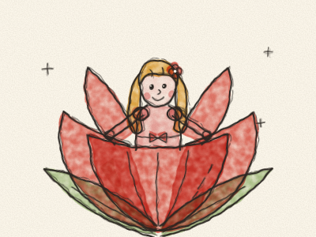
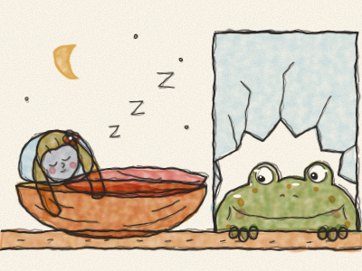
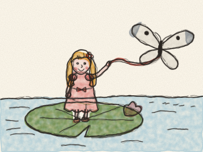
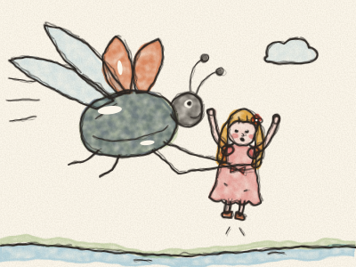
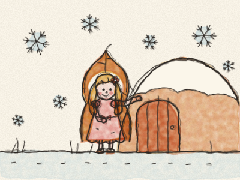
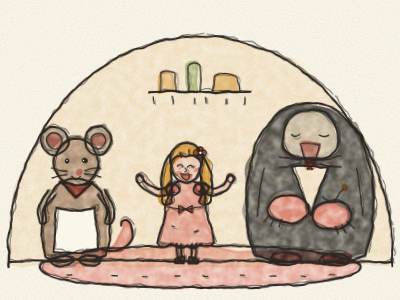
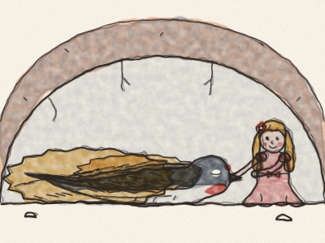
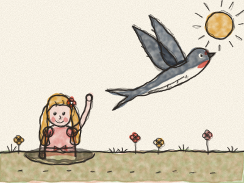
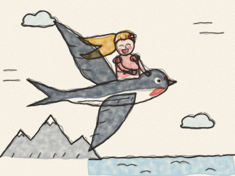
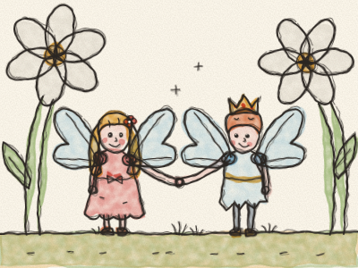

# La Petite Poucette

Il était une fois une femme qui désirait de tout son cœur avoir un petit enfant. Elle alla voir une vieille fée très gentille, qui lui donna une minuscule graine. « Plante-la dans un pot de fleurs, dit la fée, et tu verras. »

La femme planta la graine, et aussitôt poussa une fleur magnifique, toute pareille à une tulipe, avec ses pétales rouges bien fermés. « Quelle jolie fleur », dit la femme, et elle lui donna un petit baiser. *Pop !* Les pétales s’ouvrirent tout grands.

Et là, assise au beau milieu de la fleur, il y avait une toute petite fille. Elle était si petite, pas plus grande que ton pouce, que la femme l’appela Poucette.

Poucette dormait dans une coquille de noix bien cirée, avec des pétales de violette pour matelas et un pétale de rose pour couverture. Le jour, elle naviguait sur un pétale de tulipe dans une assiette pleine d’eau, en ramant avec deux crins de cheval blancs, et elle chantait d’une voix si douce et si tendre que personne n’avait jamais rien entendu de pareil.

Une nuit, pendant que Poucette dormait dans sa coquille de noix, une vieille Crapaude entra en sautant par un carreau cassé de la fenêtre. Elle était grosse, mouillée et pleine de bosses. *Croâ !*

« Quelle jolie petite chose », dit la Crapaude. « Ce serait la femme idéale pour mon fils ! » Et elle prit la coquille de noix, avec Poucette toujours endormie dedans, et l’emporta en sautillant jusqu’au ruisseau boueux, au fond du jardin.

« Croâ, croâ, brekke-ke-kex ! » dit son fils, en voyant la jolie petite fille. C’était tout ce qu’il savait dire.

« Ne crie pas, elle va se réveiller et se sauver », dit la vieille Crapaude. Et elle posa Poucette sur une grande feuille de nénuphar au milieu du ruisseau, pour qu’elle ne puisse pas s’échapper, pendant que les crapauds préparaient le mariage.

Quand Poucette se réveilla et vit de l’eau tout autour d’elle, elle se mit à pleurer. Elle ne voulait pas épouser un crapaud et vivre dans la boue !

Les petits poissons du ruisseau l’entendirent. Ils sortirent la tête de l’eau. « Elle est bien trop mignonne pour vivre avec les crapauds », chuchotèrent-ils. Alors ils plongèrent, et ils grignotèrent, grignotèrent la tige verte du nénuphar, jusqu’à ce que — *clic !* — la feuille se détache.

La feuille s’en alla au fil de l’eau, loin, très loin des crapauds. Un joli papillon blanc voletait autour d’elle, et Poucette attacha un bout de sa ceinture au papillon et l’autre bout à la feuille. Et les voilà partis, de plus en plus vite, devant les champs et les arbres. Comme Poucette était contente !

Mais voilà qu’un gros Hanneton brillant passa en bourdonnant. *Bzzzz !* Il regarda Poucette, l’attrapa par la taille et s’envola avec elle tout en haut d’un grand arbre.

« Comme tu es jolie ! » dit le Hanneton, et il lui donna à manger le miel des fleurs.

Puis tous les autres hannetons qui vivaient dans l’arbre vinrent lui rendre visite. Ils la regardèrent en remuant leurs antennes. « Seulement deux pattes ? Comme c’est bizarre ! » dirent-ils. « Et pas d’antennes du tout ! Et regardez comme elle est maigre ! Elle ne ressemble pas du tout à un hanneton. »

Alors le Hanneton changea d’avis. Il redescendit Poucette par terre, la posa sur une pâquerette et s’en alla en bourdonnant. Poucette resta là, toute seule. Mais au moins, elle était libre.

Tout l’été, Poucette vécut seule dans la grande forêt. Elle se tressa un lit d’herbe et l’accrocha sous une feuille de trèfle, pour se protéger de la pluie. Elle mangeait le nectar sucré des fleurs et buvait chaque matin la rosée sur les feuilles.

Puis vint l’automne, et puis l’hiver, long et froid. Les oiseaux s’en allèrent, les fleurs se fanèrent, et la neige se mit à tomber. Chaque flocon était aussi gros qu’une pelletée entière pour quelqu’un d’aussi petit. *Brrr !* Poucette s’enveloppa dans une feuille sèche, mais elle grelottait, grelottait.

Au bord d’un champ, sous les chaumes, elle trouva une petite porte. C’était la maison d’une Souris des champs. *Toc, toc.* « S’il vous plaît, dit Poucette, auriez-vous un grain d’orge pour moi ? Je n’ai rien mangé depuis deux jours. »

« Ma pauvre petite ! » dit la Souris des champs, qui était une bonne vieille souris. « Entre dans ma cuisine bien chaude et viens dîner avec moi. Tu peux rester tout l’hiver, si tu tiens ma maison bien propre et si tu me racontes des histoires. J’adore les histoires. »

Alors Poucette balayait et époussetait, et chaque soir elle racontait des histoires près du poêle.

Un jour, la Souris des champs dit : « Mon voisin va venir me rendre visite. Il est très riche, et il porte un magnifique habit de velours noir. Ce serait un beau mari pour toi. »

Le voisin était Monsieur Taupe. Il était riche et savant, mais il n’aimait ni le soleil ni les fleurs, parce qu’il ne les avait jamais vus. Il vivait tout au fond de la terre. Poucette chanta pour lui, et Monsieur Taupe aima beaucoup sa voix. Mais Poucette ne voulait pas vivre sous la terre.

Monsieur Taupe creusa un long tunnel entre sa maison et la leur. Et dans le tunnel, ils trouvèrent une hirondelle couchée, toute immobile, les ailes repliées et la tête sous ses plumes. « Pauvre oiseau », dit Monsieur Taupe. « Trop froid pour chanter, trop froid pour voler. » Et il continua son chemin.

Mais cette nuit-là, Poucette ne put pas dormir. Elle tressa une couverture de foin tout doux et descendit sans bruit dans le tunnel. Elle borda l’hirondelle avec la couverture et posa sa tête contre sa poitrine.

*Boum… boum… boum.* Son cœur battait ! L’hirondelle n’était pas morte, seulement gelée. Chaque nuit, Poucette revint. Elle lui apportait de l’eau dans un pétale et la gardait au chaud, et tout doucement, l’hirondelle reprit des forces.

Quand le printemps arriva, et que le soleil réchauffa la terre, Poucette ouvrit un petit trou dans le plafond du tunnel. Le soleil entra à flots.

« Merci, petite », dit l’hirondelle. « Tu m’as sauvé la vie. Viens avec moi ! Assieds-toi sur mon dos, et je t’emmènerai dans la forêt verte. »

Mais Poucette pensa à la vieille Souris des champs, qui avait été si gentille avec elle. « Je ne peux pas », dit-elle. « Elle serait triste si je partais. »

« Alors adieu, adieu, douce petite fille », chanta l’hirondelle, et elle s’envola dans le soleil. *Cui-cui !* Poucette la regarda partir, les yeux pleins de larmes.

Tout l’été, elle fila de la laine pour son mariage avec Monsieur Taupe. Le mariage aurait lieu à l’automne, et après, elle vivrait sous la terre pour toujours et ne reverrait plus jamais le soleil.

Le matin du mariage, Poucette sortit pour dire adieu au soleil. « Adieu, beau soleil », dit-elle en tendant les bras. « Et si tu vois mon hirondelle, dis-lui adieu de ma part. »

*Cui-cui !* Là, juste au-dessus de sa tête, il y avait l’hirondelle ! « L’hiver arrive », dit-elle. « Je m’envole vers les pays chauds. Viens avec moi ! »

« Oui », dit Poucette. « Je viens. » Elle grimpa sur son dos et s’agrippa bien fort à ses plumes. Elles s’envolèrent très haut, au-dessus des forêts et des mers, au-dessus des montagnes blanches de neige. Quand elle avait froid, Poucette se blottissait sous les plumes bien chaudes et regardait toutes les merveilles en dessous.

Enfin, elles arrivèrent dans un pays chaud, où le soleil brillait fort et où des citrons et des oranges poussaient sur les arbres. Là, au bord d’un lac bleu, se dressaient de grandes fleurs blanches. L’hirondelle posa Poucette sur l’un des pétales.

Et quelle surprise ! Au milieu de la fleur se tenait un tout petit homme, pas plus grand qu’elle, avec une petite couronne d’or. C’était le prince des fleurs. Dans chaque fleur vivait quelqu’un de tout petit, comme elle.

« Veux-tu rester avec nous ? » demanda le prince. Et Poucette dit oui. Les gens des fleurs lui donnèrent une paire d’ailes brillantes, pour qu’elle puisse voler de fleur en fleur. Et là-haut sur son nid, l’hirondelle chanta sa plus joyeuse chanson, rien que pour elle.

> La gentillesse revient toujours vers toi, comme l’hirondelle au printemps.
