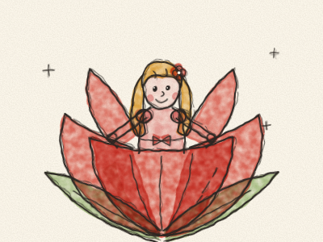
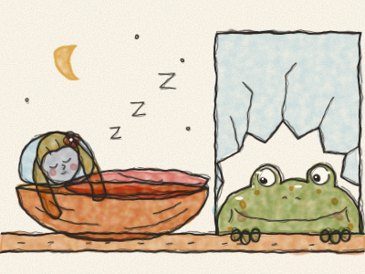
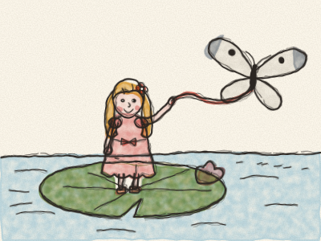
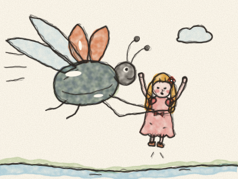
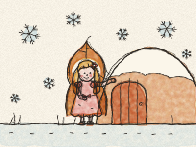
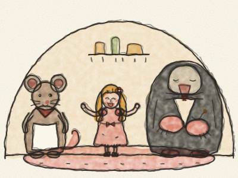
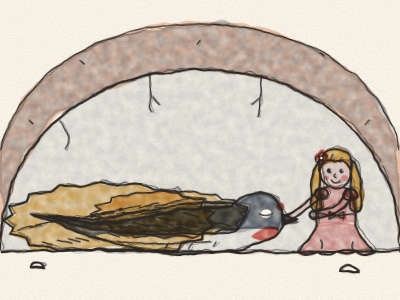
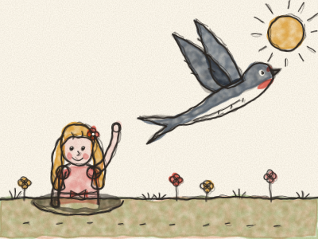
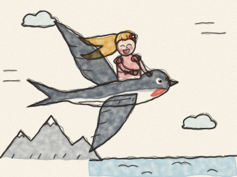
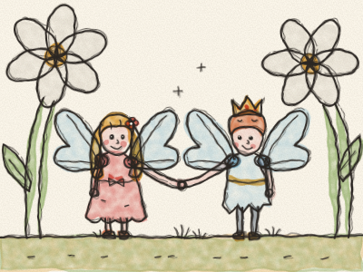

# A Polegarzinha

Era uma vez uma mulher que desejava muito, muito ter uma criança pequenina. Foi então ter com uma fada velhinha e bondosa, que lhe deu uma semente minúscula. — Planta-a num vaso de flores — disse a fada — e vais ver.

A mulher plantou a semente, e logo cresceu uma flor lindíssima, igualzinha a uma tulipa, com as pétalas vermelhas bem fechadas. — Que flor tão bonita — disse a mulher, e deu-lhe um beijinho. *Pop!* As pétalas abriram-se todas.

E ali, sentada mesmo no meio da flor, estava uma menina pequenina. Era tão pequena, do tamanho do teu polegar, que a mulher lhe chamou Polegarzinha.

A Polegarzinha dormia numa casca de noz bem polida, com pétalas de violeta como colchão e uma pétala de rosa como cobertor. De dia, navegava numa pétala de tulipa por um prato cheio de água, a remar com dois pelos brancos de cavalo, e cantava com uma voz tão doce e tão suave que ninguém nunca tinha ouvido nada assim.

Uma noite, enquanto a Polegarzinha dormia na sua casca de noz, uma velha Sapa entrou aos saltos por um vidro partido da janela. Era grande, molhada e cheia de verrugas. *Croac!*

— Que coisinha tão bonita — disse a Sapa. — Seria a mulher perfeita para o meu filho! — E pegou na casca de noz, com a Polegarzinha ainda a dormir lá dentro, e levou-a aos saltos até ao ribeiro lamacento no fundo do jardim.

— Croac, croac, brekke-ke-kex! — disse o filho, quando viu a menina tão bonita. Era tudo o que ele sabia dizer.

— Não grites, senão ela acorda e foge — disse a velha Sapa. E pôs a Polegarzinha numa grande folha de nenúfar no meio do ribeiro, para ela não poder fugir, enquanto os sapos preparavam o casamento.

Quando a Polegarzinha acordou e viu água por todo o lado, começou a chorar. Não queria casar com um sapo e viver na lama!

Os peixinhos do ribeiro ouviram-na. Puseram a cabeça fora de água. — Ela é demasiado querida para viver com os sapos — sussurraram. Então mergulharam, e roeram, roeram o pé verde do nenúfar, até que — *tic!* — a folha se soltou.

Lá foi a folha pelo ribeiro abaixo, para longe, muito longe dos sapos. Uma linda borboleta branca esvoaçava à volta dela, e a Polegarzinha atou uma ponta da sua fita à borboleta e a outra ponta à folha. E lá foram elas, cada vez mais depressa, por entre campos e árvores. Que contente estava a Polegarzinha!

Mas eis que passou um grande Escaravelho brilhante, a zumbir. *Bzzzz!* Olhou para a Polegarzinha, agarrou-a pela cintura e voou com ela até ao alto de uma árvore muito grande.

— Que bonita que tu és! — disse o Escaravelho, e deu-lhe mel das flores para comer.

Depois, todos os outros escaravelhos que viviam na árvore vieram visitá-la. Olharam para ela e mexeram as antenas. — Só duas pernas? Que esquisito! — disseram. — E nem uma antena! E vejam como ela é magrinha! Não se parece nada com um escaravelho.

Então o Escaravelho mudou de ideias. Levou a Polegarzinha cá para baixo, pousou-a numa margarida e foi-se embora a zumbir. A Polegarzinha ficou ali sozinha. Mas, ao menos, estava livre.

Durante todo o verão, a Polegarzinha viveu sozinha na grande floresta. Entrançou uma cama de erva e pendurou-a debaixo de uma folha de trevo, para se abrigar da chuva. Comia o néctar doce das flores e bebia todas as manhãs o orvalho das folhas.

Depois veio o outono, e depois o inverno, comprido e frio. Os pássaros partiram, as flores murcharam, e a neve começou a cair. Cada floco de neve era tão grande como uma pá cheia para alguém tão pequenino. *Brrr!* A Polegarzinha embrulhou-se numa folha seca, mas tremia, tremia.

À beira de um campo, debaixo do restolho, encontrou uma portinha. Era a casa de uma Rata do campo. *Truz, truz.* — Por favor — disse a Polegarzinha —, podia dar-me um grão de cevada? Não como nada há dois dias.

— Coitadinha! — disse a Rata do campo, que era uma velhinha de bom coração. — Entra na minha cozinha quentinha e vem jantar comigo. Podes ficar o inverno todo, se mantiveres a minha casa arrumada e me contares histórias. Adoro histórias.

Então a Polegarzinha varria e limpava o pó, e todas as noites contava histórias ao pé do fogão.

Um dia, a Rata do campo disse: — O meu vizinho vem visitar-me. É muito rico e usa um lindo casaco de veludo preto. Seria um belo marido para ti.

O vizinho era o Senhor Toupeira. Era rico e sabia muitas coisas, mas não gostava nem do sol nem das flores, porque nunca os tinha visto. Vivia lá no fundo, debaixo da terra. A Polegarzinha cantou para ele, e o Senhor Toupeira gostou muito da sua voz. Mas a Polegarzinha não queria viver debaixo da terra.

O Senhor Toupeira cavou um túnel comprido entre a casa dele e a delas. E no túnel encontraram uma andorinha deitada, muito quieta, com as asas fechadas e a cabeça escondida nas penas. — Pobre pássaro — disse o Senhor Toupeira. — Frio demais para cantar, frio demais para voar. — E seguiu caminho.

Mas nessa noite a Polegarzinha não conseguiu dormir. Entrançou um cobertor de feno macio e desceu devagarinho ao túnel. Aconchegou a andorinha com o cobertor e encostou a cabeça ao peito dela.

*Tum… tum… tum.* O coração batia! A andorinha não estava morta, só gelada. Todas as noites, a Polegarzinha voltava. Levava-lhe água numa pétala e mantinha-a quentinha, e devagarinho, devagarinho, a andorinha foi ganhando forças.

Quando chegou a primavera, e o sol aqueceu a terra, a Polegarzinha abriu um buraquinho no teto do túnel. O sol entrou a jorros.

— Obrigada, pequenina — disse a andorinha. — Salvaste-me a vida. Vem comigo! Senta-te nas minhas costas, e eu levo-te para a floresta verde.

Mas a Polegarzinha pensou na velha Rata do campo, que tinha sido tão boa para ela. — Não posso — disse. — Ela ficava triste se eu partisse.

— Então adeus, adeus, menina querida — cantou a andorinha, e voou para o sol. *Piu-piu!* A Polegarzinha viu-a partir, com os olhos cheios de lágrimas.

O verão inteiro, fiou lã para o seu casamento com o Senhor Toupeira. O casamento seria no outono, e depois ela viveria debaixo da terra para sempre e nunca mais voltaria a ver o sol.

Na manhã do casamento, a Polegarzinha saiu para dizer adeus ao sol. — Adeus, sol tão bonito — disse ela, de braços abertos. — E se vires a minha andorinha, diz-lhe adeus por mim.

*Piu-piu!* Ali, mesmo por cima da cabeça dela, estava a andorinha! — O inverno vem aí — disse ela. — Vou voar para os países quentes. Vem comigo!

— Sim — disse a Polegarzinha. — Eu vou. — Subiu para as costas dela e agarrou-se bem às penas. Voaram lá para o alto, por cima de florestas e mares, por cima de montanhas brancas de neve. Quando tinha frio, a Polegarzinha aninhava-se debaixo das penas quentinhas e espreitava todas as maravilhas lá em baixo.

Por fim, chegaram a um país quente, onde o sol brilhava muito e cresciam limões e laranjas nas árvores. Ali, à beira de um lago azul, havia grandes flores brancas. A andorinha pousou a Polegarzinha numa das pétalas.

E que surpresa! No meio da flor estava um homenzinho pequenino, do tamanho dela, com uma coroazinha de ouro. Era o príncipe das flores. Em cada flor vivia alguém pequenino, como ela.

— Queres ficar connosco? — perguntou o príncipe. E a Polegarzinha disse que sim. O povo das flores deu-lhe um par de asas brilhantes, para ela poder voar de flor em flor. E lá em cima, no seu ninho, a andorinha cantou a sua canção mais alegre, só para ela.

> A bondade volta sempre para nós, como a andorinha na primavera.
