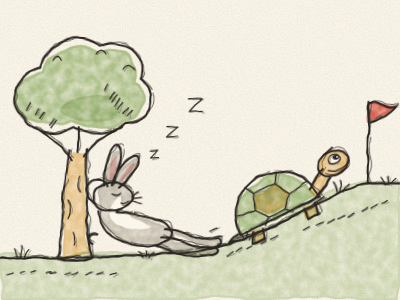
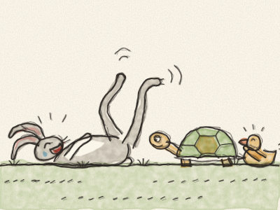
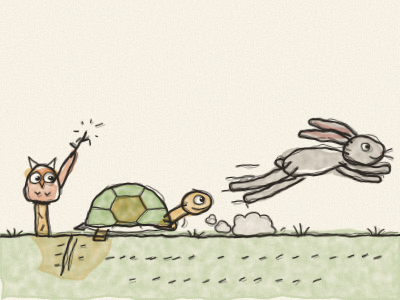
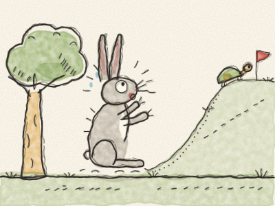
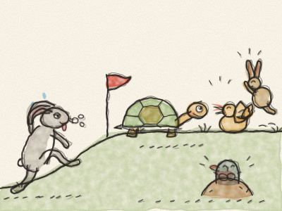

# The Tortoise and the Hare

Once upon a time, in a green meadow full of daisies, there lived a Hare with very long ears and very long legs. Hare was the fastest animal in the whole meadow, and he never, ever stopped talking about it.

“Look at me!” he would shout, whizzing past. “Zip! Zoom! Nobody is as fast as me!”

In the same meadow lived a Tortoise. Tortoise did everything slowly. She walked slowly, she ate her lettuce slowly, and she even blinked slowly. But she always got where she was going.

One morning, Hare saw Tortoise plodding along the path. “Good morning, Slowcoach!” he laughed. “Are you going somewhere? You’ll get there next Christmas!”

All the animals giggled. Tortoise did not giggle. She looked at Hare calmly and said, “Hare, would you like to have a race with me?”

Hare laughed so hard that he fell over on his back and kicked his legs in the air. “A race? With YOU? Ha ha ha! All right, Tortoise. But don’t cry when you lose!”

So the animals got everything ready. Owl drew a starting line in the dust. Fox put a red flag at the finish, far away at the top of the hill, beside the old oak tree. Everybody came to watch: the rabbits, the hedgehogs, the ducks, and even the shy little mole.

“Ready…” said Owl. “Steady… GO!”

*Zoooom!* Hare shot off like an arrow. In a few seconds he was so far away that he looked like a little brown dot.

Tortoise put one foot forward. Then the other foot. Then the first foot again. *Plod… plod… plod…*

Halfway up the hill, Hare stopped and looked back. Tortoise was nowhere to be seen. “Ha!” he said. “That slowcoach will take all day. I’ve got time for a little snack.”

He nibbled some sweet clover. Then he nibbled some more. Soon his tummy was full, the sun was warm, and the grass was soft… “I’ll just close my eyes for one minute,” he yawned. And before long: *Zzzzz… Zzzzz…* Hare was fast asleep under a tree.

Meanwhile, Tortoise kept going. *Plod… plod… plod…* Her legs were tired, but she didn’t stop. She passed the pond. *Plod… plod…* She passed the big rock. *Plod… plod…* And she passed a tree where somebody with very long ears was snoring very loudly.

Tortoise smiled, but she didn’t say a word. *Plod… plod… plod…*

A long time later, Hare woke up with a jump. “What time is it? Where am I? The race!” He looked up the hill, and his ears stood straight up in fright. There, right beside the red flag, was Tortoise, only three steps from the finish!

Hare ran faster than he had ever run in his whole life. *Zip! Zoom! ZOOOOM!* All the animals shouted and cheered. But it was too late. With one last little step… Tortoise crossed the finish line!

“Hooray for Tortoise!” cried the animals. The ducks quacked, the rabbits hopped, and the little mole clapped his paws.

Hare arrived puffing and panting, with his ears all droopy. “But… but… I’m the fastest,” he said.

“You are very fast,” said Tortoise kindly. “But being fast isn’t enough. You also have to keep going until the end.”

From that day on, Hare showed off a little bit less. And sometimes, just sometimes, he walked slowly beside Tortoise, and the two of them chatted all the way to the top of the hill.

> Slow and steady wins the race. Keep going, even when it’s hard!
