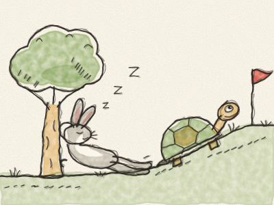
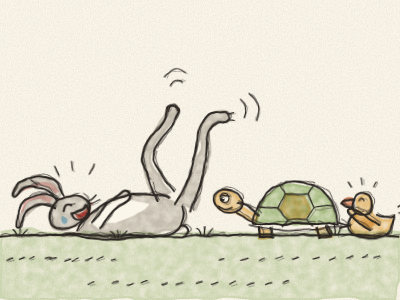
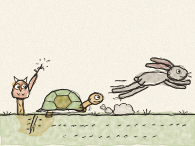
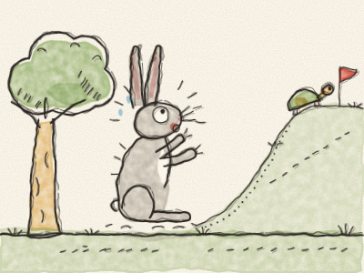
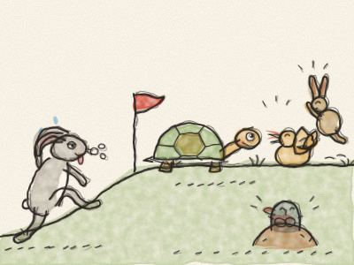

# Le Lièvre et la Tortue

Il était une fois, dans une prairie verte pleine de pâquerettes, un Lièvre aux très longues oreilles et aux très longues pattes. Lièvre était l’animal le plus rapide de toute la prairie, et il ne s’arrêtait jamais, jamais d’en parler.

« Regardez-moi ! » criait-il en passant comme une flèche. « Zip ! Zoum ! Personne n’est aussi rapide que moi ! »

Dans la même prairie vivait une Tortue. Tortue faisait tout lentement. Elle marchait lentement, elle mangeait sa salade lentement, et elle clignait même des yeux lentement. Mais elle arrivait toujours là où elle voulait aller.

Un matin, Lièvre vit Tortue qui avançait tranquillement sur le chemin. « Bonjour, la lambine ! » ricana-t-il. « Tu vas quelque part ? Tu arriveras à Noël prochain ! »

Tous les animaux pouffèrent de rire. Tortue, elle, ne rit pas. Elle regarda Lièvre calmement et dit : « Lièvre, veux-tu faire la course avec moi ? »

Lièvre rit si fort qu’il tomba sur le dos en gigotant les pattes en l’air. « Une course ? Avec TOI ? Ha ha ha ! D’accord, Tortue. Mais ne pleure pas quand tu perdras ! »

Alors les animaux préparèrent tout. Hibou traça une ligne de départ dans la poussière. Renard planta un drapeau rouge à l’arrivée, très loin, en haut de la colline, à côté du vieux chêne. Tout le monde vint regarder : les lapins, les hérissons, les canards, et même la petite taupe timide.

« À vos marques… » dit Hibou. « Prêts… PARTEZ ! »

*Zoooum !* Lièvre fila comme une flèche. En quelques secondes, il était si loin qu’on ne voyait plus qu’un petit point marron.

Tortue avança une patte. Puis l’autre patte. Puis de nouveau la première. *Pom… pom… pom…*

À mi-chemin de la colline, Lièvre s’arrêta et regarda derrière lui. Pas de Tortue à l’horizon. « Ha ! » dit-il. « Cette lambine va mettre toute la journée. J’ai bien le temps de grignoter quelque chose. »

Il grignota un peu de trèfle bien sucré. Puis encore un peu. Bientôt, son ventre fut plein, le soleil était chaud, l’herbe était douce… « Je vais juste fermer les yeux une minute », bâilla-t-il. Et très vite : *Zzzzz… Zzzzz…* Lièvre dormait profondément sous un arbre.

Pendant ce temps, Tortue continuait. *Pom… pom… pom…* Ses pattes étaient fatiguées, mais elle ne s’arrêtait pas. Elle passa devant la mare. *Pom… pom…* Elle passa devant le gros rocher. *Pom… pom…* Et elle passa devant un arbre sous lequel quelqu’un aux très longues oreilles ronflait très fort.

Tortue sourit, mais elle ne dit pas un mot. *Pom… pom… pom…*

Bien plus tard, Lièvre se réveilla en sursaut. « Quelle heure est-il ? Où suis-je ? La course ! » Il regarda en haut de la colline, et ses oreilles se dressèrent de peur. Là-haut, juste à côté du drapeau rouge, il y avait Tortue, à trois pas seulement de l’arrivée !

Lièvre courut plus vite qu’il n’avait jamais couru de toute sa vie. *Zip ! Zoum ! ZOOOUM !* Tous les animaux criaient et applaudissaient. Mais c’était trop tard. Avec un dernier petit pas… Tortue franchit la ligne d’arrivée !

« Hourra pour Tortue ! » crièrent les animaux. Les canards cancanèrent, les lapins sautèrent, et la petite taupe applaudit de ses pattes.

Lièvre arriva tout essoufflé, les oreilles tombantes. « Mais… mais… c’est moi le plus rapide », dit-il.

« Tu es très rapide », dit gentiment Tortue. « Mais être rapide ne suffit pas. Il faut aussi continuer jusqu’au bout. »

À partir de ce jour-là, Lièvre fit un peu moins le fanfaron. Et parfois, juste parfois, il marchait lentement à côté de Tortue, et tous les deux bavardaient tout le long du chemin jusqu’en haut de la colline.

> Lentement mais sûrement, on arrive au bout. Continue, même quand c’est difficile !
