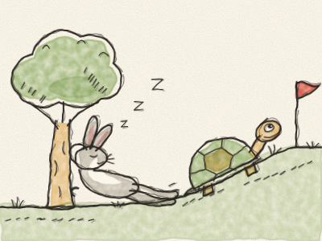
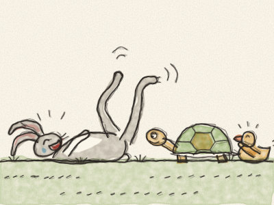
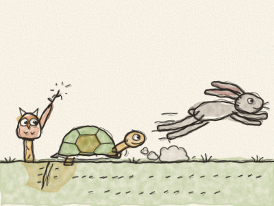
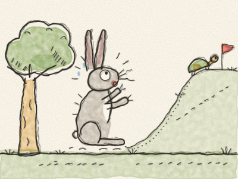
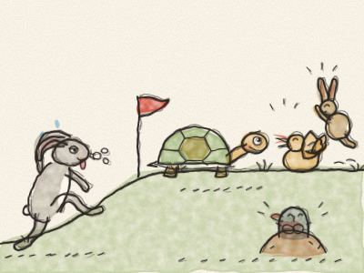

# A Lebre e a Tartaruga

Era uma vez, num prado verde cheio de margaridas, uma Lebre de orelhas muito compridas e pernas muito compridas. A Lebre era o animal mais rápido de todo o prado, e nunca, mas nunca, parava de falar nisso.

— Olhem para mim! — gritava ela, a passar num instante. — Zás! Zum! Ninguém é tão rápido como eu!

No mesmo prado vivia uma Tartaruga. A Tartaruga fazia tudo devagar. Andava devagar, comia a sua alface devagar e até pestanejava devagar. Mas chegava sempre aonde queria ir.

Uma manhã, a Lebre viu a Tartaruga a caminhar devagarinho pelo carreiro. — Bom dia, dona Lesma! — riu-se ela. — Vais a algum lado? Chegas lá no próximo Natal!

Todos os animais se riram baixinho. A Tartaruga não se riu. Olhou para a Lebre com calma e disse: — Lebre, queres fazer uma corrida comigo?

A Lebre riu-se tanto que caiu de costas e ficou a espernear com as patas no ar. — Uma corrida? CONTIGO? Ah ah ah! Está bem, Tartaruga. Mas não chores quando perderes!

Então os animais prepararam tudo. O Mocho desenhou uma linha de partida no pó. A Raposa espetou uma bandeira vermelha na meta, muito longe, no alto da colina, ao lado do velho carvalho. Toda a gente veio ver: os coelhos, os ouriços, os patos e até a pequena toupeira tímida.

— Aos vossos lugares… — disse o Mocho. — Preparados… JÁ!

*Zuuuum!* A Lebre disparou como uma flecha. Em poucos segundos estava tão longe que parecia só um pontinho castanho.

A Tartaruga pôs uma pata à frente. Depois a outra pata. Depois outra vez a primeira. *Pum… pum… pum…*

A meio da colina, a Lebre parou e olhou para trás. Nem sinal da Tartaruga. — Ah! — disse ela. — Aquela lesma vai demorar o dia todo. Tenho tempo para um lanchinho.

Mordiscou um pouco de trevo docinho. Depois mais um pouco. Em breve tinha a barriga cheia, o sol estava quentinho e a erva estava macia… — Vou só fechar os olhos um minutinho — bocejou. E pouco depois: *Zzzzz… Zzzzz…* A Lebre dormia profundamente debaixo de uma árvore.

Entretanto, a Tartaruga continuava. *Pum… pum… pum…* Tinha as patas cansadas, mas não parava. Passou pelo lago. *Pum… pum…* Passou pela pedra grande. *Pum… pum…* E passou por uma árvore debaixo da qual alguém de orelhas muito compridas ressonava muito alto.

A Tartaruga sorriu, mas não disse nem uma palavra. *Pum… pum… pum…*

Muito tempo depois, a Lebre acordou num sobressalto. — Que horas são? Onde estou? A corrida! — Olhou para o alto da colina e as orelhas puseram-se em pé de susto. Lá em cima, mesmo ao lado da bandeira vermelha, estava a Tartaruga, a só três passos da meta!

A Lebre correu mais depressa do que alguma vez tinha corrido na vida. *Zás! Zum! ZUUUUM!* Os animais todos gritavam e aplaudiam. Mas era tarde demais. Com um último passinho… a Tartaruga cortou a meta!

— Viva a Tartaruga! — gritaram os animais. Os patos grasnaram, os coelhos saltaram e a pequena toupeira bateu palmas com as patinhas.

A Lebre chegou toda esbaforida, com as orelhas caídas. — Mas… mas… eu é que sou a mais rápida — disse ela.

— És muito rápida — disse a Tartaruga com bondade. — Mas ser rápida não chega. Também é preciso continuar até ao fim.

A partir desse dia, a Lebre passou a gabar-se um pouco menos. E às vezes, só às vezes, caminhava devagar ao lado da Tartaruga, e iam as duas a conversar até ao alto da colina.

> Devagar se vai ao longe. Continua, mesmo quando é difícil!
