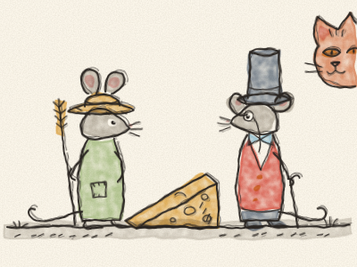
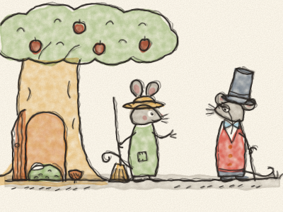
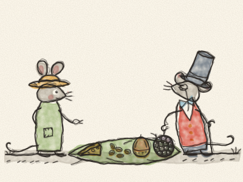
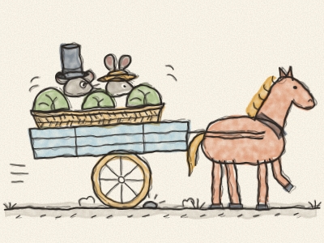
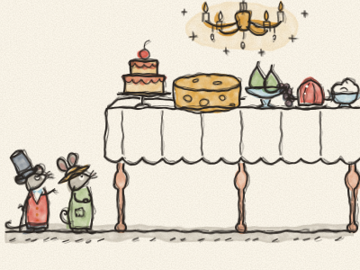
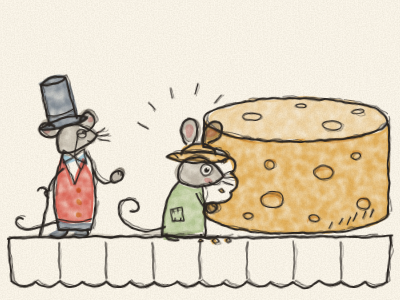
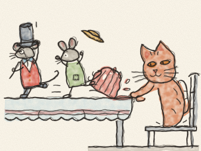
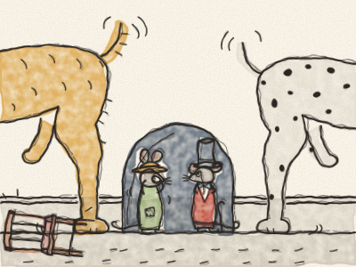
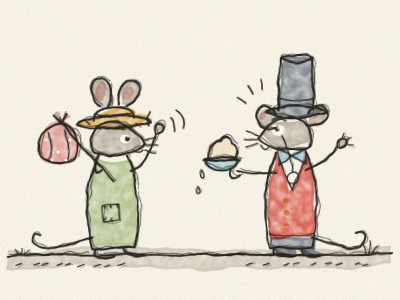
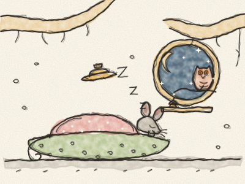

# La Souris des villes et la Souris des champs

Il était une fois, au bord d’un champ de blé, sous les racines d’un vieux pommier, une petite Souris des champs.

Sa maison était petite et douillette. Elle avait un lit de mousse verte bien douce, une tasse faite d’un gland et une petite fenêtre ronde qui donnait sur les champs. Le matin, elle écoutait chanter les oiseaux. Le soir, elle regardait le soleil se coucher derrière les collines. La Souris des champs était très heureuse.

Un jour, une lettre arriva. Elle était écrite avec de jolies lettres toutes bouclées, et elle sentait le parfum.

*« Chère cousine »*, disait-elle. *« Je viendrai te rendre visite dimanche. Bisous, la Souris des villes. »*

« Ma cousine de la grande ville ! » s’écria la Souris des champs. « Il faut que tout soit prêt ! »

Elle balaya le sol. Elle secoua son lit de mousse. Et elle partit chercher les meilleures choses à manger : des grains de blé, quelques graines d’orge, une mûre bien juteuse, une noisette et un petit morceau de fromage qu’elle gardait pour un grand jour.

Le dimanche, la Souris des villes arriva. Elle portait un gilet chic à boutons brillants, un nœud papillon en soie et un grand chapeau haut-de-forme. Elle regarda la petite maison et fronça le nez.

« Ma parole », dit-elle. « Comme c’est… petit. »

La Souris des champs était très fière de son déjeuner. Elle disposa tout sur une grande feuille. « Je t’en prie, cousine, sers-toi ! »

La Souris des villes grignota un grain de blé. Elle grignota une graine d’orge. Elle tapota la mûre du bout de la patte. « Hum », dit-elle. « C’est tout ce que tu manges ? Des graines et des baies ? Tous les jours ? »

« Eh bien… oui », dit la Souris des champs. « C’est très bon. »

« Ma pauvre cousine », dit la Souris des villes en secouant la tête. « Tu ne sais pas ce que tu rates ! En ville, je mange des gâteaux, des fromages et des bonbons tous les jours. Ma maison est un palais ! Viens donc chez moi. Tu verras comment une souris doit vraiment vivre. »

La Souris des champs regarda sa petite maison et son déjeuner tout simple. Tout à coup, ils lui semblèrent un peu trop petits. « D’accord », dit-elle. « Je viens ! »

Dès le lendemain matin, les deux souris se mirent en route. Elles se cachèrent dans un panier de choux, à l’arrière de la charrette du fermier, et furent secouées tout le long de la route pendant très, très longtemps. *Clip-clop, clip-clop*, faisait le cheval. *Boum, boum, boum*, faisait la charrette.

Enfin, elles arrivèrent en ville. La Souris des champs n’avait jamais rien vu de pareil ! Il y avait des maisons hautes comme des montagnes. Il y avait des calèches, des vélos, et des gens partout, qui se pressaient et qui criaient. *Ding-ding !* faisait un tramway. *Pouet ! Pouet !* faisait une voiture. La Souris des champs s’accrocha bien fort à la queue de sa cousine pour ne pas se perdre.

« Nous y voilà », dit fièrement la Souris des villes. Elles se faufilèrent sous une grande porte et entrèrent dans une maison magnifique. Il y avait des tapis épais, des miroirs dorés et un lustre qui scintillait comme mille étoiles. Et dans la salle à manger, il y avait une longue table couverte des choses les plus merveilleuses que la Souris des champs ait jamais vues.

Il y avait des gâteaux au glaçage rose. Il y avait un fromage gros comme une roue de charrette, plein de trous. Il y avait des raisins, des poires et des pêches, des biscuits au chocolat, des gelées qui tremblotaient et un énorme bol de crème.

« Sers-toi, cousine ! » dit la Souris des villes. « C’est mieux que des graines et des baies, non ? »

La Souris des champs avait les yeux ronds comme des boutons. Elle grimpa le long de la nappe, s’assit à côté du fromage et en croqua une grosse bouchée. « Miam ! » dit-elle. C’était délicieux !

Mais juste à ce moment-là, la porte s’ouvrit d’un coup. *BAM !* La cuisinière entra, une grande cuillère en bois à la main. « Qui est là ? » cria-t-elle. « Des souris ! Des SOURIS dans ma salle à manger ! »

« Vite ! Cache-toi ! » couina la Souris des villes. Les deux souris sautèrent de la table et filèrent dans un petit trou du mur. Le cœur de la Souris des champs faisait *boum-boum-boum*.

Elles attendirent, attendirent, sans faire le moindre bruit, jusqu’à ce que la cuisinière s’en aille.

« C’est bon maintenant », chuchota la Souris des villes. « Ça arrive tout le temps. Viens, on goûte le gâteau ! »

Elles retournèrent à pas de loup jusqu’à la table. La Souris des champs venait de poser la patte dans le glaçage rose quand… « Miaaaaou ! »

Un gros chat roux sauta sur une chaise. Il avait des yeux jaunes, de longues moustaches et des griffes très pointues. Et il les regardait droit dans les yeux.

« COURS ! » cria la Souris des villes. Les deux souris traversèrent la table à toute vitesse, renversèrent la gelée — *splotch !* —, glissèrent sur la nappe, sautèrent par terre et plongèrent dans le trou du mur, juste à temps. La patte du chat entra derrière elles et tâtonna — *gratte, gratte* — mais le trou était bien trop petit.

La Souris des champs tremblait du bout des oreilles jusqu’au bout de la queue. Elles attendirent très, très longtemps, jusqu’à ce que le chat s’ennuie et parte dormir près du feu.

« Ouf », dit la Souris des villes en redressant son nœud papillon. « Alors, on goûte les pêches ? »

Mais avant qu’elles aient pu faire un seul pas, on entendit un grand *OUAF ! OUAF ! OUAF !* Deux gros chiens entrèrent en bondissant dans la salle à manger, reniflant et aboyant, et leurs queues renversaient les chaises.

La Souris des champs se cacha les yeux. « Oh là là, oh là là, oh là là », chuchota-t-elle.

Quand la maison fut enfin redevenue calme, la Souris des champs prit son petit sac.

« Merci beaucoup de m’avoir invitée, cousine », dit-elle poliment. « Ta maison est très belle et ta nourriture est très fine. Mais je rentre chez moi. »

« Tu rentres ? » dit la Souris des villes. « Mais pourquoi ? Tu n’as même pas goûté la crème ! »

« Je préfère manger mes graines et mes baies en paix », dit la Souris des champs, « plutôt que manger des gâteaux et du fromage en ayant peur tout le temps. »

Alors elle dit au revoir, remonta dans le panier de choux de la charrette du fermier, et fut secouée tout le long du chemin du retour. *Clip-clop, clip-clop. Boum, boum, boum.*

Quand elle aperçut le vieux pommier au bord du champ de blé, son cœur fit un petit bond de joie. Elle courut dans sa petite maison douillette. Elle se prépara un dîner de grains de blé et de mûres, et c’était meilleur que tous les gâteaux du monde.

Puis elle se pelotonna dans son lit de mousse. Dehors, les étoiles s’allumèrent une à une, et une chouette fit *« Hou-hou »*. Il n’y avait ni cuisinière, ni chat, ni chiens. Seulement le vent dans les blés, qui faisait *chhhh, chhhh*.

« Ma maison », dit la Souris des champs en bâillant très fort. « Il n’y a rien de mieux. » Et elle s’endormit profondément.

> Mieux vaut une vie simple et tranquille qu’une vie riche pleine de peur. On n’est jamais aussi bien que chez soi.
