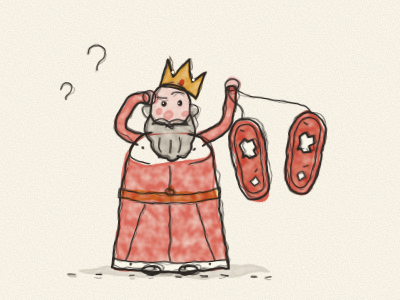
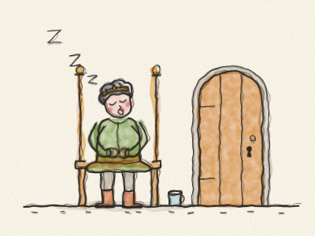
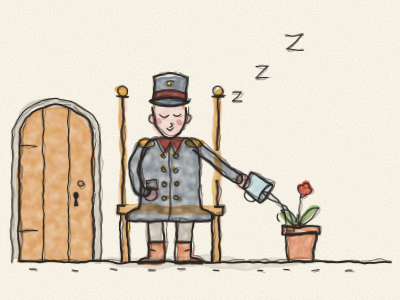

# The Twelve Dancing Princesses

Once upon a time, there was a King who had twelve daughters, each one prettier than the last. At night, the twelve princesses slept in one long bedroom, in twelve little beds all in a row. And every evening, the King locked the door himself. *Click.*

But every morning, when he unlocked it again, he found something very strange. The princesses’ dancing shoes were all worn out, with holes right through the soles, as if they had danced all night long.

“How can this be?” said the King, scratching his head. “The door was locked. The windows were shut. Where do my daughters go?”

The princesses only smiled and yawned. “We were asleep, Father,” they said. *Yaaawn.*

*(Where do you think they went?)*

So the King made an announcement. “Whoever can find out where my daughters dance at night,” he said, “may choose one of them to marry, and will be king after me.”

Soon a fine Prince arrived. That evening, he was given a chair just outside the princesses’ door, so that he could watch and listen. The eldest princess brought him a cup of warm milk. “Good night,” she said sweetly.

The Prince drank it all. *Gulp, gulp.* And at once his eyes grew heavy, and he fell fast asleep. *Zzzz…*

In the morning, the shoes were full of holes again. The Prince had seen nothing at all. “Oh dear,” said the King, and sent him home. Another prince came, and another, and another. Every one of them fell asleep, and every one went home grumpy.

Now, one day, a poor Soldier was walking along the road. His coat was old, and his boots were dusty, but he had a kind face and a clever mind. In the forest, he met an old woman carrying a heavy bundle of sticks.

“Let me carry that for you,” said the Soldier. And he carried it all the way to her door.

“Thank you, young man,” said the old woman. “Where are you going?”

“To the palace,” he said, “to find out where the princesses dance.”

The old woman smiled. “Then listen. Don’t drink anything the princesses give you. And take this.” She gave him a soft grey cloak. “When you put it on, nobody can see you. Not one bit.”

So the Soldier went to the palace. The King gave him a chair outside the princesses’ door, just like the princes. And just like before, the eldest princess brought him a cup of warm milk. “Good night,” she said sweetly.

“Thank you,” said the Soldier. But when she turned round, he quietly poured the milk into a flowerpot. *Glug, glug.* Then he leaned back in his chair, shut his eyes and pretended to snore. *Snorrre… snorrre…*

Inside the bedroom, the princesses giggled. “Another one asleep!” said the eldest. “Quick, sisters, get ready!”

They jumped out of bed. They put on their finest dresses, brushed their hair and tied up their new dancing shoes. The Soldier peeped through the keyhole, and watched.

The eldest princess went to her bed and tapped it three times. *Tap, tap, tap.* And the whole bed sank down into the floor, and there was a secret staircase, going down, down, down into the dark.

“Follow me,” whispered the eldest. And one by one, the twelve princesses went down the stairs, with the youngest at the very end.

Quick as a flash, the Soldier threw on the grey cloak. *Swish!* He disappeared. Then he tiptoed after them, down the stairs. But it was dark, and he went a little too fast, and he trod on the hem of the youngest princess’s dress.

“Ooh!” she cried. “Somebody pulled my dress!”

“Don’t be silly,” said the eldest. “You caught it on a nail.”

At the bottom of the stairs, there was a wonderful forest. Every tree had leaves of silver, which shone and tinkled in the breeze. *Ting, ting, ting.* Further on, there was a forest with leaves of gold. And further still, a forest where every leaf sparkled like a diamond.

“Nobody will believe me,” thought the Soldier. So in each forest, he snapped off a little twig and hid it in his pocket. *Crack!* *Crack!* *Crack!*

Each time, the youngest princess jumped. “Did you hear that? Something is following us!”

“It’s only the fireworks,” said the eldest, “for our happy party. Hurry up!”

The Soldier smiled under his invisible cloak, and kept very, very quiet.

After the forests, they came to a big shining lake. On the water were twelve little boats, and in each boat sat a handsome prince, holding the oars and smiling.

“Good evening, princesses!” said the princes. Each princess stepped into a boat, and the Soldier climbed quietly into the very last one, beside the youngest princess.

The princes began to row. *Splish, splosh, splish, splosh.* But the prince in the last boat began to puff and to pant.

“How strange,” he said. “The boat is so heavy tonight. I have to row with all my might!”

“It must be the warm weather,” said the youngest princess, fanning herself. And the Soldier sat beside her, invisible, trying hard not to laugh.

On the other side of the lake stood a glittering castle, full of lights and music. *Tra-la-la, tra-la-la!* There were trumpets, and fiddles, and drums.

The princes and princesses danced and danced. They twirled and spun and skipped all night long, round and round the great hall. And the Soldier danced too, invisible, right in the middle of them all, and nobody knew!

They danced until three o’clock in the morning, when their shoes were worn right through. Then the princes rowed them back across the lake, and the princesses ran home through the forests. But this time, the Soldier ran ahead of them, up the stairs, and was back in his chair before they came.

The princesses came up the stairs, very tired, holding their shoes in their hands. They peeped round the door at the Soldier. *Snorrre… snorrre…*

“He’s still asleep,” said the eldest. “We are safe!”

They put their worn-out shoes under their beds, climbed under the covers and went straight to sleep. *Zzzz…*

In the morning, the King came. “Well, Soldier?” he said with a sigh. “Did you see anything?”

“I did, Your Majesty,” said the Soldier. And all twelve princesses sat up in bed, very wide awake indeed.

“They go down a secret staircase,” said the Soldier, “through three magic forests and across a lake, to a castle, where they dance with twelve princes all night long.”

“What a story!” said the King. “But how can I believe it?”

The Soldier took the three twigs out of his pocket: one of silver, one of gold and one of diamond. They sparkled in the morning sun.

The princesses looked at each other… and then they began to laugh. “It’s true, Father,” said the eldest. “We are sorry we kept it a secret. We just love to dance!”

The King laughed too. From then on, there were no more secrets, and a big ball was held in the palace every Saturday night, where everyone could dance. The Soldier married the eldest princess, who liked his clever, kind face. And at their wedding, everybody danced until their shoes had holes in them.

> A kind heart and a curious mind can solve the trickiest puzzle.
