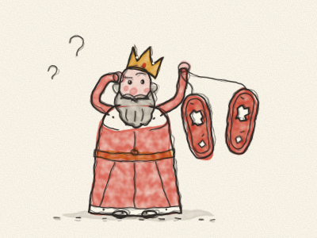
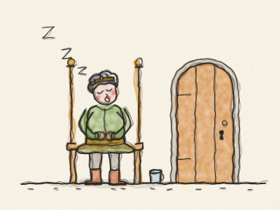
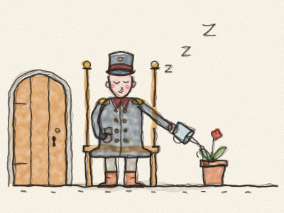

# Les Douze Princesses dansantes

Il était une fois un Roi qui avait douze filles, toutes plus jolies les unes que les autres. La nuit, les douze princesses dormaient dans une longue chambre, dans douze petits lits bien alignés. Et chaque soir, le Roi fermait lui-même la porte à clé. *Clic.*

Mais chaque matin, quand il rouvrait la porte, il découvrait quelque chose de très étrange. Les souliers de danse des princesses étaient tout usés, avec des trous sous les semelles, comme si elles avaient dansé toute la nuit.

« Comment est-ce possible ? » disait le Roi en se grattant la tête. « La porte était fermée à clé. Les fenêtres étaient closes. Où vont donc mes filles ? »

Les princesses se contentaient de sourire et de bâiller. « Nous dormions, Père », disaient-elles. *Aaaah.*

*(Où sont-elles allées, à ton avis ?)*

Alors le Roi fit une annonce. « Celui qui découvrira où mes filles vont danser la nuit, dit-il, pourra choisir l’une d’elles pour épouse, et sera roi après moi. »

Bientôt, un beau Prince arriva. Ce soir-là, on lui donna une chaise juste devant la porte des princesses, pour qu’il puisse guetter et écouter. La fille aînée lui apporta une tasse de lait chaud. « Bonne nuit », dit-elle d’une voix douce.

Le Prince but tout. *Glou, glou.* Et aussitôt, ses paupières devinrent lourdes, et il s’endormit profondément. *Zzzz…*

Au matin, les souliers étaient de nouveau troués. Le Prince n’avait rien vu du tout. « Oh là là », dit le Roi, et il le renvoya chez lui. Un autre prince vint, puis un autre, puis encore un autre. Tous s’endormirent, et tous repartirent en ronchonnant.

Or, un jour, un pauvre Soldat marchait sur la route. Son manteau était vieux et ses bottes poussiéreuses, mais il avait un visage gentil et l’esprit vif. Dans la forêt, il rencontra une vieille femme qui portait un lourd fagot de bois.

« Laissez-moi vous aider », dit le Soldat. Et il porta le fagot jusqu’à sa porte.

« Merci, jeune homme », dit la vieille femme. « Où vas-tu donc ? »

« Au palais, répondit-il, pour découvrir où dansent les princesses. »

La vieille femme sourit. « Alors écoute bien. Ne bois rien de ce que les princesses te donneront. Et prends ceci. » Elle lui donna une douce cape grise. « Quand tu la mets, personne ne peut te voir. Pas même un petit bout. »

Le Soldat alla donc au palais. Le Roi lui donna une chaise devant la porte des princesses, comme aux princes. Et comme avant, la fille aînée lui apporta une tasse de lait chaud. « Bonne nuit », dit-elle d’une voix douce.

« Merci », dit le Soldat. Mais dès qu’elle eut le dos tourné, il versa doucement le lait dans un pot de fleurs. *Glou, glou.* Puis il s’adossa à sa chaise, ferma les yeux et fit semblant de ronfler. *Rrron… rrron…*

Dans la chambre, les princesses pouffèrent de rire. « Encore un qui dort ! » dit l’aînée. « Vite, mes sœurs, préparez-vous ! »

Elles sautèrent du lit. Elles mirent leurs plus belles robes, se brossèrent les cheveux et attachèrent leurs souliers de danse tout neufs. Le Soldat regardait par le trou de la serrure.

La princesse aînée alla vers son lit et le tapota trois fois. *Toc, toc, toc.* Et tout le lit s’enfonça dans le plancher, et il y eut un escalier secret, qui descendait, descendait, descendait dans le noir.

« Suivez-moi », chuchota l’aînée. Et une par une, les douze princesses descendirent l’escalier, la plus jeune tout à la fin.

En un éclair, le Soldat mit la cape grise. *Fffuit !* Il disparut. Puis il les suivit sur la pointe des pieds, dans l’escalier. Mais il faisait noir, il alla un peu trop vite, et il marcha sur le bas de la robe de la plus jeune princesse.

« Oh ! » s’écria-t-elle. « Quelqu’un a tiré ma robe ! »

« Ne sois pas sotte, dit l’aînée. Tu l’as accrochée à un clou. »

En bas de l’escalier, il y avait une forêt merveilleuse. Chaque arbre avait des feuilles d’argent, qui brillaient et tintaient dans la brise. *Ding, ding, ding.* Plus loin, il y avait une forêt aux feuilles d’or. Et plus loin encore, une forêt où chaque feuille scintillait comme un diamant.

« Personne ne me croira », pensa le Soldat. Alors, dans chaque forêt, il cassa une petite brindille et la cacha dans sa poche. *Crac !* *Crac !* *Crac !*

Chaque fois, la plus jeune princesse sursautait. « Vous avez entendu ? Quelque chose nous suit ! »

« Ce n’est qu’un feu d’artifice, dit l’aînée, pour notre jolie fête. Dépêche-toi ! »

Le Soldat sourit sous sa cape invisible, et resta très, très silencieux.

Après les forêts, elles arrivèrent au bord d’un grand lac brillant. Sur l’eau, il y avait douze petites barques, et dans chaque barque était assis un beau prince, qui tenait les rames en souriant.

« Bonsoir, princesses ! » dirent les princes. Chaque princesse monta dans une barque, et le Soldat grimpa sans bruit dans la toute dernière, à côté de la plus jeune princesse.

Les princes se mirent à ramer. *Splish, splash, splish, splash.* Mais le prince de la dernière barque se mit à souffler et à haleter.

« Comme c’est étrange, dit-il. La barque est si lourde ce soir. Je dois ramer de toutes mes forces ! »

« C’est sûrement la chaleur », dit la plus jeune princesse en s’éventant. Et le Soldat, assis à côté d’elle, invisible, se retenait de rire.

De l’autre côté du lac se dressait un château scintillant, plein de lumières et de musique. *Tra-la-la, tra-la-la !* Il y avait des trompettes, des violons et des tambours.

Les princes et les princesses dansèrent et dansèrent. Ils tournoyèrent, virevoltèrent et sautillèrent toute la nuit, en faisant le tour de la grande salle. Et le Soldat dansa aussi, invisible, en plein milieu d’eux tous, et personne ne le sut !

Ils dansèrent jusqu’à trois heures du matin, quand leurs souliers furent troués de part en part. Puis les princes leur firent retraverser le lac, et les princesses rentrèrent en courant à travers les forêts. Mais cette fois, le Soldat courut devant elles, monta l’escalier, et se rassit sur sa chaise avant leur arrivée.

Les princesses remontèrent l’escalier, très fatiguées, leurs souliers à la main. Elles jetèrent un coup d’œil au Soldat. *Rrron… rrron…*

« Il dort toujours, dit l’aînée. Nous sommes tranquilles ! »

Elles rangèrent leurs souliers usés sous leurs lits, se glissèrent sous les couvertures et s’endormirent aussitôt. *Zzzz…*

Au matin, le Roi arriva. « Alors, Soldat ? » dit-il en soupirant. « As-tu vu quelque chose ? »

« Oui, Majesté », dit le Soldat. Et les douze princesses se redressèrent dans leurs lits, tout à fait réveillées.

« Elles descendent par un escalier secret, dit le Soldat, traversent trois forêts magiques et un lac, jusqu’à un château, où elles dansent avec douze princes toute la nuit. »

« Quelle histoire ! » dit le Roi. « Mais comment te croire ? »

Le Soldat sortit les trois brindilles de sa poche : une d’argent, une d’or et une de diamant. Elles étincelaient au soleil du matin.

Les princesses se regardèrent… puis elles se mirent à rire. « C’est vrai, Père, dit l’aînée. Pardon de l’avoir gardé secret. Nous aimons tellement danser ! »

Le Roi rit aussi. Depuis ce jour, il n’y eut plus de secrets, et un grand bal eut lieu au palais chaque samedi soir, où tout le monde pouvait danser. Le Soldat épousa la princesse aînée, qui aimait son visage gentil et malin. Et à leur mariage, tout le monde dansa jusqu’à avoir des trous dans ses souliers.

> Un cœur gentil et un esprit curieux viennent à bout des énigmes les plus difficiles.
