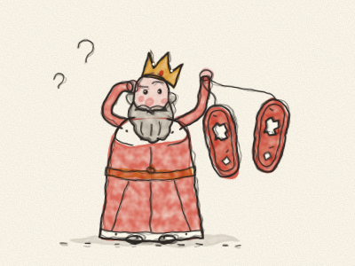
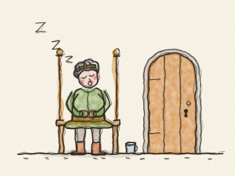
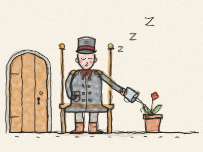

# As Doze Princesas Bailarinas

Era uma vez um Rei que tinha doze filhas, cada uma mais bonita do que a outra. À noite, as doze princesas dormiam num quarto comprido, em doze caminhas todas em fila. E todas as noites, o Rei fechava ele próprio a porta à chave. *Clic.*

Mas todas as manhãs, quando voltava a abrir a porta, encontrava uma coisa muito estranha. Os sapatos de dança das princesas estavam todos gastos, com buracos nas solas, como se tivessem dançado a noite inteira.

— Como é possível? — dizia o Rei, a coçar a cabeça. — A porta estava fechada à chave. As janelas estavam fechadas. Para onde vão as minhas filhas?

As princesas só sorriam e bocejavam. — Estávamos a dormir, Pai — diziam elas. *Aaaah.*

*(Para onde achas que elas foram?)*

Então o Rei fez um anúncio. — Quem descobrir onde as minhas filhas dançam à noite — disse ele — poderá escolher uma delas para casar, e será rei depois de mim.

Pouco depois, chegou um belo Príncipe. Nessa noite, deram-lhe uma cadeira mesmo à porta das princesas, para ele poder vigiar e escutar. A filha mais velha trouxe-lhe uma caneca de leite quente. — Boa noite — disse ela com doçura.

O Príncipe bebeu tudo. *Glu, glu.* E logo os olhos lhe pesaram, e adormeceu profundamente. *Zzzz…*

De manhã, os sapatos estavam outra vez furados. O Príncipe não tinha visto nada. — Ai, ai — disse o Rei, e mandou-o para casa. Veio outro príncipe, e outro, e mais outro. Todos adormeceram, e todos foram para casa amuados.

Ora, um dia, um Soldado pobre ia pela estrada. O casaco era velho e as botas estavam cheias de pó, mas tinha uma cara simpática e uma cabeça esperta. Na floresta, encontrou uma velhinha que carregava um molho de lenha muito pesado.

— Deixe-me levar isso — disse o Soldado. E levou-o até à porta dela.

— Obrigada, meu rapaz — disse a velhinha. — Para onde vais?

— Ao palácio — respondeu ele —, descobrir onde dançam as princesas.

A velhinha sorriu. — Então ouve bem. Não bebas nada do que as princesas te derem. E leva isto. — Deu-lhe uma capa cinzenta e macia. — Quando a vestires, ninguém te consegue ver. Nem um bocadinho.

E assim o Soldado foi ao palácio. O Rei deu-lhe uma cadeira à porta das princesas, tal como aos príncipes. E tal como antes, a filha mais velha trouxe-lhe uma caneca de leite quente. — Boa noite — disse ela com doçura.

— Obrigado — disse o Soldado. Mas quando ela se virou, ele despejou devagarinho o leite num vaso de flores. *Glu, glu.* Depois encostou-se na cadeira, fechou os olhos e fingiu que ressonava. *Rrrom… rrrom…*

Dentro do quarto, as princesas riram-se baixinho. — Mais um a dormir! — disse a mais velha. — Depressa, manas, preparem-se!

Saltaram da cama. Vestiram os vestidos mais bonitos, escovaram o cabelo e apertaram os sapatos de dança novinhos. O Soldado espreitava pelo buraco da fechadura.

A princesa mais velha foi até à sua cama e bateu-lhe três vezes. *Toc, toc, toc.* E a cama inteira afundou-se no chão, e apareceu uma escada secreta, que descia, descia, descia para o escuro.

— Sigam-me — sussurrou a mais velha. E uma a uma, as doze princesas desceram a escada, com a mais nova mesmo no fim.

Num instante, o Soldado vestiu a capa cinzenta. *Fiuu!* Desapareceu. Depois foi atrás delas, em bicos de pés, pela escada abaixo. Mas estava escuro, ele foi um pouco depressa demais, e pisou a bainha do vestido da princesa mais nova.

— Ai! — gritou ela. — Alguém me puxou o vestido!

— Não sejas tonta — disse a mais velha. — Prendeste-o num prego.

Ao fundo da escada, havia uma floresta maravilhosa. Todas as árvores tinham folhas de prata, que brilhavam e tilintavam com a brisa. *Tlim, tlim, tlim.* Mais à frente, havia uma floresta com folhas de ouro. E mais à frente ainda, uma floresta onde cada folha cintilava como um diamante.

«Ninguém vai acreditar em mim», pensou o Soldado. Por isso, em cada floresta, partiu um raminho e escondeu-o no bolso. *Crac!* *Crac!* *Crac!*

De cada vez, a princesa mais nova dava um salto. — Ouviram? Anda alguma coisa atrás de nós!

— É só o fogo de artifício — disse a mais velha — para a nossa festa. Despacha-te!

O Soldado sorriu debaixo da capa invisível, e ficou muito, muito caladinho.

Depois das florestas, chegaram a um grande lago brilhante. Na água havia doze barquinhos, e em cada barco estava sentado um belo príncipe, com os remos na mão, a sorrir.

— Boa noite, princesas! — disseram os príncipes. Cada princesa entrou num barco, e o Soldado subiu sem fazer barulho para o último de todos, ao lado da princesa mais nova.

Os príncipes começaram a remar. *Chape, chape, chape, chape.* Mas o príncipe do último barco começou a bufar e a arfar.

— Que estranho — disse ele. — O barco está tão pesado esta noite. Tenho de remar com todas as minhas forças!

— Deve ser do calor — disse a princesa mais nova, a abanar-se com a mão. E o Soldado, sentado ao lado dela, invisível, fazia muita força para não se rir.

Do outro lado do lago havia um castelo cintilante, cheio de luzes e de música. *Tra-lá-lá, tra-lá-lá!* Havia trompetes, violinos e tambores.

Os príncipes e as princesas dançaram e dançaram. Rodopiaram, giraram e saltitaram a noite inteira, às voltas pelo grande salão. E o Soldado também dançou, invisível, mesmo no meio de todos, e ninguém soube!

Dançaram até às três da manhã, quando os sapatos ficaram completamente furados. Depois os príncipes levaram-nas de volta pelo lago, e as princesas voltaram a correr pelas florestas. Mas desta vez, o Soldado correu à frente delas, subiu a escada, e voltou a sentar-se na cadeira antes de elas chegarem.

As princesas subiram a escada, muito cansadas, com os sapatos na mão. Espreitaram o Soldado pela porta. *Rrrom… rrrom…*

— Ainda está a dormir — disse a mais velha. — Estamos salvas!

Puseram os sapatos gastos debaixo das camas, enfiaram-se nos lençóis e adormeceram logo. *Zzzz…*

De manhã, o Rei chegou. — Então, Soldado? — disse ele, a suspirar. — Viste alguma coisa?

— Vi, Majestade — disse o Soldado. E as doze princesas sentaram-se na cama, muito bem acordadas.

— Elas descem por uma escada secreta — disse o Soldado —, atravessam três florestas mágicas e um lago, até um castelo, onde dançam com doze príncipes a noite inteira.

— Que história! — disse o Rei. — Mas como posso acreditar?

O Soldado tirou os três raminhos do bolso: um de prata, um de ouro e um de diamante. Brilhavam ao sol da manhã.

As princesas olharam umas para as outras… e depois desataram a rir. — É verdade, Pai — disse a mais velha. — Desculpa termos guardado segredo. Nós adoramos dançar!

O Rei também se riu. A partir desse dia, acabaram-se os segredos, e todos os sábados à noite havia um grande baile no palácio, onde toda a gente podia dançar. O Soldado casou com a princesa mais velha, que gostava da cara simpática e esperta dele. E no casamento, toda a gente dançou até ficar com buracos nos sapatos.

> Um coração bondoso e uma cabeça curiosa resolvem o enigma mais difícil.
